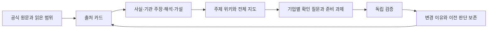

# 금융환경 변화와 기업 대응을 근거로 이어가는 연구

RWA·토큰화·온체인 금융의 환경 변화를 먼저 분석하고, 고객 문제·금융 기능·기업 신호·필요한 업무로 좁혀가는 공개 연구 저장소다. 기준일은 **2026-11-02 KST**다.

현재 판단은 토큰 발행뿐 아니라 **권리관리, 결제·환매와 은행현금 연결, 담보·유동성 운영, 준법·복구 업무**에서 사업 후보를 조사할 필요가 있다는 것이다. 도입·출시와 반복 고객·비용 후 수익은 따로 확인한다.

| 읽고 싶은 내용 | 문서 |
|---|---|
| 전체 금융 기능과 기업 연결 | [거시적 연구 지도](reports/00_macro_map.md) |
| 최근 공식 자료와 사업 기회 | [금융환경 분석](reports/01_financial_environment.md) |
| 무엇을 읽고 어디에 활용했는가 | [자료별 기록](sources/README.md) |
| 특정 주제의 주장·가설·다음 관측 | [주제 위키](wiki/INDEX.md) |
| 2026년 월별 AI 도구 관심과 최신판 비교 | [AI 방법 검토](reports/02_ai_methods.md) |
| 10월 이후 기존 GitHub 작업과 연결 | [기존 연구 연결](reports/03_prior_work.md) |
| 다음에도 갱신하는 방법 | [파이프라인 운영](PIPELINE.md) |
| 역할별 입력·출력·판단 기준 | [7개 에이전트 명세](agents/roles.json) · [호스트 지침](AGENTS.md) |

이번 기록에는 **금융 공식 자료 19건, AI 프로젝트 12개, 기존 공개 연구 3건**의 출처 카드가 있다. 금융 보고서 전문 19건 정독을 뜻하지 않는다. 자료별로 선택 절·공식 요약·보도자료·FAQ·협의안의 읽은 범위를 표시했다. 같은 금융위 문서의 대체 URL은 한 자료로 합쳤다.

AI 비교는 목적에 맞춰 선택한 12개 후보의 1~10월과 11월2일 관측 시점까지 이력이다. 전체 GitHub 월별 인기 순위가 아니며, 현재 조회한 API의 과거 생성일 기준 집계와 당시 순증을 구분한다. 최근 릴리스·유지보수·안정성을 우선 판단하고 인기는 보조 기준으로 사용한다.

## 어떻게 축적되는가



금융환경을 먼저 본 뒤 교보증권·경남은행·한화생명 등 관심 후보에 같은 기준을 적용한다. 회사·직무의 현재 상태는 별도 확인 과제로 남아 있다. 비공개 원문·개인 필기·지원서·계정정보는 이 공개 저장소에 옮기지 않았다.

## 실행과 한계

Python 3.11 이상에서 추가 패키지 없이 아래 명령으로 자료 카드·위키·관계 데이터를 재생성하고 검증할 수 있다.

```sh
python scripts/research.py build
python scripts/research.py validate
python -m unittest discover -s tests -v
python scripts/research.py search "환매 은행 현금" --mode graph
```

현재 실행 하네스는 호스트의 에이전트 기능이며, 저장소에는 그 역할 지침·근거·변경 절차를 보존한다. 단어 검색과 명시적 연결을 구현했으며 임베딩 RAG·외부 에이전트 서버의 설치나 성능 우위를 주장하지 않는다. [이번 실행 기록](runs/2026-11-02-initial.json)에 실제 수행 범위가 있다. 정기 자동 수집·거래 실행은 설정하지 않았다.

원문 전문을 재배포하지 않는다. 기관·저자의 주장, 연구자의 해석, 조건부 전망과 미확인을 구분하고 중요한 판단은 원문으로 돌아가 확인한다.
