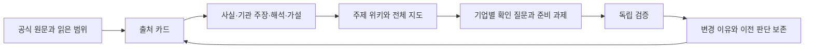

# 금융환경 변화와 기업 대응을 근거로 이어가는 연구

RWA·토큰화·온체인 금융의 환경 변화를 먼저 분석하고, 고객 문제·금융 기능·기업 신호·필요한 업무로 좁혀가는 공개 연구 저장소다. 최근 선택 원문 재확인·전망 갱신일은 **2026-11-07 KST**다. 국가별 규제 전체 기준선은 **2026-11-02**, 재무는 각 반기·분기 원문의 기간을 유지한다. 모든 실적·관할을11월6일에 전수 갱신한 것은 아니다. 11월6일 전망 재분석에는 설계 v2.1을 사용했다. 이 날짜를 현행 금융·법률 사실의 전수 갱신일로 쓰지 않는다.

현재 주된 읽기 순서는 **본래 금융기관 수익모델 → BNK·교보·한화의 실제 규모·수익·강약점 → AI·온체인이 바꾸는 고객 선택과 기존 수익 → 경쟁사 대응 뒤 우선할 업무·신뢰**다. 숫자는 실제 기반을 확인하는 근거로 쓰고 가상 배분은 보조 사례로 둔다. 기존 제도·레일 분석을 유지하면서, 변화가 새 수익뿐 아니라 가격 하락·조달·신용·유통·유지 비용을 어떻게 바꾸는지 설명한다.

2026-11-07 후속에서는 변경 자료18개와 초기 연결 자료6개를 확인하고, 최근 공식 원문31건을 범위별로 읽어 **2027년 이후 새 수요와 경쟁 후 수익**을 다시 분석했다. 공개 출처19개 추가·12개 갱신, 주장28개 추가로 원장은 **출처326개·주장/가설472개·주제14개**가 된다. 기존 재무 보고기간·국가 규제 기준선·과거 보고서·STR 순위를 보존한다. 원자료의 이전 본문은 미확보라 정확한 문장별 diff는 주장하지 않는다. 조사 중 재정리된 안내8개와 새 연결3개도 별도 확인해 장기 성장·고객 접점의 공존 구조를 보완했다.

| 읽고 싶은 내용 | 문서 |
|---|---|
| 최신: 18개 자료 검토와 최근 보고서 읽은 범위 | [자료 감사](reports/48_changed_materials_and_recent_sources.md) · [실행](runs/2026-11-07-market-update.md) |
| 최신: 2027년 이후 시장 구조·새 수요·경쟁 후 수익 | [탑다운](reports/49_2027_market_structure_update.md) · [통합 결정·고객 사례](reports/53_market_opportunities_and_decisions.md) |
| 최신: 세 그룹 본사 관점의 기회·기존 판단 변화 | [BNK](reports/50_bnk_market_update.md) · [교보](reports/51_kyobo_market_update.md) · [한화](reports/52_hanwha_market_update.md) |
| 재실행·중단 후 재개와 근거→주장→가설→행동 검사 | [사용·복구 절차](docs/REPLAY_AND_LINEAGE.md) · [수정 전후 검증](runs/2026-11-07-maintenance.md) · [연결 명세](data/research_lineage_20261106.json) |
| 2027년 이후 재분석과 기존 판단의 유지·수정 | [통합 결정과 변경](reports/45_2027_decisions_and_changes.md) · [거시 전달경로](reports/41_2027_economic_reassessment.md) |
| BNK·교보·한화의 실제 적용 결과 | [BNK](reports/42_bnk_2027_reassessment.md) · [교보](reports/43_kyobo_2027_reassessment.md) · [한화](reports/44_hanwha_2027_reassessment.md) |
| 에이전트 실제 실행·초기/후기 가설·독립검토 | [실행 기록](runs/2026-11-06-outlook-reassessment.json) · [초기](runs/2026-11-06-outlook-reassessment-opening.json) · [후기](runs/2026-11-06-outlook-reassessment-closing.md) · [검토](runs/2026-11-06-outlook-reassessment-review.md) |
| 금융·경제 원리로 환경을 해석하고 방향을 제시하는 에이전트 | [설계 검토와 변경](reports/40_agent_domain_reasoning_design.md) · [의견 절차](agents/economic_opinion_workflow.md) |
| 질문에 맞는 이론·변수·적용 한계와 검토 사례 | [도메인 지도](agents/economic_domain_lenses.md) · [세 그룹 검토 문항](agents/evaluations/domain_reasoning_cases.json) |
| 대체 대상·고객 관계·새 유료 업무·적응 투자 비교 | [대체·관계 통합](reports/39_finance_substitution_customer_relationships.md) · [구조화 비교](data/finance_substitution_relationships.json) |
| 무엇으로 돈을 벌며, 왜 이 방향을 우선해야 하는가 | [수익모델·환경 변화·고객 AI 통합 논증](reports/35_business_models_and_agent_finance.md) |
| BNK 실제 이익·기업여신·조달에서 지역 고객 관계 방어까지 | [BNK 기반·기회·위기·우선순위](reports/36_bnk_business_model_priorities.md) |
| 교보 증권·생명·문고의 다른 사업과 실행·발행·관리 | [교보 기반·기회·위기·우선순위](reports/37_kyobo_business_model_priorities.md) |
| 한화 보험·GA·ALM의 무게와 해외 사업의 자리 | [한화 기반·기회·위기·우선순위](reports/38_hanwha_business_model_priorities.md) |
| 재무 지표의 법인·기간·단위·출처와 대응 근거 | [실제 관측 원장](data/institution_business_baselines.json) · [대응 원장](data/business_model_transition_priorities.json) |
| 보조 사례: AI가 선택·거래하는 고객·돈·수익·경쟁 | [조건부 미래 통합 사례](reports/31_agent_finance_customer_money_2027.md) |
| 기업 원금100·수금 지연·자산 매각/차입과 시중은행 대응 | [BNK 고객·현금](reports/32_bnk_agent_customer_cash.md) |
| 표준상품 이탈·외부상품 관리와 문고 정산채권의 수익 | [교보 고객·자산](reports/33_kyobo_agent_assets_business.md) |
| 인니 보험·UAE ETF·미국 기관의 돈과 계약별 수입 | [한화 고객·보장·기관](reports/34_hanwha_agent_insurance_global.md) |
| BlackRock·Ondo 상품별 포지션·권리·수익·현금 | [상품 비교](reports/28_blackrock_ondo_positions.md) · [경제성 원장](data/blackrock_ondo_product_economics.json) |
| BNK·교보·한화 실제 사례에서 고객접점·수익·경쟁으로 | [그룹 대응](reports/30_group_position_responses.md) · [기능·시나리오 맵](data/global_position_group_map.json) |
| 한화생명 블록체인팀의 고객접점·수익·경쟁·90일 준비 | [한화 그룹 사업안](reports/22_hanwha_group_business_plan.md) |
| Nobu 방카·QRIS·직원 건강보험과 IDR/USDT 경계 | [인도네시아 상세](reports/23_hanwha_indonesia_business.md) |
| Velocity·ADX ETF·법인별 보수와 USDC/USDT | [미국·UAE·레일](reports/24_hanwha_us_uae_rails.md) |
| BNK·교보·한화의 국가 수요에서 찾은 사업 후보 10건 | [그룹 기회 발굴](reports/25_group_country_opportunity_discovery.md) · [구조화 원장](data/group_country_opportunities.json) |
| 보험 AI 권한·경쟁사·그룹 수익과 운영위험 | [AI·그룹·경쟁](reports/26_hanwha_ai_group_competition.md) |
| 교보 미래전략의 투자 순서·고객·보수·경쟁·90일 검증 | [교보 사업안](reports/18_kyobo_future_strategy_business_plan.md) |
| 문고 정산채권 한 건의 권리·수금·배분·회수와 생명의 역할 | [그룹 RWA 거래 설계](reports/19_kyobo_group_rwa_deal_design.md) · [거래 체크리스트](data/kyobo_ip_deal_checklist.json) |
| USDC·USDT 연결 단계와 외부 AI가 이용하는 금융 서비스 | [레일·AI 고객접점](reports/20_kyobo_rails_agent_business.md) |
| 3조·4조·8조 단계, RCPS, 계열 신용, 조달·운용 조건 | [교보 자본·업무권한](reports/21_kyobo_capital_and_permissions.md) |
| 지역 수출기업의 수금·지급·외환·운전자금과 본사 수익 설계 | [경남은행 수출기업 사업안](reports/16_kyongnam_export_treasury_business_plan.md) |
| 예금 밖 스테이블코인·펀드·채권의 권리와 지급 가능액 | [다자산 자금관리·현금 사례](reports/17_kyongnam_multiasset_cash_case.md) · [구조화 원장](data/kyongnam_export_business_plan.json) |
| 이번 연구의 핵심 판단·세 기관의 우선 과제·검증 | [전략 선택과 검증](reports/15_strategy_decisions_and_validation.md) |
| 제도·레일·AI 위임이 정착한 미래의 고객과 경쟁 | [탑다운 디지털 금융 전망](reports/11_topdown_digital_finance.md) |
| 한국은행·시중은행 대응 속 경남은행 본사의 고객 접점 | [경남은행 본사 전략](reports/12_kyongnam_head_office_strategy.md) |
| 기존 수익·자본·그룹 IP·해외 레일과 교보 미래전략 | [교보증권 전략](reports/13_kyobo_future_strategy.md) |
| Nobu 보장·UAE·미국·계열 기능·AI 서비스 사업 | [한화생명·그룹 전략](reports/14_hanwha_blockchain_strategy.md) |
| 계속 사용할 사용자 목적과 12개 검토 과제 | [지속 연구 방향](docs/RESEARCH_MANDATE.md) · [전략 결정 원장](data/strategy_decisions_2027.json) |
| 국가별 시행 중·미시행·제안 및 2027년 일정 | [국가별 규제와 미래 조건](reports/09_country_regulation_2027.md) |
| 2027년 초·이후의 기회·위기와 경쟁 가설 | [2027년 이후 사업 시나리오](reports/10_2027_business_scenarios.md) |
| 교보·한화·경남과 연결된 국가·법인·사업 단계 | [기업별 국가·관할 지도](reports/07_company_geography.md) |
| 은행·증권·보험·운용·그룹마다 다른 조사 초점 | [금융기관 역할별 분석](reports/08_role_based_focus.md) |
| 11월 현재 환경과 향후 6~24개월 기회·위기 | [현재 판단과 경쟁 시나리오](reports/04_november_outlook.md) |
| 미시행 법안·규칙의 단계와 도입 조건 | [규제 추적표](reports/05_regulatory_tracker.md) |
| 금리·성장·물가의 실적·전망·출처 | [거시 근거와 수치](reports/06_macro_evidence.md) |
| 전체 금융 기능과 기업 연결 | [거시적 연구 지도](reports/00_macro_map.md) |
| 최근 공식 자료와 사업 기회 | [금융환경 분석](reports/01_financial_environment.md) |
| 무엇을 읽고 어디에 활용했는가 | [자료별 기록](sources/README.md) |
| 특정 주제의 주장·가설·다음 관측 | [주제 위키](wiki/INDEX.md) |
| 2026년 월별 AI 도구 관심과 최신판 비교 | [AI 방법 검토](reports/02_ai_methods.md) |
| 10월 이후 기존 GitHub 작업과 연결 | [기존 연구 연결](reports/03_prior_work.md) |
| 다음에도 갱신하는 방법 | [파이프라인 운영](PIPELINE.md) |
| 역할별 입력·출력·판단 기준 | [8개 에이전트 명세](agents/roles.json) · [호스트 지침](AGENTS.md) |

2026-11-06에는 기존 8개 역할에 초기 가설·후기 판단 갱신, 경제 원리 선택, 경쟁 반응과 새 수요, 조건변경에 따른 의미 검토를 연결했다. [설계와 적용 검토](reports/40_agent_domain_reasoning_design.md) · [실행 기록](runs/2026-11-06-agent-design.json).

2026-11-04 연구에서는 **근거와 논리의 순서**를 보완했다. 공개 실적의 연결/별도·잔액/흐름·총액/순액·예상/확정을 분리하고, 세 그룹이 현재 벌고 있는 돈과 부담하는 위험에서 우선 대응을 도출했다. 기존 STR12개 순위·미확인값은 보존했다. [실행과 검토](runs/2026-11-04-business-model-priorities.json) · [재사용 절차](agents/business_model_reasoning_workflow.md).

앞선 후속은 **조건부 고객 사례 6개, 주장·가설 23개 추가, 기존 출처 9건 선택 재확인**이다. 새로운 시장 실적이나 규제 일괄 시행을 주장하지 않는다. 같은 고객의 기존+AI·그룹 적응·경쟁사 대응과 재선택, 원금·수익·잠식을 구분했다. [사례 원장](data/agent_finance_2027_cases.json) · [수익 귀속](data/agent_finance_value_capture.json) · [실행·검토](runs/2026-11-04-agent-finance-cases.json).

11월4일 누적 기록은 **출처 291건, 주장·가설 420개, 주제 14개**였다. 앞선 Ondo 연결 보완은 **신규 출처 34건·기존 출처 7건 선택 재확인, 주장 53개 추가**다. 교수 공개 원문 4개 중 1개는 기존 카드를 유지했고, 중복 공식 URL 4개를 합쳤다. 이 수는 보고서 전문 정독 수가 아니다. [이번 실행·독립 검토](runs/2026-11-04-ondo-position-integration.json).

이전 한화·그룹 심화는 **출처 카드27건 추가·기존28건 갱신, 주장60개 추가**다. 기존28건 중27건은 선택 범위를 실제 재열람했고1건은 기존 검증 기록을 재사용했다. 카드별 읽은 범위를 표시한다. 이 수는 보고서·법령 전문 정독 수가 아니다. 이전 교보 심화(출처26건 추가·기존9건 갱신·주장45개 추가/3개 갱신), 경남 심화(출처24건 추가·기존3건 갱신·주장45개 추가)는 각 실행 기록을 보존한다. **전략 검토 과제12개**의 기존 순위를 유지하고 한화 STR-HW-01~04를 구체화했다. **제도 경로41개·관측 일정18개·경쟁 시나리오5개**의 국가별 규제 원장은11월2일 기준이며 일부 조문만 재열람했다. 같은 원문의 대체 URL은 한 자료로 합친다.

한화 심화는 **Nobu의 기존 방카·QRIS와 고용주 보장, 미국 기관의 사후처리, UAE의 실제 ETF 유통에서 유료 업무를 검증하는 제안**이다. 11월2일 ADX ETF 거래 개시와 기존 MENA 거점을 구분했다. Nobu 가상계좌와 Bittime USDT 교환 안내는 한화의 직접 Tether 계약 증거가 아니다. 보험료·AUM·내부수수료와 이익을 분리하고, 산업계열 에너지 계약은 권리·독립 가격을 확인할 후속 후보로 뒀다. [구조화 사업안](data/hanwha_blockchain_business_plan.json) · [실행·검토 기록](runs/2026-11-03-hanwha-group-strategy.json) · [재사용 에이전트 지침](agents/group_country_opportunity_workflow.md)

교보 심화는 **기존 거래 고객의 자금·증거금과 반복 발행·사후관리를 먼저 검증하고, 그룹·해외 RWA는 권리·현금·유료 수요가 확인된 범위에서 넓히는 제안**이다. 자본확충·종투사 지정·발행어음·IMA를 구분하고 계열 신용 제한을 반영했다. 문고 POD는 특정 채권을 검증할 후보이며 주력 금융상품 확정이 아니다. 생명 투자 약정과 교보의 직접 USDC·USDT 계약은 미확인이다. AI 접속 자체보다 유효 견적·실행·권리·수금·복구 업무의 지급자를 찾는다. [구조화 사업안](data/kyobo_strategy_business_plan.json) · [분업·검토 기록](runs/2026-11-03-kyobo-strategy.json)

경남은행 심화의 제안은 **고객 자산이 계좌·지갑·상품 어디에 있든 필요한 통화로 지급을 끝내는 접점을 제공하는 것**이다. 기존 fERP·EDI·PTB·무역금융을 출발점으로, 기존+AI와 온체인+AI를 같은 권리·현금·총비용으로 비교한다. 외부 자산잔액은 은행 예금·수익과 구분하고, 고객 효율화로 줄 수 있는 조달 기여까지 계산한다. 현금 사례는 가정에 따른 산술이며 고객 실적이나 특정 상품의 표준 환매기간이 아니다.

AI 비교는 목적에 맞춰 선택한 12개 후보의 1~10월과 11월2일 관측 시점까지 이력이다. 전체 GitHub 월별 인기 순위가 아니며, 현재 조회한 API의 과거 생성일 기준 집계와 당시 순증을 구분한다. 최근 릴리스·유지보수·안정성을 우선 판단하고 인기는 보조 기준으로 사용한다.


이번 보완은 **BlackRock의 운용·기초상품·모델 역할과 Ondo의 발행·구현·고객 접점이 상품마다 다르다**는 점에서 출발한다. 교수 원문의 당시 숫자·계획을 현재 확정값으로 복사하지 않고 공식 문서로 교정했다. BNK의 지급·신용·회수, 교보의 원권리·인수·발행·사후관리, 한화의 현지 보장·기관 운영·해외 상품 유통으로 연결했다. 실제 제휴 요율·고객 수·순이익은 확인 전 null로 보존한다.

2026-11-07 보완 후 원장은 **출처307건·주장/가설444개·주제14개**다. 이번에는 기존 출처를 재사용해 해석9개·가설3개를 추가했고, 새 원문을 읽은 범위와 기존 회사 기록 재사용을 구분했다.

## 어떻게 축적되는가



금융환경을 먼저 본 뒤 교보증권·경남은행·한화생명 등 관심 후보에 같은 기준을 적용한다. 기존 GitHub 작업의 원문 경로를 복원해 국가·파트너·지역 고객 연결 26건을 기록했다. 교보의 기관투자·공동펀드·제휴, 한화의 법인별 투자·거점·협약, 경남은행의 정책·지역 고객 신호를 구분한다. 현재 팀의 전체 권한·정원·예산, 국가별 인가 전수, RWA 관련 반복 수익 비교는 미완료다. 한국 원화 스테이블코인 최신 의안 처리상태 등 접근 공백은 규제 원장에 남겼다. 비공개 원문·개인 필기·지원서·계정정보는 이 공개 저장소에 옮기지 않았다.

## 실행과 한계

Python 3.11 이상에서 추가 패키지 없이 아래 명령으로 자료 카드·위키·관계 데이터를 재생성하고 검증할 수 있다.

```sh
python scripts/research.py build
python scripts/research.py validate
python -m unittest discover -s tests -v
python scripts/research.py search "환매 은행 현금" --mode graph
```

현재 실행 하네스는 호스트의 에이전트 기능이며, 저장소에는 그 역할 지침·근거·변경 절차를 보존한다. 8개 논리 역할에 [교수형 경제 메커니즘 검토](agents/professor_reasoner.md)를 추가했다. 특정 교수의 현재 견해를 대리하지 않는다. 이번에는 총괄과 3개 하위 에이전트가 탑다운·세 기관 연구를 분담하고 교차검토했다. 단어 검색과 명시적 연결을 구현했으며 임베딩 RAG·외부 에이전트 서버의 설치나 성능 우위를 주장하지 않는다. [초기 실행](runs/2026-11-02-initial.json), [11월 전망 조사](runs/2026-11-02-outlook.json), [기업·국가 조사](runs/2026-11-02-geography.json), [국가별 규제·2027 전망](runs/2026-11-02-regulation-2027.json), [앞선 기관 전략 연구](runs/2026-11-03-institution-strategy.json)에 실제 수행 범위가 있다. 정기 자동 수집·거래 실행은 설정하지 않았다.

원문 전문을 재배포하지 않는다. 기관·저자의 주장, 연구자의 해석, 조건부 전망과 미확인을 구분하고 중요한 판단은 원문으로 돌아가 확인한다.

경남은행 심화의 분업·원문 범위·독립 검토·계산 검증은 [실행 기록](runs/2026-11-03-kyongnam-export.json)에 있다. 같은 총자산도 현금화 시점에 따라 지급 부족이 달라지는 [설명용 사례](data/kyongnam_export_cash_case.json)는 재현할 수 있다. 실제 자금관리 엔진·거래 실행·가격 견적은 구현하지 않았다.

## 대체 대상과 고객 관계의 후속 통합

실제 수익모델 연구35~38을 출발점으로 [보고서39](reports/39_finance_substitution_customer_relationships.md)에 대체 경로7개·고객 관계5개를 연결했다. 기존 관계 방어·외부 고객에게 기능 판매·미충족 수요·외부 구매/축소를 구분하고, 적응 투자는 같은 미래의 미적응과 비교한다. **기존 공식 원문4건 선택 재확인, 해석·가설7개 추가(C-414~420)**이며 새 실적·STR 순위 변경은 없다. [실행·검토](runs/2026-11-04-substitution-relationships.json).
