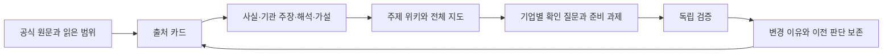

# 금융환경 변화와 기업 대응을 근거로 이어가는 연구

RWA·토큰화·온체인 금융의 환경 변화를 먼저 분석하고, 고객 문제·금융 기능·기업 신호·필요한 업무로 좁혀가는 공개 연구 저장소다. 최근 연구·원문 확인일은 **2026-11-03 KST**, 국가별 규제 기준선은 **2026-11-02**다. 자료별 사건·관측 시점은 별도로 보존한다.

현재 판단은 **상품의 표시·비교·전달이 쉬워져도 신용·유동성·권리 검증·실행 책임의 가치가 남고, 고객 AI가 보수와 고객 접점을 재배분할 수 있다**는 것이다. 필요한 제도와 레일이 성립한 미래를 먼저 그린 뒤, 경남은행의 기업 자금관리, 교보증권의 거래·발행·권리 관리, 한화의 보장·유통·해외 운영으로 좁힌다. 기존+AI와 온체인+AI를 같은 고객 업무와 총비용으로 비교하며, 2027년 초 개별 적용과 이후 경쟁을 구분한다.

| 읽고 싶은 내용 | 문서 |
|---|---|
| 한화생명 블록체인팀의 고객접점·수익·경쟁·90일 준비 | [한화 그룹 사업안](reports/22_hanwha_group_business_plan.md) |
| Nobu 방카·QRIS·직원 건강보험과 IDR/USDT 경계 | [인도네시아 상세](reports/23_hanwha_indonesia_business.md) |
| Velocity·ADX ETF·법인별 보수와 USDC/USDT | [미국·UAE·레일](reports/24_hanwha_us_uae_rails.md) |
| BNK·교보·한화의 국가 수요에서 찾은 사업 후보 10건 | [그룹 기회 발굴](reports/25_group_country_opportunity_discovery.md) · [구조화 원장](data/group_country_opportunities.json) |
| 보험 AI 권한·경쟁사·그룹 수익과 운영위험 | [AI·그룹·경쟁](reports/26_hanwha_ai_group_competition.md) |
| 교보 미래전략의 투자 순서·고객·보수·경쟁·90일 검증 | [교보 사업안](reports/18_kyobo_future_strategy_business_plan.md) |
| 문고 정산채권 한 건의 권리·수금·배분·회수와 생명의 역할 | [그룹 RWA 거래 설계](reports/19_kyobo_group_rwa_deal_design.md) · [거래 체크리스트](data/kyobo_ip_deal_checklist.json) |
| USDC·USDT 연결 단계와 외부 AI가 이용하는 금융 서비스 | [레일·AI 고객접점](reports/20_kyobo_rails_agent_business.md) |
| 3조·4조·8조 단계, RCPS, 계열 신용, 조달·운용 조건 | [교보 자본·업무권한](reports/21_kyobo_capital_and_permissions.md) |
| 지역 수출기업의 수금·지급·외환·운전자금과 본사 수익 설계 | [경남은행 수출기업 사업안](reports/16_kyongnam_export_treasury_business_plan.md) |
| 예금 밖 스테이블코인·펀드·채권의 권리와 지급 가능액 | [다자산 자금관리·현금 사례](reports/17_kyongnam_multiasset_cash_case.md) · [구조화 원장](data/kyongnam_export_business_plan.json) |
| 이번 연구의 핵심 판단·세 기관의 우선 과제·검증 | [전략 선택과 검증](reports/15_strategy_decisions_and_validation.md) |
| 제도·레일·AI 위임이 정착한 미래의 고객과 경쟁 | [탑다운 디지털 금융 전망](reports/11_topdown_digital_finance.md) |
| 한국은행·시중은행 대응 속 경남은행 본사의 고객 접점 | [경남은행 본사 전략](reports/12_kyongnam_head_office_strategy.md) |
| 기존 수익·자본·그룹 IP·해외 레일과 교보 미래전략 | [교보증권 전략](reports/13_kyobo_future_strategy.md) |
| Nobu 보장·UAE·미국·계열 기능·AI 서비스 사업 | [한화생명·그룹 전략](reports/14_hanwha_blockchain_strategy.md) |
| 계속 사용할 사용자 목적과 12개 검토 과제 | [지속 연구 방향](docs/RESEARCH_MANDATE.md) · [전략 결정 원장](data/strategy_decisions_2027.json) |
| 국가별 시행 중·미시행·제안 및 2027년 일정 | [국가별 규제와 미래 조건](reports/09_country_regulation_2027.md) |
| 2027년 초·이후의 기회·위기와 경쟁 가설 | [2027년 이후 사업 시나리오](reports/10_2027_business_scenarios.md) |
| 교보·한화·경남과 연결된 국가·법인·사업 단계 | [기업별 국가·관할 지도](reports/07_company_geography.md) |
| 은행·증권·보험·운용·그룹마다 다른 조사 초점 | [금융기관 역할별 분석](reports/08_role_based_focus.md) |
| 11월 현재 환경과 향후 6~24개월 기회·위기 | [현재 판단과 경쟁 시나리오](reports/04_november_outlook.md) |
| 미시행 법안·규칙의 단계와 도입 조건 | [규제 추적표](reports/05_regulatory_tracker.md) |
| 금리·성장·물가의 실적·전망·출처 | [거시 근거와 수치](reports/06_macro_evidence.md) |
| 전체 금융 기능과 기업 연결 | [거시적 연구 지도](reports/00_macro_map.md) |
| 최근 공식 자료와 사업 기회 | [금융환경 분석](reports/01_financial_environment.md) |
| 무엇을 읽고 어디에 활용했는가 | [자료별 기록](sources/README.md) |
| 특정 주제의 주장·가설·다음 관측 | [주제 위키](wiki/INDEX.md) |
| 2026년 월별 AI 도구 관심과 최신판 비교 | [AI 방법 검토](reports/02_ai_methods.md) |
| 10월 이후 기존 GitHub 작업과 연결 | [기존 연구 연결](reports/03_prior_work.md) |
| 다음에도 갱신하는 방법 | [파이프라인 운영](PIPELINE.md) |
| 역할별 입력·출력·판단 기준 | [8개 에이전트 명세](agents/roles.json) · [호스트 지침](AGENTS.md) |

현재 **출처 249건, 주장·가설 305개, 주제 14개**를 기록했다. 최신 한화·그룹 심화는 **출처 카드27건 추가·기존28건 갱신, 주장60개 추가**다. 기존28건 중27건은 선택 범위를 실제 재열람했고1건은 기존 검증 기록을 재사용했다. 카드별 읽은 범위를 표시한다. 이 수는 보고서·법령 전문 정독 수가 아니다. 이전 교보 심화(출처26건 추가·기존9건 갱신·주장45개 추가/3개 갱신), 경남 심화(출처24건 추가·기존3건 갱신·주장45개 추가)는 각 실행 기록을 보존한다. **전략 검토 과제12개**의 기존 순위를 유지하고 한화 STR-HW-01~04를 구체화했다. **제도 경로41개·관측 일정18개·경쟁 시나리오5개**의 국가별 규제 원장은11월2일 기준이며 일부 조문만 재열람했다. 같은 원문의 대체 URL은 한 자료로 합친다.

한화 심화는 **Nobu의 기존 방카·QRIS와 고용주 보장, 미국 기관의 사후처리, UAE의 실제 ETF 유통에서 유료 업무를 검증하는 제안**이다. 11월2일 ADX ETF 거래 개시와 기존 MENA 거점을 구분했다. Nobu 가상계좌와 Bittime USDT 교환 안내는 한화의 직접 Tether 계약 증거가 아니다. 보험료·AUM·내부수수료와 이익을 분리하고, 산업계열 에너지 계약은 권리·독립 가격을 확인할 후속 후보로 뒀다. [구조화 사업안](data/hanwha_blockchain_business_plan.json) · [실행·검토 기록](runs/2026-11-03-hanwha-group-strategy.json) · [재사용 에이전트 지침](agents/group_country_opportunity_workflow.md)

교보 심화는 **기존 거래 고객의 자금·증거금과 반복 발행·사후관리를 먼저 검증하고, 그룹·해외 RWA는 권리·현금·유료 수요가 확인된 범위에서 넓히는 제안**이다. 자본확충·종투사 지정·발행어음·IMA를 구분하고 계열 신용 제한을 반영했다. 문고 POD는 특정 채권을 검증할 후보이며 주력 금융상품 확정이 아니다. 생명 투자 약정과 교보의 직접 USDC·USDT 계약은 미확인이다. AI 접속 자체보다 유효 견적·실행·권리·수금·복구 업무의 지급자를 찾는다. [구조화 사업안](data/kyobo_strategy_business_plan.json) · [분업·검토 기록](runs/2026-11-03-kyobo-strategy.json)

경남은행 심화의 제안은 **고객 자산이 계좌·지갑·상품 어디에 있든 필요한 통화로 지급을 끝내는 접점을 제공하는 것**이다. 기존 fERP·EDI·PTB·무역금융을 출발점으로, 기존+AI와 온체인+AI를 같은 권리·현금·총비용으로 비교한다. 외부 자산잔액은 은행 예금·수익과 구분하고, 고객 효율화로 줄 수 있는 조달 기여까지 계산한다. 현금 사례는 가정에 따른 산술이며 고객 실적이나 특정 상품의 표준 환매기간이 아니다.

AI 비교는 목적에 맞춰 선택한 12개 후보의 1~10월과 11월2일 관측 시점까지 이력이다. 전체 GitHub 월별 인기 순위가 아니며, 현재 조회한 API의 과거 생성일 기준 집계와 당시 순증을 구분한다. 최근 릴리스·유지보수·안정성을 우선 판단하고 인기는 보조 기준으로 사용한다.

## 어떻게 축적되는가



금융환경을 먼저 본 뒤 교보증권·경남은행·한화생명 등 관심 후보에 같은 기준을 적용한다. 기존 GitHub 작업의 원문 경로를 복원해 국가·파트너·지역 고객 연결 26건을 기록했다. 교보의 기관투자·공동펀드·제휴, 한화의 법인별 투자·거점·협약, 경남은행의 정책·지역 고객 신호를 구분한다. 현재 팀의 전체 권한·정원·예산, 국가별 인가 전수, RWA 관련 반복 수익 비교는 미완료다. 한국 원화 스테이블코인 최신 의안 처리상태 등 접근 공백은 규제 원장에 남겼다. 비공개 원문·개인 필기·지원서·계정정보는 이 공개 저장소에 옮기지 않았다.

## 실행과 한계

Python 3.11 이상에서 추가 패키지 없이 아래 명령으로 자료 카드·위키·관계 데이터를 재생성하고 검증할 수 있다.

```sh
python scripts/research.py build
python scripts/research.py validate
python -m unittest discover -s tests -v
python scripts/research.py search "환매 은행 현금" --mode graph
```

현재 실행 하네스는 호스트의 에이전트 기능이며, 저장소에는 그 역할 지침·근거·변경 절차를 보존한다. 8개 논리 역할에 [교수형 경제 메커니즘 검토](agents/professor_reasoner.md)를 추가했다. 특정 교수의 현재 견해를 대리하지 않는다. 이번에는 총괄과 3개 하위 에이전트가 탑다운·세 기관 연구를 분담하고 교차검토했다. 단어 검색과 명시적 연결을 구현했으며 임베딩 RAG·외부 에이전트 서버의 설치나 성능 우위를 주장하지 않는다. [초기 실행](runs/2026-11-02-initial.json), [11월 전망 조사](runs/2026-11-02-outlook.json), [기업·국가 조사](runs/2026-11-02-geography.json), [국가별 규제·2027 전망](runs/2026-11-02-regulation-2027.json), [앞선 기관 전략 연구](runs/2026-11-03-institution-strategy.json)에 실제 수행 범위가 있다. 정기 자동 수집·거래 실행은 설정하지 않았다.

원문 전문을 재배포하지 않는다. 기관·저자의 주장, 연구자의 해석, 조건부 전망과 미확인을 구분하고 중요한 판단은 원문으로 돌아가 확인한다.

경남은행 심화의 분업·원문 범위·독립 검토·계산 검증은 [실행 기록](runs/2026-11-03-kyongnam-export.json)에 있다. 같은 총자산도 현금화 시점에 따라 지급 부족이 달라지는 [설명용 사례](data/kyongnam_export_cash_case.json)는 재현할 수 있다. 실제 자금관리 엔진·거래 실행·가격 견적은 구현하지 않았다.
