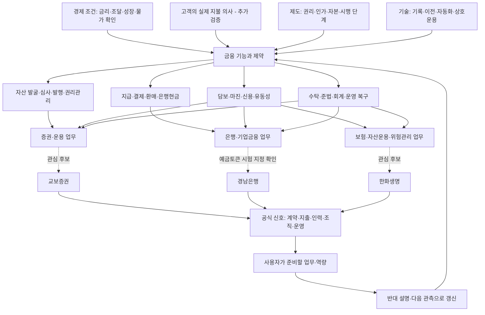

# 금융환경에서 기업 업무까지 이어지는 지도

화살표는 조사 경로다. 확인된 인과효과나 회사의 확정 전략을 표시하지 않는다. [11월 현재 분석](04_november_outlook.md), [규제 도입 조건](05_regulatory_tracker.md), [주제별 근거](../wiki/INDEX.md)를 함께 읽는다.

| 연결 | 자료에서 볼 것 | 잘못 연결하기 쉬운 것 |
|---|---|---|
| 경제 → 고객 | 지급·투자·담보·조달의 실제 필요와 제약 | 기술 유행을 고객의 지불 의사로 대체 |
| 권리 → 상품 | 명의·청구권·분배·환매·도산 시 구제 | 같은 기초자산 명칭을 같은 법적 권리로 취급 |
| 원장 → 현금 | 결제자산·외부 은행 연결·실패·복구 | 체인 확정을 최종 은행현금으로 취급 |
| 채택 → 사업성 | 반복 고객·실효 보수·운영 및 위험 비용 | 협약·실증·거래량을 순이익으로 취급 |
| 그룹 → 기업 → 직무 | 정확한 법인·인가·계약·담당 업무 | 계열사 활동을 지원 직무의 업무로 확정 |

국제기관은 구조·위험의 분석, 감독기관은 제도·조건, 운영기관은 출시·시험, 회사 자료는 자원 투입·계약·성과를 확인하는 데 사용한다. 어느 출처도 그 자체로 모든 층을 입증하지 않는다.

## 지도와 기록의 연결

- [원문 목록](../sources/README.md): 무엇을 읽고 어디에 썼는가.
- [주장 원장](../data/claims.json): 사실·기관 주장·해석·가설·미확인.
- [주제 지도](../wiki/INDEX.md): 주제별 근거와 다음 관측.
- [관계 데이터](../data/graph.json): 원문 → 주장 → 주제의 명시적 연결.
- [AI 도구 검토](02_ai_methods.md): 이 지식을 어떻게 찾고 갱신할 것인가.
- [거시 관측 원장](../data/macro_observations.json): 실적·전망·정책결정과 수치 정의.
- [규제 원장](../data/regulatory_watch.json): 13개 항목의 단계·남은 절차·의사결정 관측.
- [경쟁 시나리오](../data/scenarios.json): 조건부 가설·반대 경로·확대/축소 기준.

## 기업별로 이어진 국가와 역할

[기업·국가 지도](07_company_geography.md)와 [기관별 조사 초점](08_role_based_focus.md)을 추가했다. 교보는 일본·싱가포르·태국의 자본·상품 관계, 한화는 UAE·인도네시아·미국의 분리된 금융 기능, 경남은행은 국내 정책·경쟁은행·지역 고객 업무를 우선한다. 직접 영업·투자·협약·파트너 거점·조사 목표를 연결 데이터에서 구분한다.

## 규제가 적용된 뒤의 시간 지도

[국가별 규제·2027 일정](09_country_regulation_2027.md)은 이미 시행 중인 제도와 확정 미시행·제안·정책 목표를 구분한다. [2027년 이후 사업 시나리오](10_2027_business_scenarios.md)는 법적 권한에서 실제 고객·은행현금·반복 사용·총비용 후 수익까지 남는 관문을 연결한다. 금융기관의 역할별로 기회와 반대 경로를 함께 본다.
