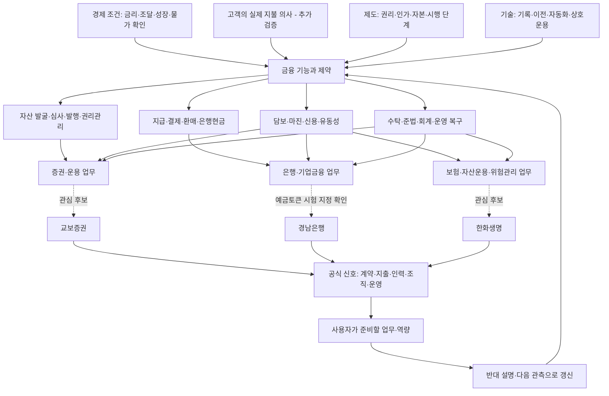

# 금융환경에서 기업 업무까지 이어지는 지도

화살표는 조사 경로다. 확인된 인과효과나 회사의 확정 전략을 표시하지 않는다. [11월 현재 분석](04_november_outlook.md), [규제 도입 조건](05_regulatory_tracker.md), [주제별 근거](../wiki/INDEX.md)를 함께 읽는다.

| 연결 | 자료에서 볼 것 | 잘못 연결하기 쉬운 것 |
|---|---|---|
| 경제 → 고객 | 지급·투자·담보·조달의 실제 필요와 제약 | 기술 유행을 고객의 지불 의사로 대체 |
| 권리 → 상품 | 명의·청구권·분배·환매·도산 시 구제 | 같은 기초자산 명칭을 같은 법적 권리로 취급 |
| 원장 → 현금 | 결제자산·외부 은행 연결·실패·복구 | 체인 확정을 최종 은행현금으로 취급 |
| 채택 → 사업성 | 반복 고객·실효 보수·운영 및 위험 비용 | 협약·실증·거래량을 순이익으로 취급 |
| 그룹 → 기업 → 직무 | 정확한 법인·인가·계약·담당 업무 | 계열사 활동을 지원 직무의 업무로 확정 |

국제기관은 구조·위험의 분석, 감독기관은 제도·조건, 운영기관은 출시·시험, 회사 자료는 자원 투입·계약·성과를 확인하는 데 사용한다. 어느 출처도 그 자체로 모든 층을 입증하지 않는다.

## 지도와 기록의 연결

- [원문 목록](../sources/README.md): 무엇을 읽고 어디에 썼는가.
- [주장 원장](../data/claims.json): 사실·기관 주장·해석·가설·미확인.
- [주제 지도](../wiki/INDEX.md): 주제별 근거와 다음 관측.
- [관계 데이터](../data/graph.json): 원문 → 주장 → 주제의 명시적 연결.
- [AI 도구 검토](02_ai_methods.md): 이 지식을 어떻게 찾고 갱신할 것인가.
- [거시 관측 원장](../data/macro_observations.json): 실적·전망·정책결정과 수치 정의.
- [규제 원장](../data/regulatory_watch.json): 13개 항목의 단계·남은 절차·의사결정 관측.
- [경쟁 시나리오](../data/scenarios.json): 조건부 가설·반대 경로·확대/축소 기준.

## 기업별로 이어진 국가와 역할

[기업·국가 지도](07_company_geography.md)와 [기관별 조사 초점](08_role_based_focus.md)을 추가했다. 교보는 일본·싱가포르·태국의 자본·상품 관계, 한화는 UAE·인도네시아·미국의 분리된 금융 기능, 경남은행은 국내 정책·경쟁은행·지역 고객 업무를 우선한다. 직접 영업·투자·협약·파트너 거점·조사 목표를 연결 데이터에서 구분한다.

## 규제가 적용된 뒤의 시간 지도

[국가별 규제·2027 일정](09_country_regulation_2027.md)은 이미 시행 중인 제도와 확정 미시행·제안·정책 목표를 구분한다. [2027년 이후 사업 시나리오](10_2027_business_scenarios.md)는 법적 권한에서 실제 고객·은행현금·반복 사용·총비용 후 수익까지 남는 관문을 연결한다. 금융기관의 역할별로 기회와 반대 경로를 함께 본다.

## 제도·AI가 정착한 미래에서 기관별 행동으로

2026-11-03 추가 연구는 [탑다운 전망](11_topdown_digital_finance.md)에서 고객 AI가 비교·위임·지급·회계·복구까지 수행하는 미래를 가정한다. 달러·원화, 은행별 예금 이동, 준비자산의 순증 수요, 상품 조합과 실제 자산, 상계·선자금 비용을 분리한다. 교수형 질문은 거래비용·희소성·책임·경쟁의 분석에 사용했으며 특정 교수의 현재 전망을 대변하지 않는다.

| 적용 대상 | 현재 기반에서 우선 조사할 업무 | 상세 문서 |
|---|---|---|
| 경남은행 본사 | 지역 기업 자금관리·운전자금, 가맹점 정산, 공공·목적성 지급과 관계 | [경남은행 전략](12_kyongnam_head_office_strategy.md) |
| 교보증권 미래전략 | 거래 자금·증거금, 반복 IB, 기관 유동성, 권리가 확인되는 IP, 국경간 레일 | [교보 전략](13_kyobo_future_strategy.md) |
| 한화생명 신사업·계열 협업 | Nobu 보장·유지, 해외 금융 기능 연결, AI가 이용할 서비스, 보험 ALM | [한화 전략](14_hanwha_blockchain_strategy.md) |

[통합 판단·검증 설계](15_strategy_decisions_and_validation.md)와 [12개 결정 원장](../data/strategy_decisions_2027.json)에 지급자·대안·다음 관측·확대·중단 조건을 연결했다. 이 표는 연구 제안이며 회사의 예산·현행 조직 소관·확정 사업이 아니다.

지역 수출기업으로 좁힌 [경남은행 본사 사업안](16_kyongnam_export_treasury_business_plan.md)은 **거래 계약→매출채권→은행·토큰·펀드 형태의 수금/보유→통화·기한별 가용 현금→지급·신용·회수**를 추적한다. [다자산 현금 사례](17_kyongnam_multiasset_cash_case.md)에서 토큰 이전과 은행현금, 자산가치와 지급 가능액을 구분한다. 고객 자금 효율화는 은행 예금 조달·대출 수요를 줄일 수도 있으므로 관리·외환·신용·운영 보수가 이를 보전하는지 검증한다.

## 교보 미래전략의 고객·자산·현금 지도

**기존 거래 고객 → 자금·증거금·출금**, **발행인 → 권리·조달·수금·재발행**, **기관 → 상품·만기·환매·은행현금**을 먼저 연결한다. 문고 IP와 해외 제휴는 이 흐름의 원권리·실행 경로를 제공할 수 있는지 심사하고, 생명은 독립 투자자 후보로 둔다. 자본 확대와 그룹 고객 접근을 자동 사업권으로 해석하지 않는다.

[미래전략 사업안](18_kyobo_future_strategy_business_plan.md) · [그룹 RWA 거래](19_kyobo_group_rwa_deal_design.md) · [외부 AI·현금 레일](20_kyobo_rails_agent_business.md) · [자본과 권한](21_kyobo_capital_and_permissions.md)

온체인·AI의 추가 가치는 같은 업무의 기존+AI 대비 판단한다. 상품 조합이 많아질수록 원권리·지급자·우선순위·실제 수금의 연결이 중요해지고, 무료 비교·연결과 대형 IB의 가격 경쟁 때문에 절감 이익이 교보에 남지 않을 수도 있다.

## 국가 수요 → 그룹 기능 → 실제 유료 업무

인도네시아의 보장·납입·가맹점 수납·고용주 건강보험, UAE의 현지 상품 접근, 미국 기관의 거래 후 현금과 복구에서 한화 기회를 좁혔다. BNK는 지역 산업의 수금·설비·운전자금, 교보는 권리·정산과 장기 고객 목적을 같은 방식으로 검증한다. [한화 통합 사업안](22_hanwha_group_business_plan.md) · [그룹·국가 기회 지도](25_group_country_opportunity_discovery.md).

국가 수요와 회사 자원 사이에는 접근가능 고객·상품권한·계약·현금·경쟁가격이 필요하다. 제도·AI·온체인 연결이 성립해도 인수·실사·유동성·복구의 비용과 책임이 남는다. 인가나 토큰 전송만으로 반복 수익을 추론하지 않는다.

## 2026-11-04 Ondo 원문과 기능별 비교 보완

[교수 원문 계보](27_professor_ondo_lineage.md)와 [BlackRock·Ondo 비교](28_blackrock_ondo_positions.md)를 [환경·경쟁 분석](29_tokenization_competition_group_strategy.md), [세 그룹 실제 사례·대응](30_group_position_responses.md)에 연결했다. 기존 판단의 출처를 소급 변경하지 않고, 새 비교와 후속 관측을 추가한다. 2027년 일괄 개방이나 그룹 전체의 단일 권한·손익을 가정하지 않는다.
