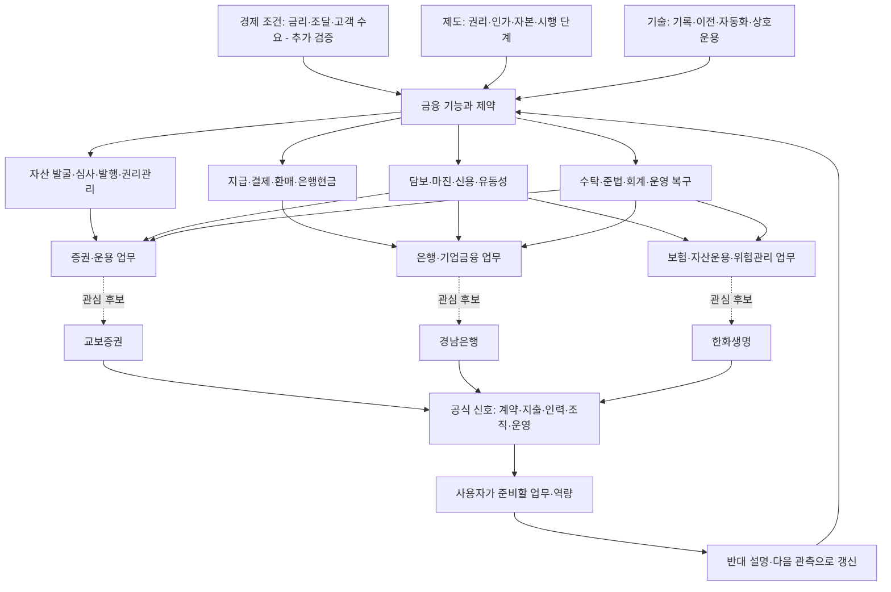

# 금융환경에서 기업 업무까지 이어지는 지도

화살표는 조사 경로다. 확인된 인과효과나 회사의 확정 전략을 표시하지 않는다. [현재 분석](01_financial_environment.md)과 [주제별 근거](../wiki/INDEX.md)를 함께 읽는다.

| 연결 | 자료에서 볼 것 | 잘못 연결하기 쉬운 것 |
|---|---|---|
| 경제 → 고객 | 지급·투자·담보·조달의 실제 필요와 제약 | 기술 유행을 고객의 지불 의사로 대체 |
| 권리 → 상품 | 명의·청구권·분배·환매·도산 시 구제 | 같은 기초자산 명칭을 같은 법적 권리로 취급 |
| 원장 → 현금 | 결제자산·외부 은행 연결·실패·복구 | 체인 확정을 최종 은행현금으로 취급 |
| 채택 → 사업성 | 반복 고객·실효 보수·운영 및 위험 비용 | 협약·실증·거래량을 순이익으로 취급 |
| 그룹 → 기업 → 직무 | 정확한 법인·인가·계약·담당 업무 | 계열사 활동을 지원 직무의 업무로 확정 |

국제기관은 구조·위험의 분석, 감독기관은 제도·조건, 운영기관은 출시·시험, 회사 자료는 자원 투입·계약·성과를 확인하는 데 사용한다. 어느 출처도 그 자체로 모든 층을 입증하지 않는다.

## 지도와 기록의 연결

- [원문 목록](../sources/README.md): 무엇을 읽고 어디에 썼는가.
- [주장 원장](../data/claims.json): 사실·기관 주장·해석·가설·미확인.
- [주제 지도](../wiki/INDEX.md): 주제별 근거와 다음 관측.
- [관계 데이터](../data/graph.json): 원문 → 주장 → 주제의 명시적 연결.
- [AI 도구 검토](02_ai_methods.md): 이 지식을 어떻게 찾고 갱신할 것인가.
