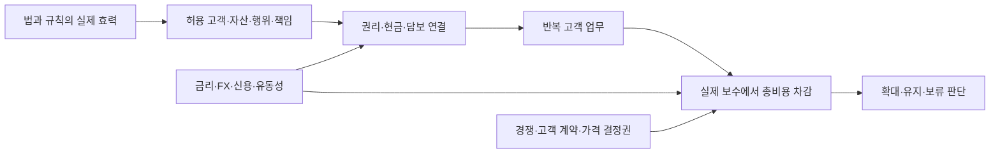

# 2026년 11월 금융환경과 제도 변화 시나리오

기준일: **2026-11-02 KST**. 관점: 한국 증권·은행·보험의 RWA·토큰화·온체인 신사업. 전망 기간은 향후 6~24개월이며 확정 예측이 아니다. 11월 전체를 관측한 보고서가 아니다.

현재의 핵심 판단은 **기존 금융의 권리·결제·담보·준법 기능을 새 원장과 연결하는 경쟁이 구체화되고 있지만, 제도 진전이 곧 반복 수요나 순이익을 보장하지 않는다는 것**이다. 제도화는 시장을 열면서 인가·준비자산·환매·자금세탁방지 비용도 명확하게 만든다. 실제 수익을 가져갈 주체는 발행 기술 제공자보다 고객 계약, 유통, 은행현금 전환, 법적 책임을 장악한 기관일 수 있다.

이전 [1차 환경 분석](01_financial_environment.md)에 거시 여건과 미시행 규제의 분기를 추가한다. 제도별 출처·단계·남은 절차는 [규제 원장과 도입 판단](05_regulatory_tracker.md), 자료별 읽은 범위는 [출처 카드](../sources/README.md)에 있다.

## 1. 현재 환경: 금리·제도·인프라를 분리해서 읽는다

| 축 | 확인한 현황 | 금융 기능에 주는 의미 — 분석자의 해석 |
|---|---|---|
| 한국 통화정책 | 한국은행 10/22 기준금리 3.00% 동결. 이미 실시한 두 차례 인상의 영향 점검과 추가 인상의 시기·속도 검토 | 무이자 지급잔액의 고객 기회비용, 은행 조달비, 담보 조달비를 사업성에 반영해야 한다 |
| 미국 통화정책 | 연준 10/28 목표범위 3.75~4.00% 유지 | 달러 준비자산 운용수익은 여전히 변수다. 정책금리를 특정 발행사의 실제 운용수익률로 대입할 수 없다 |
| 시장 위험 | IMF 10월 GFSR은 전반적으로 완화적인 금융여건과 높은 안정성 위험을 함께 진단 | 정책금리, 신용스프레드·위험선호, 스트레스 유동성을 별도로 봐야 한다. 온체인화가 신용위험을 제거하지 않는다 |
| 제도화된 연결 | ECB Pontes 9/21, DTCC DTS 10/28 출시 발표 | 실험을 넘어 연결 서비스가 등장했다. 출시·접근 계약과 반복 사용·유료 매출은 구분한다 |
| 제한적 담보 수용 | ECB는 1/27, CSD·적격 결제시스템 등 조건을 충족하는 DLT 자산을 3/30부터 담보로 수용한다고 발표. 다른 형태로의 확대는 별도 탐색 | 사업의 단위는 '토큰' 전체가 아니라 특정 권리·통화·법인·결제망·담보 기준의 조합이다 |
| 통제 강화 | FATF 10/30 가상자산 기준 이행의 표적 검토·신속 후속조치 합의 | 준법·상대방 확인·기록·복구는 운영 필수비용이며, 고객이 비용을 지불할 경우 서비스 기회이기도 하다 |

정책금리 근거는 [한국은행 10월 결정](https://www.bok.or.kr/portal/bbs/P0000559/view.do?depth=200690&menuNo=200690&nttId=11065823&oldMenuNo=201150&programType=newsData&relate=Y), [연준 10월 회의](https://www.federalreserve.gov/newsevents/pressreleases/monetary20261028a.htm)다. 인프라·담보 근거는 [Pontes](../sources/cards/FIN-009.md), [DTS](../sources/cards/FIN-015.md), [ECB 담보 정책](../sources/cards/NOV-ECB-COLLATERAL.md), 통제 방향은 [FATF 총회](../sources/cards/NOV-FATF.md)다. 거시 전망·실적은 [거시 근거·수치 설명](06_macro_evidence.md)과 [관측 원장](../data/macro_observations.json)에 발표일과 관측기간을 분리해 기록한다.

**편익에 대한 증거도 양쪽을 봐야 한다.** ECB의 2026년 4월 유럽 중심 채권 연구는 일부 매칭 표본에서 낮은 발행 스프레드와 호가 차이를 관측했다. 그러나 인수 수수료 감소는 확인하지 못했다. 표본이 작고 주로 2025년까지의 자료이며, 인수 수수료는 이 연구의 발행 운영비 지표이며 전체 비용은 아니다. 이 결과는 유망한 가설의 근거이며 모든 RWA의 비용 절감률이 아니다. [연구와 표본 범위](../sources/cards/NOV-ECB-BONDS.md)

## 2. 아직 시행되지 않은 제도의 가능성을 어떻게 판단하는가

법률 성립, 세부 규칙 확정, 효력 발생, 개별 인가, 실제 운영, 반복 유료 수요는 각각 다른 단계다. 법 통과 가능성이 높아도 특정 회사의 사업 성공 가능성을 계산해 주지는 않는다. 숫자 확률 대신 **현재까지 통과한 절차와 앞으로 필요한 결정**으로 판단한다.

- **국내 토큰증권:** 법률은 성립했고 시행일이 정해져 있다. 중심 질문은 법이 통과될지보다 하위규정·인프라·인가가 어떤 조건으로 준비되는지다. 상세 자본·투자한도·보수 규칙은 확정본을 확인하기 전 사업계획의 고정값으로 쓰지 않는다.
- **국내 원화 스테이블코인:** 정책 논의는 확인되지만 은행 지분, 발행자 범위, 이자·보상, 준비자산·외환 규칙의 최종 조합을 확정할 근거는 부족하다. 은행 중심, 비은행 참여 확대, 장기 지연의 세 경로를 모두 남긴다. 국회예산정책처 9/8 자료까지 입법 논의를 확인했지만 10~11월의 최종 의안 처리는 미확인이다. 국회 자료 접근 한계 때문에 '모든 법안이 아직 미통과'라는 전수 판단도 하지 않는다.
- **미국 스테이블코인:** GENIUS 법률과 감독기관별 이행 규칙을 분리한다. OCC 최종규칙의 미래 효력일을 연준·FDIC 규칙이나 모든 사업자의 인가일로 확대하지 않는다.
- **미국 시장구조:** CLARITY의 상원 절차 지연은 빠른 전면 시행 가정을 약하게 만든다. 토론 종결 표결 실패가 법안의 영구 폐기를 뜻하지는 않는다.
- **유럽·영국:** 이미 적용되는 MiCA·확정된 일부 규칙과 새로운 담보·시장구조 제안을 구분한다. 영국 CCP의 토큰 담보 협의가 모든 토큰자산을 적격 담보로 바꾸는 것은 아니다.

각 항목의 실제 날짜, 남은 의사결정자, 불확실성과 다음 확인 자료는 [규제 추적표](05_regulatory_tracker.md)에 연결했다.

## 3. 어떤 금융 기능에서 수익과 위험의 배분이 바뀌는가

아래는 **사업 가설**이다. 실제 계약·가격·원가를 확보하기 전에는 기업의 계획이나 예상 매출로 읽지 않는다.

| 고객 문제와 기능 | 조건이 갖춰지면 생기는 기회·지급자 | 경쟁·위기·반대 경로 | 판단을 바꿀 관측 |
|---|---|---|---|
| 증권 발행 이후 이자·배당·명부·공시·권리 변경 | 발행사·운용사가 반복 관리와 대사에 보수를 지불 | 기존 예탁·수탁·증권 시스템이 흡수하거나 발행량 부족. 원장 사용료 자체가 허용·성립하지 않을 수 있음 | 외부 발행사의 재계약, 실제 관리 보수, 예외처리 포함 원가 |
| 기업의 지급·환매·은행현금 연결 | 기업 재무팀·결제사업자가 기한 내 수취, FX, 승인·대사 서비스를 구매 | 토큰은 도착했지만 은행현금은 지연. 환매·외환·주말 유동성 비용이 절감을 상쇄 | 동일 수취액·기한에서 실패 시도까지 포함한 총비용, 최종 현금 입금 시간 |
| 담보·마진·유동성 동원 | 증권사·은행·청산회원이 적격성 확인, 담보 이동·대체·복구에 지불 | 즉시 총액결제가 기존 상계를 대체하면 선자금 수요 증가. 자동 마진이 스트레스를 가속 | 담보 수용 계약, haircut, 담보권 집행, 스트레스 시 실제 현금화 |
| 스테이블코인 준비자산·환매 운영 | 허가된 발행사·유통사가 운용·수탁·검증·환매 기능을 구매 | 금리 하락 시 수익 압박, 무이자 준비분·분배비·준법비 부담. 높은 금리도 보유자의 이탈 유인 | 허용 준비자산, 평균 잔액, 실현 수익률, 유통 배분, 상환 비용·집중도 |
| 고객 자금 접점과 은행 조달 | 은행이 예금토큰·기업 자금관리·결제 서비스를 통해 관계 유지 | 지급 잔액이 플랫폼으로 이동하고 운영예금이 대형 수탁은행에 집중. 총예금이 유지돼도 개별 은행 조달비 상승 가능 | 고객별 운영예금 잔액·금리, 법인 집중, 재유입 경로, 결제·FX 순수익 |
| 법규·권리·데이터·예외처리 | 금융회사·발행사가 허용 대상 확인, 대사, 감사 증거, 복구 업무를 구매 | 범용 기술 공급자 간 가격경쟁. 자동화 오류·법규 개정 누락에 대한 책임 증가 | 유료 검토·운영 계약, 오류·정정·복구 비용과 책임 배분 |

출발 근거는 국내 제도 원장, [권리 구분](../sources/cards/FIN-011.md), [Agorá의 결제 이후 환매](../sources/cards/FIN-004.md), [담보·자본 FAQ](../sources/cards/FIN-012.md), [영국 담보 협의](../sources/cards/FIN-016.md)다. 실제 인과효과와 고객 지불 의사는 검증 전이다.

스테이블코인 발행사 손익은 개념적으로 `평균 준비자산 × 실제 운용수익률 + 실제 서비스 수입 − 유통 배분 − 운영·준법비 − 유동성·손실 비용`으로 분해한다. 고객 보유 잔액, 발행사의 준비자산, 토큰화 펀드의 고객자산은 서로 다른 계정이다. 고객에게 이자가 허용·지급되는지도 상품·관할별로 확인한다. 높은 정책금리만으로 이익을 추정할 수 없다.

은행 예금이 스테이블코인으로 바뀌어도 발행사 예금이나 국채 매도인의 예금으로 재유입될 수 있다. 따라서 '발행 증가 = 은행 전체 예금 소멸' 대신 **어느 은행에서 누구의 예금이 어떤 금리·집중도로 이동하는지** 추적한다. 해외자산 확대도 기존 해외자산 교체·신규 취득·환헤지·환류를 나눈다.

## 4. 향후 6~24개월의 경쟁 시나리오

이는 상호 배타적 예측이 아니다. 기능·국가·고객별로 공존할 수 있다. 기준 경로는 현재 자료와 비교적 적은 추가 가정으로 이어지는 작업 가설일 뿐 확률 우위를 측정한 결과가 아니다.

| 경로 | 필요한 가정과 경제적 전달 | 기회 | 위기와 대응 | 강화·약화시키는 신호 |
|---|---|---|---|---|
| S1. 기존 기관 중심의 점진적 연결 | 예정 제도 시행, 제한적 인가, 기존 계좌·수탁과 이중 운영 → 관리·대사 수요 증가 | B2B 발행 후 관리, 예금토큰·현금 전환, 준법 연계 | 시스템 중복비와 낮은 초기 거래량. 공통 운영 역량부터 준비 | 승인·참여 계약 뒤 반복 거래·외부 고객의 재계약이 늘면 강화 |
| S2. 담보·결제의 실질 통합 | 법적 권리·담보 적격성·환매와 은행현금 공급·상호운용성 동시 충족 → 유휴자금·담보 이동 개선 | 기관 담보관리, 기업 자금관리, FX·유동성 공급 | 자동 마진·즉시결제에 필요한 선자금과 복구 책임. 제한된 사용례부터 시험 | 스트레스에서도 현금 기한 준수, 전체 원가 절감과 유료 사용이 함께 확인돼야 확대 |
| S3. 플랫폼 성장, 금융회사 보수 압박 | 비은행 참여 확대와 함께 소수 플랫폼이 고객 계약·주문흐름을 통제한다는 추가 조건 → 유통 보수·가격 결정권 집중 | 공급·운영·준법 서비스를 플랫폼에 제공하거나 직접 고객 업무 장악 | 단순 발행·중개·예금 잔액의 보수 하락. 전환이 쉽고 플랫폼 간 경쟁이 강하면 절감은 고객에게 돌아가 플랫폼 이익도 낮아질 수 있음 | 고객 계약 주체·실효 보수·플랫폼 배분이 이동하면 강화 |
| S4. 제도 지연·분절 또는 위험 충격 | 입법 지연, 외환·자금세탁 통제 차이, 시장 충격 → 거래망 분절·환매 지연·고객 관망 | 기존 계좌 자동화, 적격성 확인, 대사·복구·위험관리 | 전용 인프라 선투자 회수 실패, 담보 유동성 악화. 고정비·약정 단계적으로 집행 | 입법·인가 지연, 높은 실패율, 일회성 시험 이후 재사용 부재가 지속되면 확대 보류 |

금리 경로는 네 시나리오 모두에 겹친다. 높은 금리 지속은 준비자산 수익과 현금 효율화 유인을 높이는 한편 고객 보유 기회비용·담보 조달 부담도 키운다. 금리 하락은 운용수익 의존 모델을 압박할 수 있고, 불황을 동반하면 신용·환매 위험을 높일 수 있다. 같은 금리 하락도 수요와 위험의 배경을 함께 봐야 한다.

화살표는 확인할 분석 경로다. 법적 허용에서 수익성까지의 인과관계가 입증됐다는 뜻은 아니다.

**판단을 줄이거나 바꾸는 관측:** 실제 인가·서비스 개시 후 최초 두 번의 비교 가능한 정기 공시 또는 운영 집계에서 확인한다. 이 두 회는 투자 결정을 위한 연구 규칙이며 통계적 유의성 기준이 아니다. S1은 유료 고객의 재사용이 없고 비용 부담만 지속되면 확장을 보류한다. S2는 실제 스트레스 사건 또는 사전에 정한 동일 조건 시험에서 총원가·현금 기한이 기존 방식보다 개선되지 않으면 해당 사용례의 우위를 낮춘다. S3는 비교 가능한 계약에서 기존 금융기관이 고객과 실효 보수를 유지하거나 비용 절감이 고객에게 이전되면 플랫폼의 이익 집중 가설을 낮춘다. S4는 상호운용성·환매 기한·반복 유료 사용이 함께 검증되면 지연·분절 판단을 완화한다. 관련 공시가 없거나 관측시점 전이면 판단을 유보하며, 미관측을 실패로 세지 않는다. 내부 원가가 비공개이면 공개 거래량만으로 이익을 추정하지 않는다.

## 5. 사용자 관심 기업으로 좁힐 때의 우선 질문

| 후보 | 현재 확인 범위 | 환경에서 이어지는 조사 가설 | 다음에 찾아야 할 비용을 감수한 선택 |
|---|---|---|---|
| 교보증권 | 이번 조사에서 회사별 신규 계약·조직·채용은 확인하지 않음 | 토큰증권 발행·유통 자체뿐 아니라 발행 후 관리, 기관 고객 업무, 고객 계약·유통 보수의 배분을 조사 | 담당 법인·팀, 실제 고객·발행, 인가·시스템 투자, 반복 관리 계약 |
| 경남은행 | 금융위 2026-07-15 예금토큰 지급·결제 혁신금융서비스 신규 지정 확인 | 예금토큰이 기업·공공 자금 집행, 소상공인 정산·송금과 결합할 때 고객 관계·예금·수수료를 유지하는가 | 실제 서비스 개시, 고객·가맹점 반복 이용, 예금 구성, 운영·예외처리 인력·비용 |
| 한화생명 | 이번 조사에서 회사별 신규 투자·계약·직무는 확인하지 않음 | 온체인 자산 접근과 지급일까지의 현금 확보·수탁·환매·ALM을 연결하는 운영 업무를 조사 | 투자 가능 자산·권리, 실제 은행현금 기한, 수탁·환매 계약, K-ICS·회계·외환 검토 |

경남은행 근거는 [금융위 7/15 원문](https://www.fsc.go.kr/no010101/87338)이다. 지정은 시험할 수 있는 지위이며 실제 서비스 개시·매출·전담인력 증가의 증거가 아니다. 교보증권 미래전략, 경남은행 본사업무, 한화생명 블록체인 신사업은 사용자가 지정한 관심 분야로, 현재 채용·배치 확정 사실과 구분한다. 토큰화만으로 보험 부채의 듀레이션이나 자본규제가 개선되지 않는다.

## 6. 지금 준비할 일과 확대 조건

**어느 경로에서도 유용한 준비:** 같은 고객 업무의 기존 계좌 방식, 기존 계좌+AI, 온체인, 온체인+AI를 비교한다. 권리와 자금 흐름, 담당자 승인, 예외·복구, 은행현금 수취까지 한 흐름으로 그린다. 규정 변경은 자료→주장→가설→업무에 연결하고 이전 판단을 보존한다.

**작게 시험할 조건:** 고객과 지급자가 특정되고, 허용 범위와 데이터가 확인된 업무만 선택한다. 증권의 발행 후 관리, 은행의 예금토큰 정산 대사, 보험의 환매·지급시점 대사가 우선 후보다. 실제 거래를 실행하기 전 과거·가상 사례로 오류·지연·복구를 평가한다.

**확대할 조건:** 개별 허용·계약, 반복 유료 사용, 은행현금 기한 준수, 손실·운영·유동성·자본 비용 후 이익을 함께 확인한다. 법안 통과·협약·스타 수·토큰 잔액만으로 확대하지 않는다. 수익이 플랫폼·고객에게 이전되면 제공 기능과 가격을 재설계한다.

**다음 갱신:** [규제 추적표의 다음 관측](05_regulatory_tracker.md), 한국은행·연준의 다음 결정, 발행자 준비자산·환매 공시, 기업 공시·계약·정식 서비스·채용 업무를 순서대로 확인한다. 현재 정기 자동 수집·알림은 설정하지 않았다.

## 조사 한계

공식 자료의 선택 절·보도자료·법령 메타데이터·기관 연구를 읽은 목적표집이다. 국회 일부 상세 페이지, 법령·규칙의 연결 원문 접근에 공백이 있다. 각 나라의 모든 법안·인가·소송, 한국 보험·외환·세무 규칙을 전수 검토하지 않았다. 실측 고객 수요·보수·원가와 세 후보의 전체 신호 조사는 다음 단계다. 출처의 기관 주장과 작성자의 조건부 전망을 구분하며, 이번 파이프라인 검증은 경제 가설의 실현을 입증하지 않는다.

## 후속 국가별 조사

2027년 초와 이후의 판단은 [국가별 제도·날짜](09_country_regulation_2027.md) 및 [미래 사업 시나리오](10_2027_business_scenarios.md)로 확장했다. 한국 개정문·부칙 선택 절을 추가 확인했고 미국 일반 효력·별도 판매제한 전환, 기존 제도와 후속 제안을 구분했다. 이 문서의 거시 조건은 그대로 참고하되 최신 법적 경계는 후속 원장을 우선한다.
