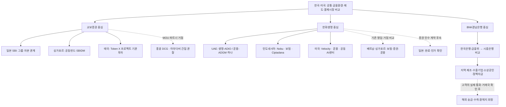

# 교보·한화·경남: 연결된 국가와 금융 기능 지도

기준일: **2026-11-02 KST**. 한국·미국은 공통 분석 축으로 유지하고, 추가 국가는 **확인된 법인·거래·파트너와 고객의 자금 흐름**에 따라 고른다. 이 지도는 해외 현지법인 목록이나 각국 영업 허가의 전수조사가 아니다.

현재 조사 우선순위는 **교보의 일본·싱가포르·태국 연결, 한화의 UAE·인도네시아·미국 연결, 경남은행의 국내 정책·시중은행 대응·지역 고객 업무**다. 홍콩·베트남·일본 등은 관계의 종류에 맞춰 보조 축으로 배치한다. [역할별 초점](08_role_based_focus.md), [연결별 근거·다음 관측](../data/institution_connections.json).

## 기존 작업에서 재사용한 것과 이번에 달라진 것

기존 GitHub의 관련 파일을 먼저 읽어 공식 원문으로 돌아갈 경로를 복원했다. 과거 필기의 결론을 그대로 현재 사실로 올리지 않고, 이번에 다시 읽은 공식 발표·회사 자료·규제기관 기록으로 관계와 단계를 확인했다.

| 기존 연구에서 이어 받은 질문 | 이번에 재확인·구체화한 내용 | 판단의 변화 |
|---|---|---|
| 교보의 해외 STO·SBI·Token X 연결 | SCBX의 NOBLX 역할표, SBI 공동펀드·투자 및 교보생명 지분취득, DCG MOU | 교보의 투자자·펀드 참여와 발행·판매 보수 사업 후보를 분리 |
| 한화의 UAE·미국 연결과 인도네시아 추가 질문 | 기존 UAE·미국 원문 경로를 복원하고, Nobu와 Ciptadana는 이번 공식 자료로 구체화 | 그룹을 하나의 금융회사로 묶지 않고 생명·증권·운용·현지 은행의 기능으로 분해 |
| 은행의 예금·결제·기업 송금 대응 | 기존 공개 보고서의 신한 원문 재열람, 경남은행 수출 우대금융·지역 고객 접점 추가 | 해외 법인 확대를 전제하지 않고 지역 고객의 외화 수취·지급 수요에서 확장 |

공개된 이전 연구는 [교보 수익전략 연구](https://github.com/Eom-TaeJun/sto-ai-frontier/blob/d64f570467204e2fdfa5be86ea456a501191b9f8/docs/KYOBO_PROFIT_STRATEGY.md), [교보 사업 기준선](https://github.com/Eom-TaeJun/sto-ai-frontier/blob/d64f570467204e2fdfa5be86ea456a501191b9f8/docs/KYOBO_BUSINESS_BASELINE.md), [11월 1일 금융기관 대응 보고서](https://github.com/Eom-TaeJun/2026-10/blob/5e4dd5143a57fda97f33151d0e284ba7f7b5576d/reports/digital-finance-institutional-response-2026-11-01.md)다. 이전 사업 가설과 회사 확정 계획은 구분한다. 비공개 원문·경로 색인은 공개 저장소에 옮기지 않았다.

## 한눈에 보는 조사 경로

화살표는 조사 연결이다. 법적 지배 관계, 자금 이전, 현지 영업 또는 수익 실현을 의미하지 않는다.

## 교보: 증권사 직접 역할과 생명·그룹 연결을 분리

| 국가·관할 | 법인과 확인된 역할 | 단계·시점 | 조사에서 활용할 내용 | 근거 |
|---|---|---|---|---|
| 일본 ↔ 한국 | SBI–교보생명그룹 협약, SBI의 교보생명 지분 관계 | 협약 2024-07; SBI 공시상 취득 완료 2026-01-16 | 그룹 자본·협력 관계. 교보증권 일본 영업과 별개 | [협약](../sources/cards/KYO-GEO-001.md), [완료 공시](../sources/cards/KYO-GEO-006.md) |
| 싱가포르 | 교보증권 공동펀드, 운용사는 SBI Ven Capital | 후속펀드 설립 2026-04; 기존 펀드의 Pints AI 투자 2026-06 | 펀드 투자·회수와 금융 기술기업 접점. 교보 내부 AI 도입은 미확인 | [후속펀드](../sources/cards/KYO-GEO-008.md), [투자](../sources/cards/KYO-GEO-007.md) |
| 싱가포르·태국 | SBIDM은 구조화·결제·유동성 관리, Token X는 태국 ICO·제공·관리, 교보생명·증권은 기관투자자 | NOBLX 완료·사모 제공을 운영사가 2025-09 발표 | 서로 다른 투자 권리·판매국·현금 회수 경로 확인. 2026년 잔액·수익은 미확인 | [SCBX 역할표](../sources/cards/KYO-GEO-003.md) |
| 홍콩 파트너·한국/아태 목표 | 교보증권–DCG RWA 기술 협력 | 2026-04-08 MOU | 자산 발굴과 양방향 유통 목표의 후속 실행 계약 | [DCG](../sources/cards/KYO-GEO-004.md) |
| 싱가포르·태국, EU 탐색 | 교보증권 발표의 IP·권리 토큰화 목표 | 2025-04 발표 목표 | 구체 자산·발행인·판매국이 확인될 때 확장. EU 특정 회원국은 미확인 | [회사 발표자료](../sources/cards/KYO-GEO-002.md) |
| 미국 기술기업 ↔ 한국 실험 | 교보생명–Ripple 국채 토큰화·결제 테스트넷 | 2026-04 검증 발표 | 보험사의 자산 운용·결제 실험. 교보증권 참여·미국 국채·미국 영업으로 대체하지 않음 | [교보생명](../sources/cards/KYO-GEO-005.md), [Ripple](../sources/cards/KYO-GEO-009.md) |

DCG 홈페이지에 홍콩·아부다비 거점이 있어도 교보의 현지법인·인가로 표시하지 않는다. 펀드의 피투자사가 인도·미국 등에 제품을 공급한다는 소개도 교보 직접 진출국을 늘리는 근거가 아니다. NOBLX의 유럽 기초자산 지역과 태국 판매 관할, 한국 기관의 투자 권리는 따로 확인한다.

**현재 의미:** 교보증권은 투자·기술·자산 네트워크에 연결되어 있다. 어떤 고객을 위해 발행·판매·관리 업무를 수행하고 대가를 받는지는 추가 계약 근거가 필요하다. 공동펀드 조성이나 기관투자 참여만으로 수수료 사업 성과를 결론 내리지 않는다.

## 한화: UAE·인도네시아·미국의 서로 다른 금융 기능

| 국가·관할 | 실제 법인·기능 | 확인 단계 | 다음에 확인할 것 | 근거 |
|---|---|---|---|---|
| UAE 아부다비 | 한화생명–ADIO; 생명 홈페이지의 아부다비 대표사무소 | 2026-09-16 협약·기존 거점 소개 | RWA·디지털뱅킹 협력의 실행 법인·상품·인가·고객 | [협약](../sources/cards/HWA-GEO-001.md), [생명 네트워크](../sources/cards/HWA-GEO-004.md) |
| UAE·ADGM | 한화자산운용–ADGM–하나금융 MOU; 운용사의 MENA 법인 | UAE 법인 2025-07 설립 소개·2026-09 MOU | 운용·판매와 스테이블코인·결제의 권한·책임 분리 | [별도 MOU](../sources/cards/HWA-GEO-001.md), [운용 네트워크](../sources/cards/HWA-GEO-003.md) |
| 인도네시아 은행 | 한화생명 → Nobu Bank 지분 연결 | 2025-06 발표상 40% 취득 완료 | 최신 지분·현지 고객·계약·출금과 은행현금 경로 | [완료 발표](../sources/cards/HWA-GEO-005.md) |
| 인도네시아 현금 접점 | Nobu 가상계좌와 Bittime 플랫폼 | 사업자 2026-05 이용 가능 발표·9월 일시 정비 공지 | 현재 이용 상태·수수료·입출금 시간·책임. Nobu의 RWA 발행 인가와 별개 | [이용 발표](../sources/cards/HWA-GEO-006.md), [운영 공지](../sources/cards/HWA-GEO-007.md) |
| 인도네시아 증권·운용 | **한화투자증권** → Ciptadana 증권·자산운용 | 회사 발표상 증권 2024-10, 운용 2025-12 취득 완료 | 인수 주체를 한화자산운용으로 바꾸지 않음. 최신 허가·지분·상품 확인 | [완료 설명](../sources/cards/HWA-GEO-010.md) |
| 미국 | 한화생명의 간접 소유구조 → Velocity Clearing | 2025-07-30 인수 완료 발표; FINRA 간접 소유 기록 확인 | 기존 청산·결제 역량의 토큰화 연결에 필요한 허가·계약·자본 | [완료](../sources/cards/HWA-GEO-008.md), [FINRA](../sources/cards/HWA-GEO-009.md) |
| 미국 | 한화자산운용 현지 법인·뉴욕 지점; 생명·손보·운용 공동 AI센터 | 회사의 기존 거점 소개 | 특정 업무·팀·실제 고객과 비용 개선. 생명 단독 자산·성과로 합산 금지 | [운용 네트워크](../sources/cards/HWA-GEO-003.md) |
| 싱가포르 | 한화자산운용 법인·투자증권 계열 Pinetree | 기존 거점 소개 | 운용·증권의 각 허가·고객·상품과 한국/UAE 연결 계약 | [운용](../sources/cards/HWA-GEO-003.md), [증권](../sources/cards/HWA-GEO-012.md) |
| 베트남 | Hanwha Life Việt Nam 보험 영업·투자증권 계열 Pinetree | 생명 2009 영업 시작 소개, 2026-07 현황·증권 기존 거점 | 보험료·보험금·현지 자산운용과 증권 고객을 분리 | [현지 보험사](../sources/cards/HWA-GEO-011.md), [증권](../sources/cards/HWA-GEO-012.md) |
| 일본 | 한화투자증권–GI캐피털매니지먼트 증권 부문 | 2026-10 주식 취득 계약 발표 | **취득 완료·승인·최종 법인·지분은 미확인** | [계약](../sources/cards/HWA-GEO-012.md) |

중국은 한화생명 홈페이지의 현지 자회사 국가 표시까지만 확인했다. 특정 법인·지분·디지털 사업은 미확인이므로 존재 지도에만 남긴다. 한화생명 일본 거점도 투자증권의 GI 계약과 같은 법인으로 취급하지 않는다. 12월 ADFW 행사 파트너 지위는 관계 형성 신호이며, 11월2일 현재 행사 개최 완료나 금융업 인가의 증거가 아니다. [공식 네트워크](../sources/cards/HWA-GEO-004.md), [ADGM 행사 발표](../sources/cards/HWA-GEO-002.md).

**현재 의미:** 미국의 거래 후 인프라, 인도네시아의 은행·보험·증권·운용 고객 접점, UAE의 투자·사업 파트너 연결을 각각 조사할 근거가 있다. 이들을 하나의 상용 서비스로 연결했다는 증거는 확보하지 못했다. 보험부채 대응과 외부 고객 대상 신사업의 손익을 분리해야 한다.

## 경남은행: 지역 업무에서 필요한 해외 연결로 확장

| 조사 층 | 확인한 신호 | 활용과 한계 | 근거 |
|---|---|---|---|
| 한국은행·금융위 | 기관용 디지털화폐/예금토큰 구분, 경남은행의 7월 시험 신규 지정 | 조달·결제·운영 조건 확인. 실제 상용화·반복 수익 미확인 | [한국은행](../sources/cards/SRC-BOK-HANGANG.md), [금융위](../sources/cards/NOV-KR-007.md) |
| 시중은행 방향 | KB의 가맹점·국고금 연계 계획, 신한의 기업 해외송금 PoC | 기존 고객 화면·계좌와 후단 기술의 결합을 비교. 경남은행 채택 사실과 별개 | [KB](../sources/cards/KN-005.md), [신한](../sources/cards/KN-006.md) |
| 지역 수출 고객 | 무보·경남은행 협약, 은행 출연금 5억원 재원의 78억원 공급 발표·외환 수수료 우대 | 대출·보증·외환·예금 업무를 함께 조사. 실제 집행·수익은 미확인 | [무역보험공사](../sources/cards/KN-003.md) |
| 가맹점·제조업 | 토스플레이스 공동마케팅 협약·대성테크 유망중소기업 선정 | 공식 목록 요약만 확인. 예금토큰 연결·대출 실행 증거 아님 | [경남은행 뉴스](../sources/cards/KN-002.md) |
| 정책자금 | 함안군 상반기 융자 접수처에 경남은행 지점 포함 | 과거 고객 접점 사례. 농협·기업은행도 참여; 현재 접수·독점 금고로 해석 금지 | [정책포털](../sources/cards/KN-007.md) |
| BNK 계열사 협업 | 4개 계열사 공동 500억원 전략펀드, BNK벤처투자 운용 | 경남은행 단독 출자액·운용수익으로 합산 금지 | [BNK 발표](../sources/cards/KN-001.md) |
| 조직·손익 기준선 | 지주 생산적금융 조직 보고, 경남은행 1~3분기 누적 순익 2,355억원 발표 | 지주 조직과 경남은행 부서 분리. 그룹 자본·연체비율을 은행 단독 수치로 전용 금지 | [금융위](../sources/cards/KN-008.md), [BNK 실적](../sources/cards/KN-004.md) |

**현재 의미:** 경남은행의 해외 분석은 “어느 나라에 진출할까”보다 “지역 수출입 고객이 어떤 통화로 누구에게 지급하고 어디서 수취하는가”에서 시작하는 편이 목적에 맞다. 실제 회랑·반복 금액·총비용·현금 도착 문제를 확인한 뒤 해당 국가의 지급·외환 규제를 조사한다. 고객의 외환 수요와 은행 자체의 해외법인 확장은 서로 다른 주장이다.

## 국가별 규제 조사는 관계의 종류에 맞춰 좁힌다

| 범위 | 먼저 확인할 규칙·권한 | 이번 확인 수준 |
|---|---|---|
| 한국·미국 | 토큰증권·스테이블코인 시행 단계, 개별 허가, 자산·결제·자본 조건 | [기존 규제 원장](05_regulatory_tracker.md) 재사용 |
| 일본·싱가포르·태국 | 해당 펀드·발행인·운용사·판매자·수탁자의 허용 활동, 적격 투자자, 국경간 권리·현금 | 회사·파트너 역할 확인; 상품별 인가문서·전체 법률 검토 미완료 |
| UAE/아부다비/ADGM | 정확한 관할, 상업등록과 FSRA 금융활동 허용, 한국과의 투자·외환·수탁 연결 | 관할과 일반 인가 절차 확인. 한화 법인별 FSP는 미확인 |
| 인도네시아 | 은행·보험·증권·운용·디지털자산·외환 감독과 계열사 간 거래 조건 | OJK/BI 감독권 이관 확인. 회사별 최신 허용 활동은 추가 확인 |
| 베트남·홍콩·기타 | 확인된 고객·상품·계약이 요구하는 규칙만 우선 | 거점·파트너 또는 사업 소개 범위. 포괄적 규제 결론 없음 |

ADGM에서는 원칙적 승인(IPA) 후 조건을 충족해야 Financial Services Permission으로 이어진다. ADIO 협약은 이 허가 절차와 다르다. 인도네시아의 2025년 감독권 이관도 은행 인수가 암호자산 거래·지급 업무까지 허용한다는 의미가 아니다. [ADGM 절차](../sources/cards/GEO-ADGM-PROCESS.md), [관할](../sources/cards/GEO-ADGM-JURISDICTION.md), [OJK·BI 공동 발표](../sources/cards/GEO-ID-SUPERVISION.md).

아직 읽지 않은 각국 법안의 통과 가능성·시행일은 추정하지 않는다. 다음 조사에서는 위 관계에서 실제 필요한 상품 한 개를 고른 뒤 법안·확정 규칙·효력·개별 인가를 나눠 [규제 원장](../data/regulatory_watch.json)에 추가한다.

## 남은 핵심 공백

현재 팀의 정원·예산·업무권한, 국가별 최신 주주명부·라이선스 전수, 상용 이용과 RWA 관련 비용 후 수익은 미완료다. 목록 화면이나 회사 소개만 읽은 자료는 상세 계약·감사·감독기관 결정문을 읽은 것으로 표시하지 않았다. 접근 실패와 읽은 범위는 각 [출처 카드](../sources/README.md) 및 [이번 실행 기록](../runs/2026-11-02-geography.json)에 남겼다.

## 11월3일 한화 후속: 기존 거점과 새 ETF 거래를 구분

한화운용 MENA의 2025년7월 설립 소개는 기존 조사에 있던 사실이다. 새 원문에서는 **KDEF·KMCA의 2026년11월2일 ADX 거래 개시**를 추가했다. 전통 ETF 교차상장이며 토큰 ETF나 Velocity 청산 참여를 뜻하지 않는다. HWA-CON-12에 법인·파트너·보수·한계를 기록했다. [미국·UAE 상세](24_hanwha_us_uae_rails.md) · [원문 ETC](https://www.exchangetradedconcepts.com/posts/exchange-traded-concepts-takes-client-etfs-to-the-abu-dhabi-securities-exchange)

인도네시아는 기존 Nobu 방카 외에 공개 QRIS 가맹점 업무와 LGI 고용주 건강보험에서 추가 고객 문제를 발굴했다. 그룹 공급 가능성과 실제 신규 계약·고객 수요는 구분한다. [인도네시아 상세](23_hanwha_indonesia_business.md)
