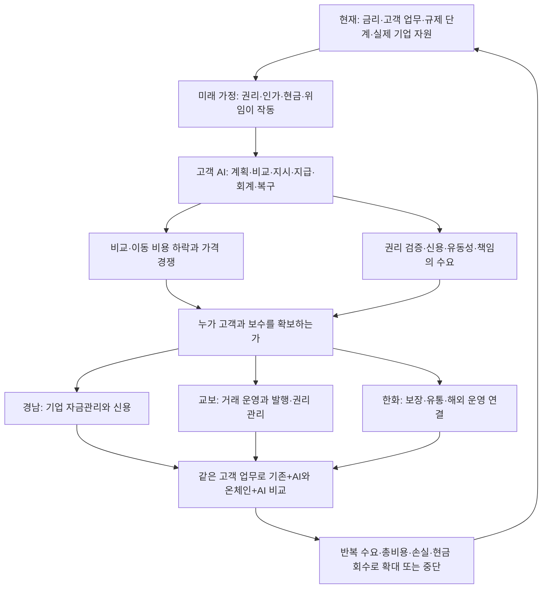

# 세 기관의 전략 선택: 기존 고객의 업무에서 2027년 이후 사업으로

작성·추가 확인일은 2026-11-03이다. 법제 출발점은 [11월 2일 규제 원장](09_country_regulation_2027.md)을 유지한다. 새로 확인한 회사·연구 자료는 각각의 확인일과 범위를 기록했다. 아래 우선순위·실험·조직 역할은 연구자의 제안이며 회사의 확정 계획이나 수행된 실험이 아니다.

**세 기관의 공통 과제는 고객이 사람을 통해서든 AI를 통해서든 금융업무를 맡길 수 있게 만드는 것이다. 차이는 어떤 고객의 어떤 결과에 책임지고 돈을 받을 수 있느냐에 있다.** 경남은행은 기업의 수금·지급·운전자금, 교보증권은 거래·증거금과 자산의 발행·관리, 한화생명과 금융계열사는 보장·유통·자산운용·해외 금융 운영을 각자의 권한으로 연결하는 데서 출발한다.

## 1. 탑다운 전망을 투자 판단으로 바꾸는 순서

[탑다운 분석](11_topdown_digital_finance.md)은 필요한 법·인가·권리·현금 레일·제한된 AI 위임과 고객 편익이 성립한 미래를 먼저 그린다. 그다음 고객 AI가 공급자를 비교하고 잔액을 이동시키면 경쟁과 수익 분배가 어떻게 바뀌는지 추론한다. 이 가정은 2027년 초 전 세계에서 동시에 실현된다는 예측이 아니다.

화살표는 조건부 조사·판단 경로다. 기술 도입의 실증 인과효과를 표시하지 않는다. 온체인을 쓰지 않고도 가치가 남는 데이터·업무·고객 계약을 먼저 확보하면 제도가 지연되거나 고객이 다른 레일을 골라도 대응할 수 있다. 반대로 권리와 현금의 공동 이전이 실제 병목이라면 기술투자를 계속 늦추는 것도 기회비용이다.

## 2. 기존 관점에서 더 구체화된 판단

| 처음의 질문 | 이번에 확인한 기준선 | 전략 판단의 변화 |
|---|---|---|
| 지방은행은 원화 디지털 환경에서 무엇을 지킬까 | 경남은행 9월말 원화대출 중 기업자금 약66.35%, 중소기업 약57.23%. fERP는 이미 자금·재고·회계·다은행 업무를 소개 | 새 앱의 이용자 수보다 기업의 수금·급여·매입·운전자금 업무를 연결할 기회를 먼저 검증. 기업 비중은 산업·지역 시장점유율이 아님 |
| 교보는 종투사 확대와 토큰화를 어떻게 연결할까 | 상반기 전체 수탁수수료 약1,610.64억원 중 해외선물 약688.28억원. 10월 RCPS 발행 결정에는 배당·상환 조건 존재 | 해외거래 고객의 자금·증거금 운영을 중요한 방어·성장 후보로 추가. 자본 확충을 무료 사업자금이나 이미 확보한 발행어음·IMA 권한으로 보지 않음 |
| 교보문고의 신뢰를 RWA로 바꿀 수 있을까 | 자체 IP 발굴·출판·2차 저작물 사업 소개 확인 | 전체 서적의 권리를 가정하지 않고 계약·정산 이력·양도 가능성을 갖춘 청구권 한 종류부터 평가 |
| 한화는 해외 디지털 레일에 어디까지 들어갔나 | 한화투자증권의 Kresus·Digital Asset 투자, Chainlink 협력, 한화생명의 Nobu·Velocity Clearing 연결은 법인과 기능이 다름 | 지분투자 수익, 금융서비스 운영 보수, 보험 이익을 구분. 기술 포트폴리오를 하나의 완성된 글로벌 지급망으로 합치지 않음 |
| 인도네시아 방카슈랑스는 미래 아이디어인가 | Nobu 공개 목록에서 현지 한화생명 상품 3개 확인 | 채널 존재 다음 단계인 적합한 고객·계약 유지·보험금 지급·총비용을 검증. 젊은 인구 전체를 신규 보험 고객으로 계산하지 않음 |

공식 근거와 수치의 기간·단위·한계: [경남은행](12_kyongnam_head_office_strategy.md), [교보증권](13_kyobo_future_strategy.md), [한화](14_hanwha_blockchain_strategy.md). 경남은행의 두 대출 비중은 BNK IR의 원화대출 잔액으로 직접 계산했다. 회사별 규모를 서로 다른 기간·회계 기준 그대로 순위화하지 않는다.

## 3. 무엇을 먼저 기획할 것인가

모든 항목은 예산 승인 전의 검토 제안이다. 구체 업무의 내부 책임자는 현재 업무분장 확인 후 정한다. [전략 결정 원장](../data/strategy_decisions_2027.json)에 근거·대안·확대·중단 조건을 저장했다.

| 기관·순서 | 첫 과제와 고객 | 돈을 받거나 기존 사업을 지키는 경로 | 확대 전 결정적인 확인 |
|---|---|---|---|
| 경남 1 | 지역기업의 수금→매입·급여→운전자금 연결 | 신용·외환·자금관리와 조달의 합산 기여 | 현행 fERP/API 개선 대비 완료시간·예외·고객 재이용·위험조정 기여 |
| 경남 2 | 가맹점 정산·반품·세금·유동성 | 반복 결제 관계와 적정 여신, 계약상 서비스 보수 | 플랫폼에 고객·가격·정보·마진을 넘기는 조건인지, 보상 종료 후 이용 |
| 경남 3 | 공공자금·목적성 지급 및 기업승계 연결 | 신뢰 가능한 지급·대사와 기업·가계 관계 | 지정 범위, 환불·목적 외 사용·데이터 책임, 장기 고객 편익 |
| 교보 1 | 해외거래 고객의 자금·증거금 업무 | 중개 고객 유지, 거래 운영 개선 | 불편의 실제 원인과 고객별 기여, 외부 청산·은행 시간표 |
| 교보 2 | 반복 IB 발행·권리·사후관리 | 발행인·투자자에게 계약상 주선·관리 보수 | 재발행·수금·배분과 비용 후 기여. 발행액보다 회수와 반복 |
| 교보 3 | 기관 유동성과 상품 관리 | 상품·환매·현금 연결 및 기존 거래 관계 | 실제 사용 가능한 은행현금 도착, 동일 통화·권리·만기·유동성 비용 |
| 교보 4 | 권리가 확인되는 IP 정산금 후보 | 실사·구조화·판매·관리 보수 | 양도 가능한 권리·지급자 신용·수금 통제·독립 평가 |
| 교보 5 | 국경간 자산과 적법한 해외 입출금 레일 | 투자 성과 또는 계약상 서비스 보수 | 현지·한국 양쪽 권한, 총FX·전환·선자금·복구 비용 |
| 한화 1 | Nobu의 동의 가능한 고객에게 적합한 보장 | 은행의 적법한 유통 보수와 보험사의 계약 수익을 분리 | 가입 전환만 아니라 납입 여력·유지·민원·보험금 지급·총비용 |
| 한화 2 | 계열사별 해외 권리·현금·업무 연결 | 청산·운영·판매·관리 계약 대가 또는 별도 투자손익 | 실제 계약 법인·인가·상품·지급자·매출 귀속 |
| 한화 3 | AI가 비교·선택·이용할 금융서비스 정보와 실행 | 검증 가능한 공급·실행·복구의 B2B 대가 | 실제 외부 이용자·지급의사·오류 책임·파트너 배분 후 기여 |
| 한화 4 | 보험금 지급 준비와 운용자산의 현금 연결 | 수익률 추구와 별도로 운영·유동성 비용 개선 | 보험부채·통화·만기·자본 제약을 맞춘 스트레스 현금 비교 |

경남은행은 신용공여와 고객 업무가 먼저다. 교보는 자기자본을 쓰는 인수·투자와 보수를 받는 관리 업무를 구분해야 한다. 한화생명은 보험 위험의 인수와 장기 지급 능력을 유지하면서 은행·증권·운용·청산 계열사를 연결해야 한다. 세 기관에 같은 ‘토큰 플랫폼’ 제안을 복사하면 이 차이를 놓친다.

## 4. 레일 선택: USDC와 USDT로 회사 지도를 단순화하지 않는다

| 대상 | 현재 확인한 연결 | 전략에서 결정할 것 |
|---|---|---|
| 경남은행 | 한강 예금토큰 시험 관련 지정·국내 기업 업무 기반 | 원화의 지급·대출·회계 업무가 먼저. 고객의 실제 해외 통화·거래국·빈도를 확인한 뒤 외화 레일 비교 |
| 교보 | 생명 주최 Circle 등 협력 논의·시연, 증권의 NOBLX 기관투자·DCG MOU | 교보증권 직접 USDC 상환 계정·고객 경로는 별도 확인. USDT 직접 계약도 이번 선택 조사에서 미확인 |
| 한화 | 증권의 지갑·원장·데이터/상호운용 관련 투자·협력, 생명의 미국 청산·인니 은행 연결 | Canton·Chainlink·지갑 기술·은행계좌·달러 토큰은 서로 다른 층. Circle/Tether의 직접 발행·상환 계약 및 실제 비용 확인 |

선택 단위는 ‘좋아하는 코인’이 아니라 **특정 고객이 특정 통화로 특정 업무를 끝내는 전체 경로**다. 발행자 신용·권리, 직접 상환 자격, 지원 체인, 수탁, FX, 지급 제한, 최종 은행현금, 중단·동결·오입금 복구, 사업자 보수를 함께 비교한다. 준비자산 이자는 토큰 보유자나 제휴 금융회사에 자동 귀속되지 않는다. 제3자 전환을 거치면 그 상대방의 가격·유동성·운영 위험이 추가된다.

## 5. 2027년 초와 이후를 다르게 본다

**2027년 초**에는 현행 업무 개선과 새 제도의 개별 적용을 병행한다. 한국의 관련 토큰증권 조항은 2월 4일 예정이지만 하위규칙·개별 등록/인가·실제 상품은 별도다. 미국 OCC 규칙의 적용 범위를 모든 해외 금융회사에 확대하지 않는다. 동남아·UAE의 지급·자산거래·보험·역외 금융 관할은 서로 다르다. 규칙의 효력과 법인의 실행 준비를 같은 달력에 두되 같은 사건으로 세지 않는다.

**2027년 중 이후 필요한 조건이 갖춰진 경로**에서는 고객 AI가 매일 같은 금융기관을 고르리라는 보장이 없다. 가격과 실행 정보를 표준화할수록 비교는 쉬워진다. 고객을 가진 AI 플랫폼이 보수를 요구하고, 대형은행은 자금·규모·신뢰를 묶어 응답할 수 있다. 작은 금융기관도 특정 고객의 복잡한 예외·신용·권리를 잘 처리하면 선택될 수 있지만, 그 능력이 실제 비용·재이용으로 입증되어야 한다.

**제도는 성립했지만 채택이 제한되는 경로**도 따로 둔다. 비정형 권리 확인비, 작은 거래 수요, 유동성 분절, 이중 원장 운영비 때문에 일부 반복 업무에서만 온체인이 쓰일 수 있다. 이때의 실패 원인은 법률 지연과 다르다. 준비한 데이터·실사·관리 체계가 기존 금융업무에도 쓰이면 투자의 일부 가치를 보존할 수 있다.

**달러 플랫폼에 집중되는 경로**에서는 국내 기관이 고객 접점·잔액·유통 보수를 잃을 수 있다. 다만 국채 준비자산 증가 전체가 신규 국채 수요는 아니고 은행권 총예금 변화와 개별 은행의 예금 이탈은 다르다. 원화 토큰만으로 이 경쟁을 해결할 수는 없다. 원화 지급 의무·신용·지역 업무를 잘 처리하고 적법한 외화 연결을 제공해야 한다. [거시 메커니즘과 반대 경로](11_topdown_digital_finance.md)

## 6. 교수형 검토를 적용하면 바뀌는 질문

공개 강의의 거래비용·비교우위·위임과 검증 책임을 참고했다. 아래는 그 질문을 이번 연구에 적용한 것이며 강의자의 현재 의견이나 개별 회사 권고가 아니다.

| 쉬운 결론 | 다시 물을 경제적 질문 | 실제 결정에 주는 영향 |
|---|---|---|
| 결제가 빠르면 비용은 준다 | 상계가 사라지면 선자금·담보·24시간 유동성이 더 필요한가 | 건별 즉시 결제와 배치·상계를 비교. IMF Box3.2를 설계 검토 근거로 사용 |
| AI가 효율화하면 회사 이익은 는다 | 고객 가격 인하·플랫폼 보수·기존 수익 잠식으로 누가 이득을 가져가는가 | 고객 편익과 회사의 비용 후 증분 기여를 별도 계산 |
| 그룹 시너지는 고객·자본을 합치는 것이다 | 어떤 법인이 어떤 권리·동의·자본으로 계약하는가 | 법인별 고객자산·계정·인가·손익·사고 책임표를 먼저 작성 |
| 지역 정보와 브랜드는 영구적인 강점이다 | AI가 정보를 표준화하면 경쟁자가 같은 신호를 얻는가 | 현장 예외·회수·책임의 가치가 남는지 확인하고 표준 업무는 공동 조달 |
| 무한한 상품은 무한한 자산이다 | 같은 원천 현금흐름·담보·상관위험을 몇 번 포장했는가 | 원권리·총청구·선후순위·중복담보를 합쳐 보고 고객 맞춤의 효용과 분리 |
| 기술 투자 지분은 사업 수익이다 | 배당·회수·평가손익과 실제 운영 계약의 보수는 무엇인가 | 투자성과와 서비스 사업 손익을 별도 장부·가설로 추적 |

원문과 귀속은 [탑다운 분석 1·6장](11_topdown_digital_finance.md), 역할 지침은 [교수형 경제 메커니즘 검토](../agents/professor_reasoner.md)에 있다.

## 7. 다음 90일의 기획·운영·검증 제안

첫 30일에는 기관별 우선 업무 한 개의 실제 계약·사례·수익·비용·예외를 모아 기준선을 만든다. 현재 공식 신호와 내부 담당자의 확정 업무를 대조하고, 고객의 지급의사와 회사의 허용 업무를 확인한다. 공개 자료로 확인되지 않은 고객 수·마진·단가는 null로 남긴다.

31~60일에는 같은 업무를 현행 방식+AI와 필요한 경우 온체인+AI로 비교한다. 동일 통화·법적 권리·고객·기간·위험을 유지한다. 잘못된 권리·오래된 가격·중복 지시·환매 지연·부정 접근·파트너 중단·분쟁을 넣고 예외 처리까지 측정한다. 금융 수량·배분·한도는 검증 가능한 계산으로 처리한다. AI의 제안이 자동 위험 인수나 무제한 출금 권한으로 연결되지 않게 한다.

61~90일에는 비용 후 반복 기여가 확인되는 범위에서 제한된 실제 운영 진입을 판단한다. 고객 피해·법적 권리 공백·현금 복구 불능은 매출 기대와 상쇄하지 않는다. 기준선보다 나쁘면 레일이나 설계를 바꾸고, 지급할 고객이 없으면 확대를 중단한다. 목표 수치와 표본은 회사의 기준선·위험 한도에 따라 사전에 정해야 하며 이번 보고서가 임의로 정하지 않았다.

| 계산 | 포함·분리할 항목 |
|---|---|
| 고객 순편익 | 시간·오류·대기자금 개선에서 요금·FX·세금·새 위험과 복구 부담을 차감. 시간을 현금 절감으로 자동 환산하지 않음 |
| 금융기관 증분 기여 | 새 계약 보수·검증된 유지 효과·실현 절감에서 기존 수익 잠식·제휴·운영·준법·조달·유동성·기대손실·경제적 자본 비용 차감 |
| 은행 관계 기여 | 예금 조달 가치와 대출 마진의 내부 이전가격을 일관되게 적용해 이중 계산 제거 |
| 보험 성과 | 보험료·유통 수수료·회계상 수익·서비스 손익·투자손익 구분. 보장·유지·지급·민원과 함께 판단 |
| 보유 투자 성과 | 기간 중 분배·회수 현금 + 기말 잔존가치 − 기초 보유가치 − 기간 중 신규·추가 납입 − 직접비용. 실현·미실현 분리, 별도 산식에서 이미 차감한 비용 재차감 금지 |

이 계산 틀을 실제 손익으로 채운 실험은 아직 수행하지 않았다. 비용 데이터 없이 순이익률이나 투자수익률을 제시하지 않는다.

## 8. 자료 재사용·검증과 남은 공백

기존 GitHub 공개 보고서와 연결 원장을 먼저 읽고, 선택한 라이브러리·채팅·로컬 작업에서 조사 질문과 공식 원문 경로를 복원했다. 10월 이후 GitHub 활동의 후보 목록과 관련 저장소의 커밋·문서 이력을 선택 확인했다. 이는 모든 저장소의 모든 커밋과 개인 자료를 완독했다는 뜻이 아니다. 공개 저장소에는 공개 원문과 새로 작성한 분석만 반영했다. 자료별 읽은 위치·활용·한계는 [출처 목록](../sources/README.md)에 있다.

분업은 탑다운·교보·한화·경남으로 나누고 다른 담당이 핵심 주장과 원문을 교차검토했다. 교보 투자손익의 원금 이중 차감 소지를 수정했고, 단기 가격 경쟁을 대출금리·예금 보상에 따라 구분했으며, 교수의 견해와 연구자 재구성을 분리했다. 당사자 식별이 다른 Velocity 발표를 동일 법인·지배관계 확인 없이 한화 인수 자회사의 실적으로 연결하지 않았다. 다수 에이전트의 동의 자체를 독립 증거로 세지 않는다.

남은 중요한 공백은 회사별 실제 계약 가격·활성 고객·신사업 순기여·정원·예산, 교보 RCPS 후속 납입과 현재 지정 권한의 완결 확인, USDC/USDT 직접 운영 계약, Nobu 고객별 보장 공백과 유지 성과다. 미확인은 부재의 증거가 아니다. 이 항목이 확인될 때 전략 원장의 우선순위·행동을 바꾸며, 새 뉴스 수만 늘리지 않는다.

다음 연구는 [지속 연구 방향](../docs/RESEARCH_MANDATE.md), [전략 결정 원장](../data/strategy_decisions_2027.json), [파이프라인](../PIPELINE.md)에서 이어간다.

## 9. STR-KN-01의 수출기업 자금관리 심화

2026-11-03 후속 [경남은행 사업안](16_kyongnam_export_treasury_business_plan.md)과 [다자산 현금 사례](17_kyongnam_multiasset_cash_case.md)를 연결했다. 기존 전자무역·보증·조기 현금화와 예금 밖 자산을 동일한 수금·지급 흐름에 놓고, 고객 접점·수익 지급자·은행 조달 잠식·경쟁 대응을 구체화했다. 예금 감소의 FTP 기여와 대체조달비, 인출한 대출과 잔여한도를 중복 계산하지 않는 기준을 독립 검토했다.

공식 출처 24건·기존 3건 갱신·주장 45개는 별도 [실행 기록](../runs/2026-11-03-kyongnam-export.json)에 남긴다. 기존 12개 우선순위를 재평가한 것으로 표시하지 않으며, 실제 고객 시험·허가·ROI가 확보된 것도 아니다.

## 10. STR-KY-01~05의 미래전략 사업안 심화

[교보 사업안](18_kyobo_future_strategy_business_plan.md), [그룹 RWA 한 거래](19_kyobo_group_rwa_deal_design.md), [레일·AI 고객접점](20_kyobo_rails_agent_business.md), [자본·업무권한](21_kyobo_capital_and_permissions.md)을 연결했다. 기존 중개·반복 IB·기관 자금관리와 그룹/해외 후보의 투자 거리를 나누고, 주선·관리 수익과 자기 인수·보증·유동성·제휴 지분의 자본 사용을 분리한다. 기존 다섯 과제의 순위를 임의로 바꾸지 않았다.

독립 검토에서는 계열 기업신용 제한, IBKR의 시점·고객별 문서 차이, AI 자금 구획과 법적 재산 분리의 차이를 보강했다. 정산채권의 배분식에는 요구액·실제 지급/적립·부족을 구분하고 적법한 대체발행과 소멸채권 중복 발행을 나눴다. 공개 출처26건 추가·9건 갱신과 주장45개 추가·3개 갱신은 [실행 기록](../runs/2026-11-03-kyobo-strategy.json)에 있다. [사업 원장](../data/kyobo_strategy_business_plan.json)과 [거래 체크리스트](../data/kyobo_ip_deal_checklist.json)의 실제 고객·계약·예산·수익은 미확인이다.

## 한화 사업 구체화와 세 그룹 확장

기존 STR-HW-01~04 순위는 유지하고 [한화 사업안](22_hanwha_group_business_plan.md)의 현지 보장·청구, 미국 사후처리, UAE 실제 유통, AI 실행/복구, ALM, 산업계약 후보로 세분화했다. [구조화 원장](../data/hanwha_blockchain_business_plan.json)에 지급자·법인·총비용·반증을 보존한다. 90일 초기 운영 검증으로 장기 보험 유지·보험손익을 입증했다고 판단하지 않는다.

BNK지주의 지역 산업금융, 교보의 정산권리·장기 목적 관리, 한화의 현지·산업 업무 후보 10건은 [그룹 기회 원장](../data/group_country_opportunities.json)과 [보고서25](25_group_country_opportunity_discovery.md)에 연결했다. 기존 12개 전략 과제의 순위나 예산을 자동 변경하지 않았다.
