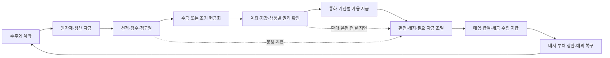

# 경남은행 본사 사업안: 지역 수출기업의 통합 자금관리

작성·선택 원문 확인: **2026-11-03 KST**. 경남은행의 확정 사업계획이 아닌 연구자의 제안이다. [기관 전략](12_kyongnam_head_office_strategy.md)의 첫 과제 STR-KN-01을 수금·지급·외환·운전자금과 예금 밖 자산관리로 구체화한다. 실제 고객 자료·요율·계약·실험 성과는 확보하지 않았다.

## 1. 본사에 제안할 결정

**기업이 어느 은행·지갑·상품에 자산을 두더라도, 지급일에 필요한 통화의 돈을 확보하고 거래를 마치는 접점을 경남은행이 제공한다.** 예금 잔액을 보여주는 화면에서 계약·미수금·보유자산·환매·외환·지급·대출의 연결 상태를 관리하는 서비스로 넓히자는 제안이다. 은행으로 모든 자산을 옮기게 하는 것이 고객 선택의 전제는 아니다.

첫 고객은 반복적인 수출입 대금과 원화 매입·급여를 관리하지만 별도 자금관리 인력이 충분하지 않은 지역 제조기업이다. 특정 업종이 경남은행의 실제 최다 고객이라는 통계는 확인하지 않았다. 기계·부품·조선 관련 업체는 **인터뷰·업무 표본 후보**이며, 수출기업 전체를 같은 회수주기·위험으로 취급하지 않는다.

처음에는 기존 계좌·기업뱅킹·fERP·전자무역을 연결해 수금·지급을 끝내는 업무를 개선한다. 외부 지갑·토큰화 상품은 합법적 보유와 정보 접근이 가능한 고객의 읽기 전용 현황부터 구분한다. 이후 필요한 법·개별 권한·고객 계약·수탁·환매·외환 연결이 성립하면 실행 가능한 자산 전환·지급으로 확대한다. **조회·분석·자문·판매·수탁·처분·대출은 서로 다른 업무**다.

본사가 지금 결정할 것은 대규모 자체 코인·체인 투자보다 한 고객군의 기준선 조사와 제한된 업무 검증 범위다. 기존+AI로 해결되는 부분의 가치도 남기며, 다기관의 권리·조건·현금 연결에서 추가 편익이 있는 구간에 온체인을 적용한다.

## 2. 이미 있는 기능에서 출발한다

경남은행은 fERP뿐 아니라 무역금융, 수출환어음 매입, EDI, KTNET PTB, 외화예금·송금 기능을 공식 안내한다. 따라서 전자문서·ERP 연결 자체를 신규 기능으로 제안하면 기존 기반을 놓친다. 실제 고객에게 어디에서 재입력·대기·오류·자금 부족이 발생하는지 확인하는 것이 먼저다.

| 확인된 기반 | 이번 사업에서 재사용할 것 | 확인하지 못한 부분 |
|---|---|---|
| fERP | 다은행 계좌·자금·회계·재고 등 기존 업무 접점 | 활성 기업·버전·가격·데이터 품질·현행 연결 범위 |
| EDI·PTB | 수출입·내국신용장·구매확인서·송수신문서의 전자 처리·조회 | 모든 ERP·보증·해외은행까지 실시간 완결되는지 |
| 무역금융 | 생산·원자재 조달 단계의 자금 지원 | 고객별 한도·실행 조건·금리 |
| 수출환어음 매입 | 선적서류 심사 후 조기 현금화와 사후관리 | 고객별 소구 조건·매입 가격·승인·회수 실적 |
| 외화예금·송금 | 필요한 통화의 보유·지급 및 기존 은행 연결 | 실제 실행 견적·해당 회랑·마감·최종 입금 시간 |
| K-SURE 우대금융 협약 | 보증·신용·외환과 고객 지원의 연결 | 발표 공급액의 실제 집행·잔여한도·성과 |

근거: [fERP](../sources/cards/ST-KN-002.md), [EDI](../sources/cards/KNX-S-003.md), [PTB](../sources/cards/KNX-S-004.md), [무역금융](../sources/cards/KNX-S-002.md), [수출환어음 매입](../sources/cards/KNX-S-001.md), [외화예금](../sources/cards/KNX-S-005.md), [이종통화송금](../sources/cards/KNX-S-006.md), [우대금융 발표](../sources/cards/KN-003.md). 여러 상품 페이지는 갱신일이 없어 현재 적용·가격·국가별 가용성을 고객별로 재확인해야 한다. 안내의 기능 존재와 실현 효율은 구분한다.

K-SURE 포괄매입 절차의 공개 안내는 전자보증 제출 은행 6곳과 기타 은행의 서면 절차를 나눈다. 무일자 명단만으로 경남은행의 현재 미연계를 확정하지 않는다. 실제 절차가 수작업이라면 본사가 개선할 것은 단순 조회 화면보다 **서류 완비→은행 확인→보증→승인 결과까지의 연결**이다. [절차와 확인 한계](../sources/cards/KNX-R-002.md)

## 3. 수출기업의 돈·권리를 한 흐름으로 추적한다

아래는 외상 송금방식 수출의 설명용 기준 흐름이다. 신용장·추심·선수금 거래는 문서·은행의 의무·지급 조건이 달라 별도 경로로 설계한다. 동일 대금을 매출채권·담보·토큰·수취현금으로 중복 합산하지 않는다.

| 단계 | 기존 방식의 돈·권리 | AI가 보조할 업무 | 온체인이 추가로 유리할 조건 | 경남은행의 역할·대가 후보 |
|---|---|---|---|---|
| 계약·수주 | 통화·금액·기일·인도·검수·공제 조건. 주문이 곧 확정 현금은 아님 | 계약·청구·발주 조건 대조, 누락·변경 표시 | 동일 조건을 여러 당사자가 사용하고 법적 원문·변경권한이 연결됨 | 현금계획·외환 상담·적법한 서비스 계약 |
| 원자재·생산 | 선적 전 비용이 먼저 발생. 원화/외화 대출·자기자금 사용 | 생산·지급 일정과 약정한도 대조 | 실제 거래의 조건부 지급·증빙 공유가 비용을 줄임 | 무역금융·보증 연결. 심사와 손실 부담은 유지 |
| 선적·청구 | 선적·검수 후 채권 발생과 채무자의 지급 의무를 구분 | 문서 불일치·미인수·미입금·계약상 기한 탐지 | 유효한 권리·양도·명부·중복담보 확인과 다기관 대사가 연결됨 | 서류 처리·수출채권 조기 현금화·사후관리 |
| 수금 | 해외 은행 송금→외화계좌. 청구액과 순입금액이 다를 수 있음 | 수취 참조번호·인보이스·공제액 대사, 지연 원인 분류 | 적법한 토큰 수취가 계약상 채무이행이고 환매·현금 경로가 작동 | 수취·외환·현금 연결 및 예외 처리 |
| 자금 배분 | 당장 지급할 돈과 남는 돈의 구분 | 통화별 기한·예약·담보·변환 시간을 반영한 계획 | 허용된 자산·현금 전환이 실제 업무 병목을 줄임 | 자금관리 보수, 권한 있는 공급자 연결 |
| 환전·헤지 | 달러 수입과 수출의 시차·순노출, 원화 지급 필요 | 확정/예상 노출과 기존 헤지 대사, 견적 비교 | 지급·환전 조건의 동시 충족이 실패·대기자금을 줄임 | 환전·헤지의 계약상 보수. 방향성 투기 권유와 구분 |
| 지급·상환 | 공급업체·직원·세무기관이 요구하는 통화·계좌로 지급 | 승인·한도·중복 지시·잔액·마감 확인 | 양쪽 지급수단과 권리·최종성이 모두 작동 | 기업 지급·운영·약정 신용의 가치 |
| 사후관리 | 회계전표·대출 상환·분쟁·회수 | 상태 불일치·기한 누락 탐지와 증거 연결 | 여러 기관의 상태를 재사용해 대사를 줄임 | 책임 있는 복구·고객 관계. 대출 원금 회수는 매출 아님 |

은행의 기존 매입 안내에는 상대방 미결제 등에서 수출자에게 회수하는 절차가 있다. K-SURE 포괄매입도 최종 상환 책임을 수출자에게 둔다. 따라서 조기 현금화를 ‘채권을 넘겼으니 위험과 부채가 모두 사라졌다’고 설명하지 않는다. 일반 보증의 90% 이내 안내와 우대 협약의 개별 조건도 구분한다. [경남 매입](../sources/cards/KNX-S-001.md) · [K-SURE 제도](../sources/cards/KNX-R-001.md)

## 4. 계좌 밖 자산까지 관리한다는 의미

외부 자산을 관리한다는 것은 은행이 모두 보관·운용한다는 뜻이 아니다. 고객 동의와 법적 권한에 따라 **무엇을 보유하고, 어떤 제한이 있으며, 어느 지급에 언제 쓸 수 있는지**를 연결한다. 공개 지갑 주소의 잔액만으로 법인의 소유권·지배권·출금권을 확정하지 않는다.

| 자산·수단 | 본사가 설계할 관리 항목 | 지급 계획에서의 처리 |
|---|---|---|
| 원화·외화예금 | 은행·통화·계정·권한·지급예약·담보·만기 | 제한 없는 잔액도 필요한 통화와 마감에 맞추어 사용 |
| 같은 은행 예금토큰 | 예금과의 법적 관계·전환·이용처·상태 | 같은 청구권을 계좌 잔액과 토큰 잔액에 두 번 합산하지 않음 |
| 달러 스테이블코인 | 발행자·정확한 체인/토큰·수탁·처분/상환 자격·동결·가격·수수료·은행 수취 | USD 표시 토큰과 은행 USD를 분리. 발행자 환매와 시장 매도를 다른 경로로 표시 |
| 토큰화 MMF·단기채 펀드 | 투자자 자격·펀드 지분·NAV·수수료·환매 시간·통화·매각 깊이 | 토큰 이전 가능 시간과 실제 은행현금 가용 시간을 분리. 수익률만으로 운영자금에 편입하지 않음 |
| 매출채권·그 토큰 | 채무자·인보이스·소구·양도·질권·분쟁·우선순위 | 아직 들어오지 않은 돈. 매각·대출 실행 전에는 현금이 아님 |
| 대출 약정·담보 한도 | 확약성·인출 조건·잔여한도·통화·실행시간·담보 중복 | 자산 잔액과 별도 표시. 인출 시 현금과 부채가 함께 증가 |

달러 부채에 달러 자산을 맞춰도 통화만 맞는 것이다. 스테이블코인의 디페그·동결·상환 제한이나 펀드의 가격·환매 위험은 남는다. 달러-원화 환헤지가 토큰 발행자·수탁자 위험까지 없애지는 않는다. 토큰화 자산의 준비자산 수익을 고객 수익이나 은행 수익에 자동 배분하지 않는다.

자금은 네 용도로 관리한다. **확정 지급분**은 지급 통화와 기한을 먼저 맞춘다. **비상 준비분**은 스트레스 때 필요한 현금과 실제 이용 가능한 대체 수단을 둔다. **예상 잉여분**은 이후 지급·대출 상환·세금·비용을 차감한 뒤 적합한 상품을 비교한다. **위험·장기자산**은 운영자금의 부족을 메우는 확정 재원으로 세지 않는다. 한 자산을 여러 용도로 예약하면 가용액에서 한 번만 사용한다.

세부 권리·상태·예시와 공식 상품 조건은 [다자산 자금관리와 현금 예시](17_kyongnam_multiasset_cash_case.md)에 있다.

## 5. 고객이 반복해서 찾을 접점

앱 체류시간보다 재무담당자가 매일 완료해야 할 업무 안에 들어가야 한다. 기존 기업뱅킹·fERP/ERP에서 사용할 수 있게 하고, 필요할 때 담당자가 이어받는다. 고객의 외부 AI에도 적법한 조회·견적·승인·처리 상태를 제공하는 방식을 함께 검토한다.

| 접점 | 고객이 얻는 답과 행동 | 은행에 남을 수 있는 가치 |
|---|---|---|
| 오늘과 다음 지급일의 가용 자금 | “급여일 원화가 부족한가, 어떤 자산을 언제 현금화해야 하나” | 자금관리 재이용, 외환·약정 신용 상담 |
| 거래 한 건의 수금 진행 | 계약·선적·검수·인보이스·미입금·서류 보완과 담당자 | 수출금융·보증·수취 관계 유지 |
| 외환·운전자금 선택 | 기존 달러 사용, 환전, 헤지, 채권 조기 현금화, 신용한도의 실행 조건 비교 | 적정 위험을 부담하는 신용·FX·보수 |
| 자산 전환의 진행·실패 | 승인→주문→토큰/지분→환매→은행입금→대사, 막힌 단계·책임자 | 운영 보수·고객 신뢰·사고 대응 |
| 월말 회계·관리 보고 | 자산·채무·현금의 차이, 수수료·환차·미확정 항목 | 고객 ERP에 남는 반복 업무와 적법한 서비스 계약 |

알림은 가격 뉴스의 반복보다 의사결정에 연결한다. 예를 들어 지급 부족 예상, 수금 지연, 환매 마감 임박, 기존 견적 만료, 금액·수취인 변경, 중복 인보이스, 승인 범위 초과를 알려준다. 고객이 다른 은행·상품을 고를 수 있어야 비교 도구의 신뢰도 생긴다. 더 높은 보수를 주는 상품을 유리하게 노출하는 이해상충은 표시하고 통제한다.

지역 관계의 차별화는 담당자 이름을 아는 데서 끝나지 않는다. 납품 분쟁·거래처 지연·보증 서류·갑작스러운 원재료 지급을 증거와 함께 해결하고, 신용을 공급할지 결정할 수 있어야 한다. 실제로 빠르고 손실이 적은지는 표본 업무로 검증한다.

## 6. 시중은행과 같은 기능 목록으로 경쟁하지 않는다

IBK e-branch는 L/C·B/L·미입금·외화·무역금융 한도·EDI·ERP 연결을 안내한다. KB Cyber Branch도 자금·외화·수출입·관리자 결재를 제공한다. 두 자료는 시장의 기존 기준선이며 실제 가격·사용률·우열의 검증은 아니다. [IBK](../sources/cards/KNX-S-007.md) · [KB](../sources/cards/ST-KN-005.md)

| 경쟁자의 대응 | 경남은행의 선택 | 판별할 관측 |
|---|---|---|
| 대형은행이 비슷한 AI 화면을 무료 제공 | 현장 문제 해결·보증·신용·회수와 연결. 단순 조회 구독료에만 의존하지 않음 | 같은 고객의 완료시간·총비용·예외 해결·유지 |
| ERP·AI 업체가 은행을 가격으로 비교 | 고객이 선택할 견적·처리 상태를 정확히 제공하고 플랫폼과 비독점 계약 | 유입 고객의 순기여, 외부 보수, 가격 결정권·이전권 |
| 은행들이 FX·대출 가격을 인하 | 묶음의 실제 편익과 위험조정 기여를 평가. 불필요한 차입·환전을 늘려 수익 보전하지 않음 | 보수 압축 후 고객별 기여와 손실·조달비 |
| 글로벌 토큰 플랫폼이 잔액·운용을 확보 | 고객의 원화 지급·세금·급여·신용과 적법한 자산 현금 연결에 집중 | 외부 자산 보유 고객도 경남에서 완료하는 유료 업무가 남는가 |

공통 연결·보안·지갑 기술은 BNK 또는 외부 공급자와 조달할 후보지만 실제 계약·가격·책임은 확인해야 한다. 고객 문제 정의, 지역 심사·회수, 자금 가용성 규칙, 승인·설명·사고 책임은 은행이 통제할 핵심 기능이다. 파트너 지분 보유만으로 이 기능이나 고객 권한이 생기지 않는다.

## 7. 어디서 수익을 얻는가

| 수익·방어 경로 | 지급자·가격 기준 | 반드시 차감할 항목·검증 |
|---|---|---|
| 자금관리·대사 서비스 | 기업의 계약상 이용료. 무료 기본 기능과 유료 완결 업무를 분리 | 고객의 실제 지불 의사, ERP/데이터·운영·지원비 |
| 외환·지급·거래 처리 | 허용된 업무의 견적·스프레드·수수료 | 헤지·유동성·은행/전환 파트너 보수·실패·복구. 불필요한 왕복 전환 금지 |
| 무역·운전자금과 약정한도 | 적합한 차주의 실제 필요 자금과 계약 | 조달·자본·기대손실·담보·미사용 약정 부담. 잔액 증가만 목표로 삼지 않음 |
| 상품·수탁·관리 연결 | 해당 법인의 권한과 계약이 있는 경우의 보수 | 판매·자문·수탁 자격, 제휴 배분·이해상충·고객 손실. 현재 경남 권한으로 확정하지 않음 |
| 거래관계·예금의 기여 | 계좌의 실제 평잔·지급금리·유동성 특성을 통한 조달 기여 | 고객 자금 효율화로 예금이 줄 수 있음. 외부 자산잔액은 은행 예금·수익이 아님 |

은행의 기존 고객을 디지털 자산으로 옮겨 잔액만 늘린 것은 신규 경제적 가치가 아닐 수 있다. 고객이 원래 은행 예금 대신 상품을 고르면 상품 보수가 생겨도 조달 기여가 줄 수 있다. 반대로 보수 없이도 신용·외환·운영 관계를 지키는 효과가 있을 수 있으므로 **고객 관계 전체의 증분 기여**로 판단한다.

`증분 관계 기여 = Δ관리 계약 보수 − Δ해당 외부 배분 + Δ외환·지급 순기여 + Δ대출 FTP 후 이자기여 + Δ예금 FTP 후 기여 − Δ기대손실 − Δ경제적 자본비용 − Δ기타 운영·지원·준법·구축비`

외환·지급 순기여는 고객 스프레드·처리 보수에서 거래·헤지·결제·전환 파트너 비용을 차감한 항목이다. 관리 계약 보수와 구분하고 이미 뺀 외부 배분·유동성·운영비를 재차 차감하지 않는다. FTP는 내부 자금 이전가격이다. 대출의 자금 비용과 예금의 조달 기여를 같은 기준으로 대사하고 유동성 비용을 중복 차감하지 않는다. 은행 전체에서는 내부 FTP를 상계하고 실제 외부 조달비와 대사하며, 예금 감소의 FTP 손실과 대체조달비를 동시에 다시 차감하지 않는다. 위 대출 기여는 신용손실·자본비용 차감 전으로 정의했다. 이는 관리회계 틀이며 공시 NIM·회계 순이익과 동일하지 않다. 은행의 경제적 비용 인식과 고객 가격에 전가할 수 있는 법적 항목도 구분한다.

전체 사업은 현행 업무를 기준으로, **온체인의 추가 투자**는 동일 업무의 기존+AI를 기준으로 따로 평가한다. 절약한 인시는 인건비 절감으로 자동 환산하지 않는다. 남는 시간이 다른 고객 처리에 쓰이는지, 실제 지출이 줄었는지 구분한다. 고객·요율·이탈 방지 효과·개발비가 없는 현재는 매출·ROI·예산을 null로 남긴다.

## 8. 기존·AI·온체인을 비교하는 운영 기준

| 비교안 | 같은 업무에서 확인할 효과 | 추가 비용·실패 가능성 |
|---|---|---|
| A. 현재 계좌·ERP·전자무역 | 실제 인시·서류·대기·처리·수익 기준선 | 현재의 오류·재작업·분절 |
| B. 기존+AI | 문서 대조·수금/현금계획·설명·예외 탐지 | 원문 누락·오판·개인정보·검토·시스템 통합 |
| C. 온체인+기존 승인 | 동일 권리·자산·통화의 다기관 상태 공유·조건부 이전 | 권리 설정·수탁·키·환매·은행 연결·이중 원장·선자금 |
| D. 온체인+AI | B와 C의 결합이 완결 업무에서 주는 추가 편익 | 오류 지시의 빠른 전파·중복 실행·동시 환매·복구 책임 |

수취인의 **사용 가능한 최종 통화**, 법적 권리, 고객·거래규모·위험을 같게 맞춘다. 은행 계좌로 달러를 받은 거래와 토큰 지갑 도착만 측정한 거래의 속도를 직접 비교하지 않는다. 고객이 토큰으로 받는 것을 계약상 최종 이행으로 받아들이고 토큰 지급처가 충분한 별도 경로라면, 실제 환전·환매 횟수가 줄 수 있는 편익도 측정한다. 이를 모든 수출기업에 일반화하지 않는다.

AI는 증빙·대안·예측을 제안한다. 잔액·통화·한도·권한·수취인·중복·기한·담보 예약은 검증 가능한 규칙으로 점검한다. 추천과 출금·투자 권한을 분리하고, 원문·가격·권리·현금 상태가 불명확하면 해당 실행을 멈추되 허용된 기존 지급·상담 경로는 이어간다. 위임 철회가 이미 끝난 거래의 취소를 뜻하지는 않는다.

## 9. 본사의 기획·운영 책임과 단계

실제 조직 소관·정원은 별도 확인이 필요하다. 아래는 책임 기능의 배치안이다.

| 기능 | 본사가 책임질 산출물 |
|---|---|
| 기업금융·산업 담당 | 고객군·반복 업무 선정, 영업점과 실물거래·분쟁 사례 확인 |
| 외환·자금 담당 | 통화별 마감·실행 견적·환매/은행 연결·유동성 조건 |
| 여신·보증·리스크 | 조기 현금화와 한도·담보·소구·동일 채권 중복 사용 통제 |
| 디지털·IT·보안 | 기존 fERP/PTB/EDI/API 연결, 권한·상태·대사·복구·공급자 전환 |
| 준법·고객보호·회계 | 업무별 허용·신고·계약·데이터 동의·설명·회계처리 확인 |
| 재무·사업관리 | 고객별 원가·FTP·제휴·보수·잠식과 전체 증분 기여 |

**첫 30일:** 실제 업무 표본의 계약·서류·통화·기일·현재 비용·승인·실패를 확인한다. 계좌 밖 자산 보유는 고객의 동의와 적법한 자료로 확인하며 보유를 유도하지 않는다. 원장·데이터·책임의 공백을 기록한다.

**31~60일:** 공개·합성 또는 승인된 자료로 읽기 전용/그림자 처리를 한다. A~D 비교에서 원문·권리 누락, 수금 지연, 환매 지연, 잘못된 수취인·체인, 중복 인보이스·담보, 파트너 장애를 넣어 복구한다. 다음 보고서의 수치 예시는 이 단계의 설명용 산술이며 실제 시험 결과는 아니다.

**61~90일:** 실제 권한·계약·고객 동의가 갖춰진 작은 업무만 운영 후보로 심사한다. 고객 재이용·완료시간·총비용·예외·손실·순기여의 사전 기준으로 확대 여부를 판단한다. 표본 수·예산·개선 목표는 기준선 확보 후 정한다. 현재 그 값을 임의로 채우지 않는다.

2027년 초에는 기존 기능과 현재 허용된 연결을 우선하며 새로운 제도의 개별 적용을 확인한다. 이후 필요한 허용과 현금 연결이 성립한 경로에서는 외부 지갑·상품을 포함하는 관리·실행으로 넓힌다. 제도 성립 후에도 비용·수요가 부족하면 범위를 유지하거나 줄인다.

## 10. 확대·중단을 결정할 질문

확대 조건은 반복 고객이 같은 업무를 맡기고, 지급 기한·권리·현금 대사가 맞으며, 직접·제휴·유동성·위험 비용 후 관계 기여가 남는 것이다. 고객이 기존+AI로 같은 결과를 더 싸게 얻으면 온체인 부분만 보류할 수 있다.

미확인 자산을 지급 가능액으로 포함하거나 권한 초과·중복 집행·상환 실패를 숨기는 설계는 집행을 막아야 한다. 예상 가입률 미달이나 보수 부족은 위험 사고와 구분해 고객군·가격·서비스 범위를 바꾼다. 은행이 해결하지 않은 유동성 문제 때문에 고객이 불필요하게 차입하도록 만드는 사업은 성공으로 세지 않는다.

우선 요청할 내부 자료는 활성 기업·사용 기능, 실제 수출거래의 단계별 시간·예외, 고객별 계약·요율·평잔·FTP·손실, 외부 자산의 적법한 조회/처분 가능성, 제휴 견적·출구·책임이다. 공개 자료로 이 값들을 대신 추정하지 않았다. [구조화된 사업안](../data/kyongnam_export_business_plan.json)과 [현금 예시](17_kyongnam_multiasset_cash_case.md)를 함께 갱신한다.
