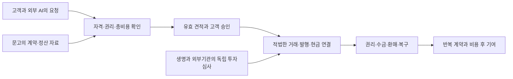

# 교보증권 미래전략팀 사업안: 반복 발행·권리 관리·고객 자금의 연결

작성·선택 자료 확인: **2026-11-03 KST**. [기존 교보 전략](13_kyobo_future_strategy.md)의 STR-KY-01~05를 구체화한 연구 제안이다. 회사의 확정 계획·현행 팀 소관·예산 승인·고객 실험 결과가 아니다. 종투사·초대형 IB 확대는 실제 자본·지정·업무별 권한을 확인하면서 진행할 경로로 다룬다.

## 1. 미래전략팀이 선택할 사업

**교보가 투자할 대상은 고객의 자금조달·투자·거래를 끝내는 업무다.** 이를 위해 기존 거래 고객의 자금·증거금 서비스를 개선하고, 반복 발행인의 권리·정산·투자자 대응을 맡으며, 기관이 상품과 현금을 연결하는 서비스를 검토한다. 그룹의 IP·해외 제휴는 이 업무에 필요한 자산·고객·실행 경로를 제공할 수 있는지 따로 심사한다.

AI로 상품 비교와 조합이 쉬워지면 설명만 제공하는 서비스의 가격은 내려갈 수 있다. 원권리 확인, 실제 매수·매도와 지급, 자본 투입, 분쟁·회수 책임은 여전히 필요하다. 교보는 자기 화면을 방문하는 고객과 외부 AI를 통해 들어오는 고객 모두에게 이 기능을 제공할 후보가 된다. 이는 조건부 경쟁 가설이며 현재 확보한 유료 고객 수를 뜻하지 않는다.

| 투자 묶음 | 고객이 맡길 업무 | 수익·방어 경로 | 자본과 운영의 선택 |
|---|---|---|---|
| 거래·기관 고객의 자금과 상품 연결 | 필요한 시간에 거래 가능한 돈·증거금·환매·출금 상태 확인 | 반복 거래·적법한 판매·중개·기관 서비스 보수 | 기존 은행/API 개선을 기준선으로 삼고 새 레일은 추가 편익이 있을 때 연결 |
| 반복 발행과 사후관리 | 자금조달 준비→실사→구조·투자자 연결→수금·분배→재발행 | 발행인 주선·자문·계약상 관리 보수, 실제 중개 대가 | 원칙적으로 주선·배분과 자기 인수·보증을 별도 심사 |
| 선별한 그룹·해외 RWA | IP 권리자 또는 해외 발행인이 보유한 현금흐름을 적격 투자자에게 연결 | 역할별 서비스 보수 또는 자기 투자 성과 | 권리·현금·매수 수요를 확인한 자산만 제한적으로 검토 |

도식은 필요한 권한·동의·계약이 성립한 미래의 업무 제안이다. 계열 간 자동 자금 이동이나 현재 가동 서비스를 뜻하지 않는다.

앞의 두 묶음에서 재사용할 계약·권리·현금·고객 자격 데이터와 운영 능력을 먼저 만든다. 세 번째 묶음의 지분 투자·자체 플랫폼·신규 인력 확대는 실제 자산 공급, 유료 계약, 반복 운영이 무엇을 추가하는지 입증할 때 별도 결정한다. 예산과 목표 매출은 내부 기준선이 없어 정하지 않았다.

## 2. 종투사·초대형 IB 확장은 자본과 업무를 함께 설계한다

기존 보고서의 반기 회계상 자본, 10월 RCPS 발행 결정, 금융위 지정 자료는 서로 다른 증거다. 자본 확충 발표→납입→회계·감독상 인정→지정→개별 업무→실제 고객 수요를 같은 사건으로 합치지 않는다. 증권사의 투자은행 기능이 은행 면허나 일반 예금수취 권한을 뜻하는 것도 아니다.

| 확대 단계 | 사업안에서 얻을 수 있는 선택권 | 미래전략팀의 확인 과제 |
|---|---|---|
| 현재 확인된 업무권한과 자본 | 기존 중개·주선·자문·투자·기관 영업의 생산성과 관계 개선 | 부문별 실제 권한, 거래·발행 고객, 자본·유동성 사용과 비용 |
| 종투사 지정과 해당 업무요건 충족 | 허용되는 기업금융·신용공여 등 범위를 활용한 조달 구조 설계 | 자본 인정·지정·한도와 실제 기업신용·인수 수요. 토큰 발행량으로 자본요건 대체 불가 |
| 초대형 IB 및 별도 조달업무 요건 충족 | 조달원의 확대를 장기적인 기업금융·상품 공급과 연결할 가능성 | 발행어음 등 실제 인가, 만기·운용제약·차환·유동성·손실흡수력 |
| 더 높은 자본과 IMA 등 추가 업무요건 충족 | 다른 조달·운용 계약을 검토할 선택권 | 원금 지급 의무·수익배분·운용 범위·손실·판매 책임을 상품별로 확인 |

자본·인가 판단의 현재 증거는 다음과 같다. 원문 수치·기간·경과조치는 [자본과 업무권한 부록](21_kyobo_capital_and_permissions.md)에서 확인할 수 있다.

| 확인 대상 | 11월 3일 선택 자료에서 확인한 상태 | 사업 판단 |
|---|---|---|
| 6월 말 별도 회계상 자본 | 약 2.2406조원이라는 역사적 공시 | 11월 현재 감독 인정자본으로 대체하지 않음 |
| 10월 22일 RCPS | 약 1,000억·2,000억원 발행 결정, 10월 30일 납입 예정 | 실제 납입 완료·회계분류·지정 자본 인정은 미확인 |
| 종투사·초대형 IB·IMA 경로 | 일반적으로 3조·4조·8조 단계와 기간·업무·심사 조건 존재 | 교보의 최신 지정·인가·상품 가동을 완결 확인하지 못함; 부재로 단정하지 않음 |

현행 선택 시행령에는 최근 2개 결산일 연속 자본요건, 상위 단계에 앞 단계 업무의 2년 영위 요건이 있다. 다만 2025년 11월 25일 전 신청자 등에 경과조치가 있으므로 **교보 신청일·적용규정 없이 최단 지정연도를 계산하지 않는다.** 4조 단계 지정과 단기금융업 인가도 구분한다. 단기금융 조달의 200%와 IMA·단기금융 합계의 300% 한도를 더해 500%로 해석하지 않는다. [시행령](../sources/cards/KYX-A-001.md) · [업무·조달 조건](../sources/cards/KYX-A-002.md)

2027년에는 이미 규정된 모험자본 공급 비율·부동산 운용한도의 경과 변화도 고려해야 한다. 신용위험과 상환 재원이 맞는 자산을 확보하기 전에 조달부터 늘리는 전략은 피한다. IP·토큰이라는 이름 자체가 적격 기업금융 자산이나 모험자본 인정을 보장하지 않는다. [금융투자업규정과 적용 범위](../sources/cards/KYX-A-003.md)

**새 조달원이 생겨도 IP 재고를 무조건 보유할 이유는 없다.** 주선 수수료를 받는 사업, 자기자금으로 먼저 사서 배분하는 사업, 유동성을 약정하는 사업은 서로 다른 손익·자본 사업이다. 미매각 물량을 계열사나 개인 고객에게 넘겨 인수 실적을 만드는 방식은 고객 수요의 검증이 아니다.

그룹 자금 협업에는 추가 제약도 있다. 선택 확인한 자본시장법 제77조의3 제9항은 종투사의 계열회사 기업신용공여와 계열법인이 운용하는 일반 사모집합투자기구에 대한 전담중개업무를 제한한다. 별도 예외·거래 정의를 확인해야 하므로 **문고의 권리를 주선·관리하는 업무와 문고·계열 구조에 직접 신용을 제공하는 업무를 구분한다.** SPV나 토큰 형태를 덧붙였다는 이유로 거래의 실질이나 제한이 사라졌다고 보지 않는다. [법 조문과 선택 확인 범위](../sources/cards/KYX-A-004.md)

각 투자안은 `유료 업무 / 자기 인수·재고 / 보증·유동성 약정 / 제휴 지분 / 공통 시스템`을 구분한다. 자기 인수는 매각 지연·금리·가격·집중·회수 시나리오와 스트레스 자금이 필요하다. 지분 투자는 얻는 계약권·기술권·정보권을 확인하고, 상대 기업의 상품 거래액을 교보의 매출로 잡지 않는다. RCPS의 조건부 우선배당과 회사 상환권·차환 부담은 모든 프로젝트에 같은 확정 이자율을 적용하는 대신 자본계획 전체에서 고려한다. [기존 자본·실적 근거](13_kyobo_future_strategy.md)

## 3. 다섯 고객 업무를 실제 계약으로 만든다

| 업무 | 한 건의 시작과 완료 | 계약상 지급자·대가 후보 | 확대를 가르는 관측 |
|---|---|---|---|
| 거래 고객 자금·증거금 | 거래 전 자금 준비→지원 통화 입금→거래 가능액→증거금 변화→출금·오류 해결 | 고객의 기존 중개 보수, 별도 편익이 확인된 기관 운영 계약 | 자금 문제로 인한 실패·이탈 감소와 고객별 순기여. 거래량 증가만 세지 않음 |
| 반복 발행 IB | 발행인 자료·권리 확인→조건 제시→매수자 확보→발행→정산·공시→재발행 | 발행인의 자문·주선·인수 대가, 허용되는 별도 사후업무 계약 | 재발행과 정시 수금, 실사 재사용 뒤 총비용, 미매각·보증 위험 |
| 기관 자금·상품 관리 | 기관의 만기·통화·지급 의무→적격 상품 비교→매수→환매·현금 도착 | 판매·중개 계약 또는 기관이 별도로 구매하는 관리 업무 | 같은 통화·권리에서 실제 현금 가용성·총비용·반복 사용 |
| IP 정산채권 후보 | 권리자·유통계약·정산 이력→양도 가능 청구권→수금 통제→기관 수요→배분·분쟁·회수 | 권리자/발행인의 구조화·모집, 계약상 관리 대가 | 순현금흐름·양도·대항요건·독립 평가·실제 매수 수요 |
| 국경간 자산·레일 | 적격 해외 발행인/고객→현지와 한국 역할→수탁·외환·결제→회수 | 확인된 투자 성과와 실제 서비스 계약의 보수를 분리 | MOU를 넘어선 역할·가격·책임·반복 고객·최종 현금 |

가격은 실제 구매하는 업무를 기준으로 정한다. 발행액 비례, 거래별 보수, 기간별 사후관리 계약은 가능한 가격 구조의 후보다. 모두 허용되는 보수·자격·계약과 고객 지불 의사를 확인해야 한다. 원장에 기록했다는 사실만으로 과금하거나 기존 수수료의 이름을 바꾸어 신규 매출로 표시하지 않는다.

10월 1일 하위법규 예고는 전자등록용 분산원장 이용의 직접 대가 제한과 발행인의 직접 계좌관리 경로를 포함한다. **11월 3일에는 예고기간 중인 내용**이며 최종 규칙으로 취급하지 않는다. 이 조건이 유지되는 미래에는 노드 보상보다 실사·구조화·모집·정산 검증·예외 처리의 실제 구매 가치가 중요하다. 제한된 기록 대가를 관리비로 이름만 바꾸는 방식은 사업안에 포함하지 않는다. [금융위 원문 FIN-008](https://www.fsc.go.kr/no010101/87838?srchEndDt=+)

## 4. 생명·문고와의 협업은 역할별 계약으로 연결한다

교보문고의 IP·출판 사업은 자산 발굴과 산업 이해의 기반이다. 서점 판매권, 저작권, 2차적 이용권, 에이전시 수수료, 특정 기간 정산채권을 구분해야 한다. 제안의 첫 후보는 **이미 계약과 정산 이력이 있고, 분리·양도·회수 가능한 특정 청구권**이다. 작품의 인지도나 전체 판매액이 담보가 되는 것은 아니다.

문고는 보유한 권리·정산 자료에 대해 적법한 접근을 제공하는 후보, 증권은 실사·구조화·판매·사후관리의 수행 후보다. 생명은 별도 자산운용 기준에 맞을 경우 검토할 수 있는 기관투자자다. 보험부채·ALM·자본 부담·계열 거래 조건이 맞아야 하며 자동 매입자나 투자자 손실의 보증자가 아니다. 그룹 내부 이전 보수는 연결 기준에서 제거하고 각 법인의 책임과 비용을 따로 본다.

문고 이용자의 취향·독서 이력이나 생명의 보험정보를 증권 투자성향으로 자동 변환하지 않는다. 저자·출판사에는 조달·정산 업무 접점을, 기관투자자에는 권리·현금·공시 접점을 먼저 설계한다. 개인 대상 유통은 적합성·설명·가격·손실·환금성을 검증한 별도 결정이다. [기존 문고·생명 근거](13_kyobo_future_strategy.md) · [그룹 RWA 거래 설계](19_kyobo_group_rwa_deal_design.md)

교보의 신뢰는 사후에 점검할 수 있어야 한다. 권리 누락률, 정산과 입금의 불일치, 제때 분배한 비율, 분쟁 대응, 회수와 민원, 독립 평가 결과를 남긴다. 높은 판매량이 이 지표를 대신하지 않는다.

## 5. USDC·USDT는 고객 업무에 필요한 경로별로 고른다

기존 작업의 SBI·Circle 행사, NOBLX 투자, DCG MOU는 의미 있는 탐색 경로다. 그러나 투자자·제휴 상대방과 고객 입출금 서비스의 계약 당사자는 다르다. 교보증권의 직접 발행자 상환권·지원 체인·적격 고객·은행 연결·고객 가격은 개별로 확인해야 한다.

비교는 `고객 자금 → 허용된 은행/지갑 → 전환·상환 상대방 → 증권계좌에서 쓸 달러 → 거래·증거금 → 출금`의 끝까지 한다. 기존 은행·외환 경로도 같은 고객·금액·시각에서 비교한다. 토큰 입금 확정과 증거금 인정은 다르며, 전환사업자 수수료를 교보가 받는 보수로 계산하지 않는다.

USDC와 USDT를 하나의 범용 달러로 묶지 않는다. 발행자·법인·체인·직접 상환 자격·시장 매각·은행 수취·동결·재전송·수수료를 구분한다. 고객이 보유한 토큰을 쓸 수 있게 해 얻는 중개 관계와 레일 자체 수익, 발행사 준비금 수익은 별개다. 어느 레일이 더 널리 쓰인다는 이유만으로 교보의 채택을 확정하지 않는다. [레일·AI 고객접점 상세](20_kyobo_rails_agent_business.md)

| 조사할 국가·관계 | 기존 공식 발표에서 복원한 연결 | 이번 사업에서 확인할 실제 계약 |
|---|---|---|
| 한국 | 교보증권의 중개·IB와 생명·문고의 개별 기능 | 원권리·투자자·인가·정산·법인별 보수 |
| 일본 | SBI 그룹과의 자본·사업 협력 관계 | 자산 발굴·투자자 소개·기술 조달 중 누가 무엇을 제공하는가 |
| 싱가포르 | SBI Ven Capital 운용 펀드, NOBLX에서 SBIDM의 구조화·결제·유동성 역할 | 펀드 투자와 교보의 서비스 수행·보수 수취를 분리 |
| 태국 | NOBLX의 Token X와 교보생명·증권 기관투자 참여 발표 | 투자 권리·현지 판매·수금·회수와 별도 유통 계약 |
| 미국 | Circle의 상품·계약과 IBKR의 비교 사례 | 고객 관할·상환 자격·전환·수취 계좌. 교보 현지 영업 증거로 쓰지 않음 |

DCG 파트너의 홍콩·아부다비 거점을 교보증권의 직접 진출·인가로 취급하지 않는다. 국가를 넓히는 기준은 실제 발행인·자산·투자자·수탁·현금 경로다. [기업·국가 지도](07_company_geography.md) · [NOBLX](../sources/cards/KYO-GEO-003.md) · [SBI 펀드](../sources/cards/KYO-GEO-007.md) · [DCG](../sources/cards/KYO-GEO-004.md)

## 6. AI 시대의 고객접점은 질문에서 사후관리까지 이어진다

고객은 교보 앱이나 외부 AI를 통해 “언제 어떤 통화로 쓸 돈이 필요한가”, “어떤 위험과 손실을 감당할 수 있는가”를 전달한다. 교보는 비교 가능한 정보뿐 아니라 실제 처리 가능한 조건과 책임을 제시해야 한다. AI에게 선택받는다는 것은 검색 노출만 늘리는 일이 아니다.

비교 사례인 IBKR의 11월 3일 공식 안내에는 승인형 지시와 제한된 자금 구획을 이용하는 자동 거래 구조가 함께 나타난다. 별도 AI 연결료를 받지 않는다는 안내는 **연결 자체의 구독료만으로 사업성을 잡기 어렵다**는 경쟁 가설을 뒷받침한다. 계좌·상품·관할 제한과 문서 간 상태 차이가 있어 모든 고객의 현재 이용 가능성을 확정하지 않으며, 국내 교보의 허용·운영으로 대입하지 않는다. [IBKR 현재 안내](https://www.interactivebrokers.com/en/trading/ai-integrations.php) · [거래 약관](https://ndcdyn.interactivebrokers.com/Universal/servlet/Registration_v2.formSampleView?formdb=4923&preferredFormat=html) · [확인 범위와 사업 해석](20_kyobo_rails_agent_business.md)

| 접점 | 고객·AI에 제공할 것 | 교보가 검증·책임질 것 |
|---|---|---|
| 적격 상품 탐색 | 원권리·발행인·통화·만기·비용·평가 시각·환매·유통 제한 | 확인한 원문과 미확인 항목, 고객·관할별 적격성 |
| 비교·견적 | 고객 의무에 맞는 총비용·현금 도착·위험·실행 가능 수량 | 표시 가격과 유효 견적 구분, 유동성·재고·이해상충 |
| 승인·실행 | 고객이 승인한 상품·금액·상대·기간과 진행 상태 | 법적 권한·한도·중복 지시·가격 변경·취소 가능 범위 |
| 보유·수금·환매 | 계약 변경·분배·담보·환매·은행 수취 상태 | 원장·명부·권리·현금 대사, 책임 있는 정정·복구 |
| 재조달·재투자 | 다음 의무와 만기, 기존 계약 재사용 가능성 | 적합성 재검토, 새 계약과 기존 계약의 연결·종료 |

고객 자격 확인 전 공개 가능한 상품정보와 계좌·자산·주문정보를 분리한다. 조회·추천·주문·출금·담보·신용 권한도 나눈다. 실제 계산·승인 규칙이 수량·한도·잔액·수수료를 검사하고, AI는 원문 정리·대안·설명·예외 분류를 보조한다. 현재 금융위 설명의 보조수단성·임직원 책임 원칙과 미래 위임 확대 가정을 혼합하지 않는다. [금융위 AI 설명 ST-KY-009](https://www.fsc.go.kr/no010101/87142)

AI가 같은 기초자산을 여러 상품으로 조합해도 자산의 현금흐름은 늘어나지 않는다. 원권리 ID, 법적 청구권의 층위, 지급자, 기간, 담보·양도·우선순위, 보유 수량을 따라 중복 노출을 찾아야 한다. 선후순위·합성 노출 등 다른 권리를 단순 복제와 구분하며, 상품 수를 분산투자의 증거로 쓰지 않는다. 이 구조를 잘 설명하고 관리하는 능력은 경쟁력 후보이나, 정보 표준화가 교보의 독점성을 줄이는 반대 경로도 있다.

이는 **같은 자산·현금흐름을 고정한 비교**다. 조달 비용이 낮아져 새 제작·설비 투자가 생기면 미래 실물 공급은 늘 수 있지만, 그때는 새 사업의 성공·상환 위험을 별도로 인수한 것이다. AI가 콘텐츠 생산·추천도 바꾸는 미래에는 작품별 매출 감소·경쟁·정산 조건 변화가 생길 수 있다. 과거 베스트셀러의 현금흐름이 유지된다는 가정과 신규 흥행위험을 기존 정산채권의 확실성에 섞지 않는다.

## 7. 사업별 기여와 회사 전체 자본을 대사한다

`증분 사업 기여 = Δ계약상 서비스 순수입 + Δ중개·판매 순기여 + Δ자기자금 투자·인수 기여 − Δ공통·지원·준법·운영비 − Δ아직 반영하지 않은 기대손실·경제적 자본비용`

순수입·순기여는 각각의 외부 배분·조달·헤지·결제·사후관리 비용 포함 범위를 먼저 정한다. 이미 항목 안에서 뺀 비용·손실은 다시 빼지 않는다. 서비스 부문의 고객 유지 효과는 실제 발생한 중개 기여와 같은 거래에 중복 가산하지 않는다. 직원 시간을 절약한 것과 실제 지출 감소·추가 유료 업무를 구분한다. 자기 인수의 매각대금에서 원금을 제외하고, 재고 평가·실현 회수·조달 비용을 같은 기간으로 맞춘다.

자본 효율은 기간 손익과 같은 기간의 평균 또는 사전에 정한 배분자본을 비교한다. 경제적 자본비용을 이미 차감한 기여에 다시 요구수익률을 중복 적용하지 않는다. **수수료 중심 사업은 자본·보증·유동성 부담이 작다는 것을 실제로 확인해야 하며, 자본을 덜 쓴다는 이름만으로 위험이 없는 것은 아니다.**

고객에게도 별도 계산이 필요하다. 낮은 표면 수수료가 더 긴 현금 대기·낮은 매각가격·새 수탁 위험을 동반하면 편익이 아닐 수 있다. 고객이 비용을 아끼더라도 경쟁사가 보수를 더 낮추면 교보 이익은 늘지 않을 수 있다. 현재 고객별 가격·원가·손실·활성 이용·개발비를 확보하지 않았으므로 매출·ROI·손익분기 건수·예산은 미확인이다.

## 8. 경쟁 대응과 미래전략팀의 투자 선택

| 경쟁 경로 | 교보의 대응 후보 | 판단을 바꿀 관측 |
|---|---|---|
| 대형 IB가 낮은 가격·큰 인수 한도를 제시 | 특정 발행인의 실사·정산·회수를 반복 수행하고 필요하면 공동 인수·배분 | 반복 고객의 기여, 자본 점유·미매각·회수 손실 |
| 플랫폼·AI가 상품 비교를 무료 제공 | 외부 채널에서도 유효한 견적·실행·보유 관리 제공 | 채널별 고객 획득비·배분 보수·순기여·고객 이전권 |
| 발행인·IP 권리자가 직접 유통 | 투자자 적격성·실사·사후관리 등 실제 구매하는 업무에 집중 | 지급자가 서명한 유료 계약과 재발행 |
| 글로벌 브로커가 토큰 입출금 제공 | 국내 허용 범위에서 은행 경로 개선과 레일 연결을 비교 | 고객 사용 가능 자금 시각·총비용·오입금 복구·유지 |
| 표준화된 권리 정보가 누구에게나 제공 | 독점 정보보다 정확성·실행 가능성·책임·현장 심사 품질 강화 | 오류·분쟁·재검토 비용과 비교 서비스의 실제 선택 |

공통 원문·권리·현금 데이터와 통제 기준은 내부에 축적할 후보이고, 체인·수탁·전환·분석 도구는 구매·제휴·공동 기반을 함께 비교한다. 사업 운영자와 공급자 변경권, 데이터 이관, 장애 시 대체 경로, 계약 종료 후 고객자산 반환까지 정한다. 지분 투자와 서비스 구매를 한 계약으로 묶어 비용·대안을 감추지 않는다.

## 9. 90일 안에 만들 의사결정 자료

| 기간 | 산출물 | 책임 기능 후보 | 다음 단계 조건 |
|---|---|---|---|
| 1~30일 | 자본·인가 증거표, 기존 거래고객 불편 한 건, 반복 발행인/기관 수요 한 건, IP 권리·정산 자료 확보 가능성 | 미래전략 총괄, 재무·해외상품·IB·기관영업·법무·그룹 계약 담당 | 실제 자료·고객·권한과 미확인이 구분됨 |
| 31~60일 | 동일 업무 A현행/B현행+AI/C온체인/D온체인+AI 비교, 견적·오류·권리·현금·복구 자료 | 사업부·운영·IT·보안·리스크·준법 | 전체 업무의 편익과 위험·사람 검토비용을 비교 가능 |
| 61~90일 | 유료 또는 기존업무 개선의 제한 운영 후보 심사, 역할·보수·책임 계약, 확대/중단안 | 사업 책임자·독립 리스크·소비자보호·재무·투자심사 | 실제 허용·계약·고객 동의와 비용 후 기여 조건 충족 |

기간은 제안이며 공식 일정이 아니다. 미래전략팀은 포트폴리오 우선순위·자본 배분·협업 계약·검증 기준을 묶되, 투자심사·고객 권유·외환·수탁·회수 책임을 모두 대신하지 않는다. 현재 조직 소관과 인원은 별도 확인한다.

2027년 초에는 기존 권한으로 가능한 업무를 개선하면서 토큰증권 법 시행·최종 하위규정·개별 권한을 확인한다. 이후 허용과 실제 고객 수요가 성립하면 IP·기관자금·해외 레일을 넓힌다. 자본 확대, 토큰증권 제도, 스테이블코인 영업, AI 위임은 서로 독립된 관문이므로 하나가 성립했다고 다른 조건을 채우지 않는다.

9월 4일 정책 방향의 첫 단계는 기관전용 사모 MMF·사채, 신탁 방식 비상장주식, 공모 조각투자증권의 토큰화다. 공모 정형증권 확대와 스테이블코인 결제 연결은 후속 단계이며 이행 시점이 가변적이다. **따라서 2027년 상품 발행을 USDC·USDT 결제 개방과 묶어 가정할 필요가 없다.** 기존 은행현금으로 발행·수금·사후관리 가치를 먼저 검증하고, 이후 필요한 고객에게 새 레일의 추가 편익을 따로 평가한다. 정책 방향·후속 규칙·실제 인프라 준비는 각각 확인한다. [금융위 정책 방향 FIN-007](https://www.fsc.go.kr/no010101/87650)

확대는 반복 수요·정시 수금·고객 총편익·비용 후 기여·복구 능력으로 판단한다. 권리 입증 실패·무권한 실행·고객자산 혼용은 해당 실행을 멈출 조건이다. 낮은 지불 의사·경쟁 보수 압축·기존+AI 대비 편익 부족은 가격·고객군·온체인 투자 범위를 바꿀 조건이다. [구조화된 사업안](../data/kyobo_strategy_business_plan.json)

## 2026-11-04 Ondo 원문과 기능별 비교 보완
