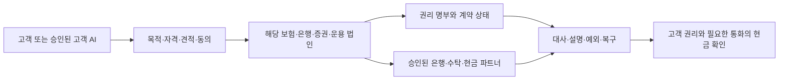

# 한화생명 블록체인팀은 현지 고객 업무와 그룹의 금융 기능을 연결해야 한다

**2026-11-03 기준 공개자료 사업안 · 2027년 초 준비와 이후 조건부 확대**

이번 제안의 중심은 **인도네시아에서는 보장·납입·청구의 품질을, UAE·미국에서는 기관의 자산 접근·거래 후 처리·현금화의 품질을 높이는 것**이다. 한화생명 블록체인팀은 이 과정에서 고객 문제, 계약상 권리, 현금 흐름, 각 회사의 책임과 보수를 연결하는 역할을 맡을 수 있다. 이는 연구상 기획 관점이며 실제 팀의 전결권·업무분장 확인은 아니다.

기존 조사에서 판단을 더 구체화한 세 가지가 있다. **Nobu 방카슈랑스는 이미 공개된 제휴·상품이 있어 신규 판매망 구축보다 적합한 보장과 유지·청구 경험을 검증할 단계다. UAE에는 협약뿐 아니라 현지 법인과 11월2일 ETF 교차상장이라는 더 진행된 활동이 있다. AI 역시 미래 구상만이 아니라 현재 보험 심사·서류 자동화 위에서 다음 고객 업무를 설계할 수 있다.** 각각의 출시·운영 안내가 고객 성과나 비용 후 이익까지 증명하는 것은 아니다.

읽는 순서는 이 사업안→[인도네시아 상세](23_hanwha_indonesia_business.md)→[미국·UAE·레일](24_hanwha_us_uae_rails.md)→[AI·그룹·경쟁](26_hanwha_ai_group_competition.md)이다. [세 그룹 기회 발굴](25_group_country_opportunity_discovery.md)은 같은 방식을 BNK와 교보까지 확장한다.

## 1. 국가마다 다른 고객 문제를 출발점으로 삼는다

| 시장·고객 | 확인한 기반 | 해결할 문제와 사업 가설 | 현재 단계에서 넘지 않을 경계 |
|---|---|---|---|
| 인도네시아 가계·소기업 | 현지 생명과 Nobu의 방카슈랑스 제휴·공개 상품, 은행의 IDR 계좌 접점 | 기존 보장 확인→납입 여력→이해 가능한 견적→유지·청구·보상 | 젊은 인구·금융포용률은 보험 미가입자 수나 실제 고객 수가 아님. 스테이블코인 보험료 지급을 기본 경로로 두지 않음 |
| UAE 현지 기관·가족자산 운용 주체 등 | 생명–ADIO, 운용–ADGM·하나 협약, 운용 MENA 법인 소개, KDEF·KMCA ADX 거래 개시 | 현지 통화·계좌·시간에 맞는 자산 접근과 상품 설명·유통·사후관리 | 전통 ETF 교차상장을 토큰 ETF로 표시하지 않음. 투자자 수요·순유입·한화 수취 요율은 별도 |
| 미국 기관·브로커 | Velocity 인수와 확인된 청산·수탁·증권금융 기능, 별도 기술 투자 | 고객·상품 범위에 맞는 계좌 자금·거래 후 상태·복구 연결 | 모든 RWA의 자체청산, 직접 USDC·USDT 계약, 해외 개인에 대한 포괄 판매권은 미확인 |
| 한국 보험 고객·금융계열 | 보험 심사·서류 자동화, 목적 중심 고객서비스, 증권·운용의 투자·사업 신호 | 보장·자산·지급 의무를 정확히 설명하고 승인된 일을 완료 | 보험계정·고객재산·회사 조달·투자지분·결제대금을 분리 |
| 한화 산업계열과 외부 투자자 | Qcells의 에너지 사업과 Microsoft 신규 전력·VPP 협력 탐색 | 실계약이 확보된 산업 현금흐름의 검증·조달·관리 후보 | 기술 제휴·예상 발전량은 확정채권이 아니며 금융계열 투자 의무가 없음 |

첫 세 시장의 원문·정확한 날짜·단계·한계는 보고서23·24에 있다. 산업계열 후보는 [Qcells 공식 발표 HWX-R-006](https://us.qcells.com/blog/qcells-expands-alliance-with-microsoft-to-explore-new-approach-for-adding-energy-capacity-alongside-ai-infrastructure/)에서 도출한 연구 가설이다. 다른 지역은 기존 관계의 존재만으로 동일한 사업성을 부여하지 않는다.

## 2. 그룹 연결은 서비스 계약과 손익으로 완성해야 한다

한화그룹이라는 분석 범위는 ‘한 회사가 모든 업무를 수행한다’는 뜻이 아니다. 한화생명, 각국 보험법인, Nobu, 한화투자증권·해외 법인, 한화자산운용·현지 법인, Velocity, 기술 피투자사, 산업계열은 자본·인가·고객·계약·손익이 다르다. 금융복합기업집단 감독도 내부거래·위험집중·전이를 살피도록 요구한다. [금융위 HWX-R-008](https://www.fsc.go.kr/po010105/87336)

| 기능 후보 | 고객에게 책임질 주체 | 대가를 받는 경로 | 그룹 기획이 확인할 것 |
|---|---|---|---|
| 현지 보험 보장·인수·보험금 | 해당 인도네시아 보험회사 | 보험 위험 인수 후 성과. 보험료 전액을 이익으로 세지 않음 | 판매 승인, 보장·면책·청구, 재보험·자본, 현지 책임 |
| 예금·수납·지급·방카 유통 | Nobu와 실제 판매·은행 계약 주체 | 적법한 판매 보수, 은행 서비스·금융 기여 | 계약상 보수·환수, 잔액과 조달가치, 동의·민원 |
| 구조화·판매·집행 | 허용된 증권·현지 판매 법인 | 발행인·투자자·기관 계약의 주선·유통·집행 보수 | 판매국·투자자 자격·독립 가격·적합성 |
| 펀드·상품 관리 | 실제 adviser·운용사·sponsor·수탁자 | 각 계약의 운용·라이선스·관리 보수 | 총보수를 모두 한화 수입으로 귀속시키지 않음 |
| 청산·수탁·증권금융 | Velocity와 계약된 파트너 | 기관 고객의 청산·보관·금융 보수 | 지원 상품, 직접청산·중개·타사 의존, 고객재산·담보·복구 |
| 지갑·체인·가격·메시지 | 실제 기술 계약 법인 | 기술회사의 계약 수입, 투자자에는 지분 성과 가능성 | 지분 소유≠무료 서비스·독점·배당·규제 권한 |
| 산업 자산 공급·운영 | 해당 산업회사·프로젝트 법인 | 에너지·제조 계약 수입과 금융 조달 비용 | 지급채무자·양도·담보·계량·회수·내부거래·집중 |

블록체인팀의 산출물은 공통 시스템 구축안만이 아니라 **고객 한 건의 계약·현금·상태·책임표와, 외부 업체를 포함한 비교 견적**이어야 한다. 생명 자산의 투자 결정과 고객 보험금 지급 책임을 신사업 프로젝트에 자동으로 넘기지 않는다.

## 3. 제안할 사업 묶음과 투자 순서

아래 순서는 실행 예산이나 회사의 확정 순위가 아닌 연구 제안이다. 기존 STR-HW-01~04의 판단을 유지하면서 사업 단위를 세분화했다. [구조화 사업 원장](../data/hanwha_blockchain_business_plan.json)에 확인 사실과 미확인 수치를 함께 둔다.

### HW-BIZ-01 — Nobu 고객의 보장·유지·청구를 연결한다

**고객 접점:** Nobu의 허용된 채널이나 현지 보험사의 상담에서 기존 보장을 확인한다. AI는 고객이 승인한 정보로 공백·면책·납입 부담을 설명하고 필요한 서류를 준비한다. 보험사는 인수·보장 책임을 지며, 고객은 최종 조건과 자동납부 범위를 승인한다. 보험료·환급·보험금은 적법한 IDR 은행 경로로 확인한다. 청구할 때 고객이 여러 기관에 같은 서류를 반복 제출하는 문제를 우선 시험한다.

**왜 돈이 생길 수 있는가:** Nobu는 계약상 유통 보수와 관계 기여, 보험사는 적합한 위험 인수 후 보험 성과를 얻을 수 있다. 납입 실패·서류 재요청·대사·민원 처리비를 줄이는 편익도 후보다. 다만 유지가 늘어도 인수 위험·보험금·사업비가 더 크면 이익이 늘지 않는다. 보험금 조기 지급은 고객 편익이지만 운용 가능 기간을 줄일 수 있으므로 양쪽 효과를 본다.

**온체인의 추가 역할:** 은행·보험·외부 증빙기관이 합의한 상태를 공유하고 중복 처리·분쟁을 줄일 때만 검토한다. 주민·건강 원문을 공개체인에 기록하거나 토큰 보유를 보험금 청구 조건으로 만들지 않는다. 기존 API와 서명된 감사기록으로 같은 효과가 나면 그 경로를 선택한다.

**현지에서 추가로 찾은 후보:** Nobu의 QRIS 가맹점 접점에서는 매출 수납·대사·운전자금 문제를, LGI의 기존 기업 건강보험에서는 고용주의 직원 보장·청구 문제를 볼 수 있다. 전자는 가맹점·차주가, 후자는 기업 보험계약자가 지급자 후보다. 개인 방카 고객과 같은 분모로 합치지 않는다. 일부 QRIS 거래의0% MDR은 결제량만 늘려 수수료 이익을 기대하기 어렵다는 경쟁 조건이다. 상세 상품·현지 규제·경쟁·가격표의 적용 구간은 보고서23에서 검토한다.

### HW-BIZ-02 — 미국 기관의 거래 후 업무와 현금 상태를 연결한다

**고객 접점:** 기관 운영 담당자 또는 승인된 AI가 상품·계좌별 거래 가능 상태, 담보·수수료·컷오프, 미결제·현금·예외를 확인한다. 실제 권한이 있는 법인이 주문·청산·수탁·자금 전환을 맡는다. ‘체인에서는 끝났지만 계좌에서 쓸 수 없는 상태’를 분리해 보여준다.

**수익 후보:** 기관의 실제 청산·보관·증권금융·운영 계약에 따른 수입. 단순 AI 연결료보다 해결한 사후처리·복구 업무에 대한 지급 의사를 먼저 확인한다. 새 경로가 기존 매출을 대체하는 부분과 파트너에게 지급하는 비용도 차감한다.

**선행 조건:** Velocity의 현재 지원 범위, 법인·고객 적격성, 최종 은행 입금, 수탁·담보·신용 약정을 한 업무로 고정한다. 일부 상품은 준비 중이거나 제3자 관계이므로 모든 토큰을 자체청산하는 그림으로 제시하지 않는다. USDT의 미국인·법인 제한도 계약 경로에서 검토한다.

### HW-BIZ-03 — UAE의 실제 유통 접점에서 토큰화의 추가 가치를 시험한다

**고객 접점:** 현지 투자자가 자국 계좌·통화로 접근할 수 있는 상품 설명, 적격성, 총비용, 유동성·주문·사후정보를 제공한다. 11월2일 ETF 거래 개시는 기존 증권 경로의 구체적 기준선이다. 그 기준선에서 토큰 표시가 어떤 고객에게 거래 시간·담보·배분·사후관리를 개선하는지 따로 비교한다.

**수익 후보:** 실제 운용·sponsor·지수·유통 계약에 따른 수입. KDEF 설명서상 adviser와 한화의 역할이 다르므로 표시된 펀드 총보수 전부를 한화 매출로 세지 않는다. ETF 거래대금·AUM 증가도 순유입·평가·환율·기존 상장분 이동으로 분해해야 한다.

**선행 조건:** MENA 법인의 개별 업무권한, 실제 판매자·투자자·수탁·시장조성·상환 구조. ADIO 협약, ADGM 법인·인가, ADX 상장, CBUAE 지급 규정을 같은 권한으로 합치지 않는다. 기관 고객이 전통 ETF를 충분히 편리하게 쓰면 토큰화는 보류할 수 있다.

### HW-BIZ-04 — 고객 AI가 이해하고 승인된 일을 끝낼 수 있게 한다

외부 AI에게 보여줄 것은 광고 문구보다 **유효한 상품 버전·자격·보장/면책·가격·세금/비용·취소 조건·현금화 시간·권한·민원 창구**다. 계약 설명과 견적 요청, 고객 승인, 실행 결과, 예외·철회·복구를 서로 다른 단계로 만든다. 보험 가입·면책 동의·건강정보 처리·송금은 각자 별도 권한이다.

수익은 금융상품·집행·운영의 실제 계약에서 검증한다. 기관용 감사·대사·서비스 도구에 별도 요금을 받을 가능성은 있지만 현재 가격·외부 고객은 미확인이다. 기존 보험금 청구권을 별도 AI 구독이나 계열상품 구매에 묶지 않는다. 한화 상품을 우선 추천하는 경제적 이해관계도 숨기지 않는다. 현재 한화의 자동화·경쟁사 사례와 시스템 책임은 보고서26에 있다.

### HW-BIZ-05 — 보험 ALM에는 지급 의무와 스트레스 현금을 먼저 적용한다

보험사의 내부 고객은 ALM·운용·리스크·지급 부서다. 토큰 펀드 수익률이 높다는 이유로 장기 부채 대응 자산을 단기 자산으로 바꾸면 듀레이션·헤지·자본 구조가 바뀐다. 비교는 같은 통화·만기·신용·부채 지급조건에서 한다. 시간·대사 비용이 줄어도 선자금·환매 지연·주말 은행 연결 때문에 현금 버퍼가 커질 수 있다.

첫 산출물은 자산별 장부가가 아니라 **보험금 지급일에 실제 사용할 수 있는 통화별 현금과 실패 시 대체 조달**이다. 매출 사업과 내부 비용 개선을 별도 표로 관리한다. 보험자산의 수익을 스테이블코인 발행자 준비금 운용 수익으로 이름만 바꾸지 않는다. 기존 STR-HW-04의 가설을 유지한다.

### HW-BIZ-06 — 산업계열의 계약 있는 현금흐름을 후순위로 발굴한다

에너지·설비의 현금흐름은 금융계열에 새로운 자산 후보를 줄 수 있다. 다만 그룹 내부 상품을 만드는 것이 목표는 아니다. 실제 지급의무·운영 실적·담보·양도·회수와 외부 투자자 가격을 확보한 뒤 기존 PF·리스·사모대출과 비교한다. 한화생명은 자동 매수자·보증자가 아니며, 고객·보험계정의 위험과 산업계열 자금 조달 목적을 혼동하지 않는다. 세 그룹에 적용할 발굴 방식과 Qcells 후보는 보고서25에 있다.

## 4. USDC·USDT는 하나의 버튼이 아니라 여러 계약의 연속이다

현재 조사에서 한화의 직접 Circle Mint·Tether 발행/상환·준비금 운용 계약은 확인되지 않았다. Kresus·Digital Asset 투자, Chainlink 채택, Velocity 인수, Nobu의 은행 가상계좌 연결은 각각 다른 증거다. **Bittime의 공식 배포문에는 Nobu IDR 가상계좌 입금과 Bittime의 IDR→USDT 교환 설명이 함께 있다.** 따라서 USDT와 관련된 고객 경로가 전혀 없다는 뜻도 아니다. 관측된 Nobu의 은행 접점과 Bittime의 교환 역할을 구분하고, Nobu의 직접 Tether 계약·발행·환매 권한으로 확대하지 않는다. 특정 토큰 지원 기술에 투자했다고 해당 토큰의 모든 지급·판매 권한을 갖는 것도 아니다.

| 구간 | 확인할 계약·상태 | 수입·비용 귀속 |
|---|---|---|
| 고객 은행돈→토큰 | 실제 고객과 사업자의 적격성, 발행/매입, 통화·체인, 수수료 | 발행자·거래상대·은행·기술사 각각의 계약 |
| 토큰 이전→상품 매수 | 증권 판매·투자자 자격·가격·동시 결제·권리 명부 | 운용·판매·집행·수탁 대가, 상품 위험 |
| 자산 보유·담보 | 원권리·평가·헤어컷·담보권·처분·중복 사용 | 적법한 관리·증권금융, 자금·자본 비용 |
| 매각 또는 환매→토큰 | 매수 상대 존재와 발행자 환매 의무 구분 | 스프레드·환매비·지연·가격 손실 |
| 토큰→필요 통화 은행현금 | 직접 환매 또는 시장 매도, FX, 컷오프·보류·한도·중단 | 환매·환전·은행·선자금 비용과 최종 지급 책임 |

USDC와 USDT의 선택은 브랜드 선호가 아니라 **법인·국가·고객·통화·금액·시간·적격 계약·복구 경로**로 정한다. 미국 법인에서 USDT를 기본값으로 두지 않고, 인도네시아 가계의 IDR 보험료를 곧바로 달러 토큰으로 바꾸지도 않는다. 합법적인 디지털자산 거래의 은행 연결과 일반 지급 허용은 다른 문제다. 상세 원문·제한·기존 거래 사례는 보고서24에 보존한다.

다음 그림은 제안 구조다. 각 화살표는 별도 계약·권한 확인이 필요한 관계이며 현재 한화의 단일 상용망을 나타내지 않는다.

## 5. 기존 방식·AI·온체인을 같은 업무로 비교한다

| 업무 | 기존 방식의 강점·문제 | 기존+AI의 변화 | 온체인+AI의 추가 편익 가설 | 추가 비용·실패 조건 |
|---|---|---|---|---|
| 보험 가입·유지·청구 | 기존 인가·계약·은행 지급, 반복 서류·설명·대사 부담 | 정보 검색·서류 구조화·납입 확인·설명 보조 | 여러 기관이 같은 상태를 합의할 때 중복 처리 감소 | 민감정보·오류·동의·정정·분쟁. 단일 기관 내부 작업이면 체인 편익 작음 |
| 기관 자산 접근·거래 후 관리 | 기존 상장·청산·수탁·은행망의 고객 기반 | 견적·조건·잔액·예외를 읽고 준비 | 허용된 권리 이동·조건부 결제·담보 관리 | 상계 상실·선자금·체인/은행 시간 불일치·법적 회수 |
| 보험 ALM | 부채·자산·헤지·현금 관리의 기존 체계 | 정보·스트레스·지급 예정의 탐색·설명 | 다기관 대사·자산 이동의 시간 단축 가능성 | 듀레이션·신용·유동성·규제자본 변화가 편익 상쇄 |
| 산업 현금흐름 금융 | 실제 계약·현장 심사·회수, 고정 실사비 | 계약 추출·정산 이상 탐지·운영 보조 | 공동 검증·권리 상태 공유 | 센서·오라클이 틀리거나 지급채무가 없으면 토큰도 부실 |

시험은 동일한 고객·권리·통화·금액·보장·위험 조건에서 수행한다. 초안 생성속도나 체인 확정시간이 아니라 **최종 고객 업무의 완료·현금·오류·사람 개입·총비용**으로 비교한다. AI 판단은 근거와 한계를 제시하고, 금액·한도·중복·권한 통제는 결정적인 규칙과 책임 있는 승인 절차로 확인한다.

## 6. 수익모델은 법인·고객·그룹을 나눠 평가한다

`증분 경제 기여 = 증분 외부 수입 + 실제 회피 가능한 기존 비용 − 추가 운영·기술·준법·파트너 비용 − 추가 조달·유동성·예상손실·자본 부담 − 기존사업 잠식`

이는 관리 판단 틀이며 회계상 순이익 산식은 아니다. 위험 비용을 이미 포함한 지표에 같은 손실·자본 비용을 또 빼지 않는다. 다음 네 가지는 필수 구분이다.

- **보험:** 수입보험료·보험수익·CSM·보험 성과·현금·이익은 서로 다르다. 판매 수수료가 늘어도 보험자와 은행 양쪽의 고객·준법·위험 비용을 본다.
- **은행·청산:** 예금·고객자산·거래량은 매출이 아니다. 잔액의 금융 기여와 실제 서비스 보수를 분리한다.
- **운용·ETF:** 총 AUM·총보수·한화 계약상 보수·순이익을 분리한다. 상장시장 간 이동을 전부 신규 자금으로 세지 않는다.
- **그룹:** 법인별 기여를 보고한 뒤 해당 연결범위 내부 거래를 제거한다. 모든 산업계열·지분법 피투자사를 한화생명 연결손익으로 합치지 않는다.

실제 계약 요율·고객 수·전환·유지·보험금·비용·예산이 없어 확정 매출·ROI를 제시하지 않는다. 대신 수익을 결정할 항목과 필요한 자료를 원장에 남긴다. 투자 예산도 임의 비중 배분 대신 **공통 정보·통제 → 기존 고객 업무의 작은 시험 → 유료 수요가 확인된 계약 연결 → 자본을 쓰는 확장** 순서로 검토한다.

## 7. 경쟁자의 대응까지 가정한다

인도네시아 기존 은행·보험 채널은 가격·보장·상담·청구 경험으로 대응할 수 있다. 글로벌 기관은 자체 은행·청산·수탁·운용 조합을 이미 갖고 있으며, ETF 접근성이 충분하면 새 토큰 경로를 원하지 않을 수 있다. AI 플랫폼은 비교를 무료화하고 유통 접점을 가져갈 수 있다. 상세 경쟁 사례와 적용 한계는 보고서23·26에 있다.

따라서 차별화 가설은 ‘AI나 블록체인을 보유한다’가 아니라 **해당 고객의 설명·납입·청구·권리·최종현금·복구를 더 잘 끝낸다**이다. 기술 공급자가 경쟁사에도 같은 기능을 제공하는 경우에도 이 차이가 유지되어야 한다. 자체 개발은 공통 벤더 구매·외부 금융조합과 비교하고, 계약 종료·데이터·키 반환·대체 공급자 전환을 가격에 포함한다.

중대 위험은 부적합 보험 판매, 데이터의 무단 공유, 고객 승인 초과·중복 실행, 권리/현금 불일치, 환매·FX·주말 지급 실패, 계열 집중, 수탁·키·벤더 의존이다. 이를 막는 통제 없이 단가 절감을 이익으로 계산하지 않는다. 위험을 보험으로 이전하는 제안도 실제 인수 법인·담보 범위·제외·면책·재보험·자본을 별도로 확인해야 한다.

## 8. 2027년 이후를 세 경로로 본다

| 경로 | 필요한 가정 | 고객·경쟁·보수 변화 | 지금 준비할 것 |
|---|---|---|---|
| 기본: 국가별 적용과 AI 보조가 진행 | 각국 현행 계약·인가·지급 통화 유지 | 기존 고객의 설명·서류·대사 단가 하락, 가격 경쟁 | 기존+AI 기준선·계약 조건·고객 이해·복구 |
| 강한 변화: 적법한 토큰 권리·현금·AI 위임이 연결 | 고객·상품·법인 권한, 유동성·데이터·책임이 실제 성립 | 고객 AI의 상품 비교·신규 선택이 쉬워짐. 비교 경쟁은 유통 보수와 유휴 잔액 가치를 압박할 수 있으나 기존 보험 변경에는 재심사·보장 상실·해지 손실이 남음. 실사·인수·유동성·서비스 책임의 대가가 중요 | 외부 AI도 읽을 유효 조건·권한·상태와 실패 복구, 법인별 가격·위험 |
| 반대: 분절·유동성 부족·전환 비용 우세 | 신규 수요·시장조성·회수 경로가 약함 | 기존 보험·ETF·은행/청산망이 더 유리 | 공통 정보·통제 개선은 유지, 체인·자체 발행 확장 보류 |

2027년 초를 모든 나라·업무의 동시 개방일로 놓지 않는다. [규제 원장](../data/regulatory_regimes_2027.json)의 11월2일 기준선에 이번 선택 재확인을 연결한다. 필요한 법과 레일이 모두 성립한 강한 미래에서도 고객 수요와 이익은 별도로 증명해야 한다. 같은 자산을 여러 상품으로 조합해도 독립된 기초 현금흐름이 자동으로 늘지는 않는다.

교수형 경제 검토의 결론은 조건부다. 기술이 줄이는 탐색·대사 비용보다 새 권한·준법·복구 비용이 작아야 하고, 절감액이 고객·플랫폼·상품 공급자 중 누구에게 귀속되는지 봐야 한다. 이 부분은 경제 메커니즘을 적용한 연구자 판단이며 특정 교수의 현재 견해를 대변하지 않는다.

## 9. 착수 후 90일의 제안과 판단을 바꿀 관측

| 단계 | 구체적인 결과물 | 확대·보류 판단 |
|---|---|---|
| 1–30일 | 인니 고객 한 유형, 기관 고객 한 업무를 선택. 실제 상품·동의·계약·현금·가격·담당 법인과 기존 기준선 확보 | 지급자·수요·적법한 종료조건이 없으면 제품 정의 수정 |
| 31–60일 | 승인된 자료의 읽기/그림자 시험. 기존+AI와 온체인 추가를 비교. 납입 실패·면책 설명·부정확 자료·중복·철회·은행 중단 시험 | 더 빠른 초안이 아니라 오류·사람 개입·최종현금·비용이 개선되는가 |
| 61–90일 | 필요한 인가·계약·동의가 갖춰진 경우에 한해 제한된 고객 시험을 제안. 외부 비교견적·책임·출구 계약·검증 결과를 검토 | 반복 유료 수요와 위험조정 기여가 확인된 업무만 확대 |

보험의 장기 유지율·손해율은90일로 검증 완료할 수 없다. 초기에는 이해·납입 실패·불완전판매·서류 재요청을 보고, 이후 성숙한 계약 코호트에서13개월 등 유지·청구·성과를 본다. 만기·보장·상품군이 다른 집단을 합쳐 효과를 추정하지 않는다. 이 연구에서는 고객 모집·거래 실행·보험 판매·파트너 접촉·스케줄 설정을 수행하지 않았다.

**이번에 남긴 의사결정:** 기존 방카슈랑스의 실제 고객 문제를 먼저 좁히고, UAE의 교차상장을 기존 증권 기준선으로 삼으며, 미국의 실제 기능 범위 안에서 기관 업무를 고른다. AI·온체인은 그 일을 더 잘 끝내는지 검증한다. 그룹 확장은 자산·고객을 무조건 합치는 계획이 아니라 각 법인의 권리·현금·책임을 연결하고 외부 대안과 비교하는 과정이다.

자료의 읽은 범위·출처별 활용·미확인·교차검토는 [이번 실행 기록](../runs/2026-11-03-hanwha-group-strategy.json), [자료 카드](../sources/README.md), [주장 원장](../data/claims.json)에 보존한다. 기존 공개 연구의 링크는 [연구 계보](03_prior_work.md)에서 이어간다.

## 2026-11-04 Ondo 원문과 기능별 비교 보완

[교수 원문 계보](27_professor_ondo_lineage.md)와 [BlackRock·Ondo 비교](28_blackrock_ondo_positions.md)를 [환경·경쟁 분석](29_tokenization_competition_group_strategy.md), [세 그룹 실제 사례·대응](30_group_position_responses.md)에 연결했다. 기존 판단의 출처를 소급 변경하지 않고, 새 비교와 후속 관측을 추가한다. 2027년 일괄 개방이나 그룹 전체의 단일 권한·손익을 가정하지 않는다.
