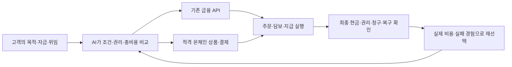

# AI가 고객의 돈을 배분할 때, 금융그룹에는 어떤 수익이 남는가

**2027년 이후 필요한 제도·권한·온체인 인프라·고객 위임이 갖춰졌다는 조건부 사례다. 작성·근거 확인 기준은 2026-11-04다.**

고객은 한 금융회사를 통째로 선택하는 대신, 자금 보관·투자상품·환전·차입·보험·사후관리를 서로 다른 공급자에게 맡길 수 있다. AI가 이를 계속 비교하면 BNK·교보·한화는 고객의 계좌를 유지하고도 기존 수익을 잃을 수 있다. 반대로 자산 전부를 내부에 보유하지 않아도 지급·신용·권리·청구·실행을 책임지는 업무에서 대가를 받을 수 있다. 어느 쪽이 되는지는 연결된 자산의 총액보다 **고객이 실제로 지불한 대가와 위험·비용을 차감한 기여**로 판별한다.

세 사례의 중심 선택은 다음과 같다. 이는 회사의 발표된 미래 계획이 아니라 기존 기반에서 출발한 연구 가설이다.

| 고객의 선택 장면 | 돈과 고객이 이동하는 곳 | 해당 그룹이 지킬 수 있는 수익과 잃을 수 있는 수익 |
|---|---|---|
| 지역 수출기업 AI가 원화 지급일을 지키면서 잉여 달러를 비교한다 | 운영계좌는 경남에 남고 잉여는 외부 펀드로, FX나 다음 차입은 다른 은행으로 갈 수 있음 | 지급·회수·FX·신용·관리의 기여 대 저원가 예금·환전마진·기존 대출의 잠식 |
| 투자자 AI가 같은 투자 목적의 상품·구현·현금화 비용을 비교한다 | 기초 운용자 잔액은 유지되면서 판매 창구·포장·실행 플랫폼이 바뀔 수 있음 | 교보의 실사·인수·발행·수금·집행 대가 대 고보수 상품·단순 중개·설명 보수 감소 |
| 인니 고객 AI가 보장 공백·납입 여력·청구 서비스를 비교한다 | Nobu를 계속 사용하면서 보험자는 외부를 고르거나, 한화 보험을 유지하면서 다른 지급 접점을 쓸 수 있음 | 적합한 보장과 청구·운영의 성과 대 은행 판매보수·기존 계약 유지 기여 감소 |

상세 이야기는 [BNK 수출기업](32_bnk_agent_customer_cash.md), [교보 투자·정산채권](33_kyobo_agent_assets_business.md), [한화 보장·글로벌 기관](34_hanwha_agent_insurance_global.md)에서 읽는다. 앞선 [BlackRock·Ondo 기능 비교](28_blackrock_ondo_positions.md)와 [환경 분석](29_tokenization_competition_group_strategy.md)의 다음 단계다.

## 1. 무엇이 갖춰졌고, 무엇은 여전히 비싸다고 가정하는가

선택한 고객·법인·상품·나라의 판매·중개·투자·지급·환전 행위가 적법하고, 고객의 위임과 데이터 접근이 유효하다고 둔다. 권리·소유·담보·가격·비용 정보를 비교할 수 있고, 주문과 현금 경로가 연결되며, 오류·취소·분쟁 처리 계약도 존재한다고 가정한다. 따라서 아래에서는 ‘아직 허용되지 않았다’는 이유로 이야기를 중단하지 않는다.

이 가정은 모든 국가가 같은 날 개방되거나 모든 고객에게 모든 상품을 판매할 수 있다는 뜻이 아니다. 특히 다음 경제적 제약까지 없앤 것은 아니다.

- **돈의 목적:** 원화 급여·IDR 보험금·USD 증거금은 해당 통화와 기한에 맞춰 지급해야 한다. 수익률이 높은 자산이 곧 지급 가능한 현금은 아니다.
- **자본과 위험:** 신용·보험 인수, 시장조성, 환매 선지급에는 자본과 손실 부담이 남는다. 계열사 소속만으로 자금·보증·고객정보를 자유롭게 옮기지 않는다.
- **상품과 권리:** 같은 가격을 참조해도 펀드 지분·구조화 채권·주식·보험 계약은 서로 다르다. 상대방 위험·세금·보장·기한을 조정하지 않은 수익률 순위는 비교가 아니다.
- **경쟁과 가격:** 연결 비용이 낮아져도 유동성과 위험 인수의 가격이 0이 되지는 않는다. 기술은 잘 작동하면서 공급자가 낮은 가격에 응하지 않는 경우도 있다.

사례의 원금 100이나 순서는 계산 설명용이다. 실제 고객·시장 규모·채택률·보수율·미래 이익을 추정한 값이 아니다. 기존 원장의 회사 사실과 사례의 가정을 별도로 저장했다.

## 2. AI가 먼저 가져가는 것은 로그인 화면보다 선택의 권한이다

가상 고객은 AI에게 ‘수익률을 최대화하라’만 지시하지 않는다. 급여·보험료·세금·증거금 기한, 감수할 손실과 발행자 집중, 허용한 상품·금액·상대방, 해지·차입·담보 제공의 범위를 정한다. AI는 이 제약을 충족하는 유효한 견적을 비교한다. 법적 주문·이체·계약의 당사자는 계속 고객과 금융기관이며, AI 자체가 자산 소유자나 금융수익의 최종 수취인이 되지는 않는다.

이 그림은 가정한 업무 순서이며 특정 회사가 현재 전체 기능을 운영한다는 증거가 아니다. AI가 기존 계좌를 사용해도 비교와 전환이 쉬워질 수 있으므로 **기존+AI**를 온체인+AI의 기준선으로 둔다. 블록체인 처리시간만 비교하면 AI가 만든 개선을 온체인 효과로 잘못 귀속할 수 있다.

현재의 제한된 경쟁 신호도 있다. IBKR의 공식 안내는 연결 자체의 추가료와 일반 거래·데이터·AI 공급자 비용을 구분하고, 주문별 승인 방식과 별도 자금·상품 범위의 자동 거래 방식을 나눈다. 다만 해당 페이지의 관할별 가용성에는 예정 표현이 남아 있다. 이것은 모든 고객·한국 금융기관의 현재 권한을 입증하는 자료가 아니라 ‘AI 연결 무료화와 실행 사업의 분리’가 가능한 경쟁 방식의 참고다. [KYX-V-008](https://www.interactivebrokers.com/en/trading/ai-integrations.php)

그 약관 양식은 주문 반복·시스템 오류와 고객 책임, 법으로 배제할 수 없는 권리를 함께 다룬다. 우리의 미래 사례에서는 위임 철회와 이미 제출된 주문 취소를 별개로 확인하고, 누가 정정·배상·민원을 맡는지 정한다. 연결에 성공했다는 사실만으로 손실 책임까지 정리됐다고 보지 않는다. [KYX-V-009](https://ndcdyn.interactivebrokers.com/Universal/servlet/Registration_v2.formSampleView?formdb=4923&preferredFormat=html)

## 3. 고객이 누구의 AI를 쓰는지에 따라 수익 배분도 달라진다

아래는 가능한 계약 방식이다. 세 그룹이나 특정 AI 회사가 이 요율·계약을 이미 갖고 있다는 사실이 아니다.

| AI 접점의 계약 | 실제 지급자와 수취인 | 금융그룹에 생기는 협상 문제 |
|---|---|---|
| 고객이 독립 AI에 구독료를 낸다 | 고객 → AI 공급 법인. 은행·증권·보험 대가는 별도 | 고객 총비용 절감 압력이 커진다. 고객이 다른 AI로 바꾸거나 자체 도구를 쓰면 AI 구독료도 압박받음 |
| 금융기관이 자체 서비스에 AI를 붙인다 | 금융기관 → 기술 공급자, 고객 대가는 기존/신규 허용 계약에 반영 | 절감 비용을 고객 가격으로 돌려줘야 할 수 있다. 내부 AI가 그룹 상품만 보도록 하면 독립 비교에서 불리해질 수 있음 |
| 허용된 소개·유통 계약으로 플랫폼이 돈을 받는다 | 금융기관 또는 해당 계약의 지급자 → 플랫폼 | 상품 순위가 고객 편익보다 보수에 좌우될 이해상충. 적용 가능 법·고지·적합성·금지 보수는 별도 준수 |

AI가 모든 공급자를 공정하게 비교한다는 가정과 특정 플랫폼이 고객 접근을 통제하는 가정은 결과가 다르다. 후자에서는 표준화로 생긴 이익 일부가 플랫폼의 고객 접근 대가로 이전될 수 있다. 은행·증권·보험이 단순히 접속 기능을 만들었다고 그 접점의 협상력을 소유하는 것은 아니다.

## 4. 같은 고객이 남아도 돈과 수익은 서로 다른 방향으로 움직인다

세 종류의 원장을 함께 봐야 한다. 첫째는 고객 자산·부채, 둘째는 누가 현금을 받는지, 셋째는 어떤 계약이 금융회사 수입·비용을 만드는지다.

**원금의 이동.** 고객이 예금으로 기존 토큰을 사면 매도인에게 돈이 가고 토큰 소유자가 바뀔 수 있다. 새 발행의 자금 용도는 상품에 따라 스테이블코인 준비자산, 펀드 기초자산 매입, 원채권자의 조기 현금화 등으로 다르다. 펀드나 ETF의 2차 거래는 우선 매도인과의 거래이며 펀드 신규 설정과 다르다. 따라서 한 고객의 은행 잔액 감소를 은행 시스템 전체 예금의 같은 금액 감소나 신규 기초자산 창출로 계산하지 않는다. 기존 연준 분석도 자금 출처·준비자산·은행별 분포와 대응을 나눈다. [ST-TD-005](https://www.federalreserve.gov/econres/notes/feds-notes/banks-in-the-age-of-stablecoins-implications-for-deposits-credit-and-financial-intermediation-20251217.html)

**수입의 이동.** 운용자에게는 유료 잔액에 따른 보수, 판매·집행·관리자에게는 해당 계약 대가, 유동성 공급자에게는 약정된 대가가 생길 수 있다. 고객 투자원금·보험료·대출원금·토큰 전송액을 각각의 서비스 매출로 더하지 않는다. BlackRock 모델 보수, Ondo 구현 보수, 기초펀드 보수와 AI 플랫폼 수입도 실제 계약이 있는 부분만 분리한다.

**위험의 이동.** 고객이 투자손실을 부담하는 것, 은행이 대출손실을 부담하는 것, 보험자가 보험금을 지급하는 것, 운영자가 오류 책임을 부담하는 것은 다른 사건이다. 토큰의 소유자를 바꿔도 은행이 환매·보증을 남기거나 그룹이 손실을 지원한다면 위험은 완전히 이전되지 않는다. 디지털 처리와 법적 회수는 함께 확인한다.

## 5. 경쟁사는 가만히 있지 않는다

| 순서 | BNK 고객을 두고 | 교보 고객을 두고 | 한화 고객을 두고 |
|---|---|---|---|
| 첫 선택 | 기업 AI가 잉여·FX·차입을 분리 비교 | 투자자 AI가 같은 목적의 총비용과 실제 권리를 비교 | 고객 AI가 보장/계약 유지·기관이 거래 후 운영을 비교 |
| 경쟁사의 대응 | 대형은행이 CMS·AI를 무료로 묶고 FX·신용·예금 조건 조정 | 운용사 직접 판매, 대형증권 저가 실행·인수, 플랫폼 보수 묶음 | 현지 보험/은행의 가격·청구 서비스 개선, ETF·청산 공급자의 통합 견적 |
| 그 다음 선택 | 경남에 급여계좌만 남기고 대출까지 이전하거나, 회수·예외 해결 때문에 핵심 업무를 유지 | 교보에서 표준 상품은 외부로 이동하고 원권리·발행·회수 업무만 유지하거나 전체 관계 이탈 | 기존 한화 보험을 유지하고 비교·청구 지원 접점을 바꾸거나, 변경 가능한 계약·갱신 시점에 적합한 외부 보장 선택; 기관은 일부 운영자 교체 |
| 그룹의 대응 | 모든 잔액을 붙잡는 비용과 특정 업무의 순기여를 비교 | 포장 보수보다 원권리·자본·실행 책임을 누구에게 팔지 선택 | 보험 유지·유통·기관 운영을 별도 손익으로 판단하고 무조건적 계열 결합을 피함 |

보험의 비교·지원 접점이 바뀌었다고 기존 모집·유통 보수나 권리가 새 접점에 자동 재배정되는 것은 아니다. 갱신·해지·변경 가능성도 해당 계약에 따른다.

경쟁자는 모두 기술을 채택할 수 있다. 그래서 ‘우리가 AI를 쓴다’는 차별점은 오래가지 않을 수 있다. 다음 경쟁은 실효 가격, 거래 가능 조건, 데이터 정확성, 예외 해결, 회수, 지급 여력과 고객이 옮길 때 드는 비용으로 이동한다. 반대로 고객의 비교 비용이 낮아져도 자본·데이터·고정비의 규모가 중요하면 대형 금융그룹과 플랫폼의 통합 우위가 커질 수 있다. 둘 다 검토할 미래다.

## 6. 새 사업이 커져도 그룹의 이익은 줄 수 있다

같은 법인·고객 집합·기간을 정해 비교한다. 회사 전체 수입·비용의 순증감으로 계산했다면 잠식을 또 빼지 않는다. 아래는 이를 분리해서 보는 의사결정식이며 회계 순이익 추정식이 아니다.

`증분 경제적 기여 = 신규·확대 업무의 외부 수입 − 그 업무의 파트너·운영·준법·기술·손실·조달/자본 부담 − 추가 고정비 − 기존 업무 순기여 감소`

기존 업무의 절감 비용은 해당 순기여에 한 번 반영한다. 운영·기술비에 포함한 고정비를 추가 고정비로 다시 빼지 않고, 위험조정 지표에 이미 포함한 손실·자본비용도 다시 차감하지 않는다. 계열 내부 수수료는 해당 법인 장부에 필요하지만 같은 연결범위 전체의 외부 수입으로 재차 더하지 않는다. 한화·교보의 모든 산업·금융사를 BNK 금융지주와 같은 연결범위로 가정하지도 않는다.

보험은 수입보험료에서 당기 지급보험금만 빼서 이익을 계산하지 않는다. 보험수익 인식·부채와 잔여 의무·획득비·해지 잠식·위험집단 구성을 충분한 기간으로 함께 본다. 아래 건당 식은 비교 가능한 운영 업무 한 종류의 분석이며 보험계약 전체의 장기 손익식이 아니다.

한 종류의 반복 업무만 떼어 놓고 평균 실효 수입을 p, 중복을 제거한 건당 비용·배분·위험 부담을 c, 추가 기간 고정비를 F, 기존 사업의 기간 순기여 감소를 L, 동일 기간 유료 완료량을 N이라고 두면 `증분 기여 = N × (p−c) − F − L`이다. `p>c`인 범위에서 `N > (F+L)/(p−c)`가 양의 증분 기여 조건이다. 가격·고객 구성·비용이 물량에 따라 달라지면 다시 계산해야 한다. 서로 다른 통화·기간의 수입, 보장과 투자, 잔액형 보수와 건당 수수료를 이 식의 한 N에 섞지 않는다. 실제 p·c·F·L·N은 이번 연구에서 미확인이다.

이 식이 보여주는 것은 두 가지다. 고객 수가 늘어도 경쟁사가 p를 내리고 플랫폼 배분이 c를 높이면 잠식을 보상하지 못할 수 있다. 반대로 단위 보수는 내려가도 고객의 반복 이용과 실제 회피 비용이 충분하면 이익이 늘 수 있다. 어느 결론도 거래량만으로 확인할 수 없다.

## 7. 인프라가 정상이어도 한꺼번에 현금이 필요하면 가격이 바뀐다

여러 고객 AI가 같은 신호에 따라 같은 펀드를 팔거나 같은 통화의 지급을 준비한다고 가정한다. 계약상 환매 창구가 있어도 유동성 공급자는 재고·조달비·신용한도에 따라 견적과 제공량을 바꾼다. 즉시 개별결제가 기존 순액상계를 줄이면 필요한 선자금이 늘 수 있다는 점도 기존 IMF 분석에 있다. 이는 특정 회사의 실현 비용 추정이 아니다. [NOV-M07](https://www.imf.org/-/media/files/publications/gfsr/2026/october/english/ch3.pdf)

이때 BNK 고객에게는 임박한 원화 지급을 충족할 대체 현금·신용이, 교보 고객에게는 적격 매도·환매와 담보 처분 순서가, 한화에는 보험금 지급 버퍼와 기관 결제 예외 처리가 필요하다. AI가 ‘토큰을 보냈다’고 기록한 시각보다 고객의 의무가 실제로 이행됐는지를 확인한다. 이를 보장하는 계약은 무상 기능이 아니며 금융회사는 약정 가격 안에서 감당할 수 있는지 판단해야 한다.

## 8. 지금 준비할 고객 접점과 판단 변경 관측

모든 상품을 자체 발행하기 전에, 고객이 허용한 업무에 대해 **비교 가능한 조건을 제시하고, 승인 범위 안에서 끝까지 처리하며, 실패하면 복구하는 접점**을 만든다. 고객의 기존 은행·직접 ETF·다른 보험을 포함해 비교해야 순증 편익을 알 수 있다.

| 판단 질문 | 실제로 비교할 자료 | 판단을 바꾸는 결과 |
|---|---|---|
| 고객이 남는가, 업무가 남는가 | 같은 고객의 평균 잔액·주문·FX·차입·납입·청구를 기능별 추적 | 계좌만 유지되고 유료 업무·조달 기여가 외부로 이동하면 접점 유지 가설 수정 |
| 누가 절감액을 가져가는가 | 고객 총가격·실효 보수·플랫폼 배분·파트너 비용 | 고객 가격은 내려도 그룹 순기여가 악화되면 외형 확대 중단/가격·역할 재설계 |
| 자체 서비스가 필요한가 | 동일 목적의 기존+AI·외부 공급자 견적·완료와 실패 경험 | 외부 조합이 지속적으로 우세하면 내부 포장 대신 필요한 전문 기능만 유지 |
| 누구에게 손실이 남는가 | 사고·지연·회수·배상·보증·보험 유지/지급 기록 | 위험 이전이 형식뿐이거나 고객 피해를 복구할 수 없으면 해당 권한 확대 보류 |
| 비용·성과의 시계가 맞는가 | 업무별 기간과 고객 집합, 보험은 충분한 유지·청구 기간 | 단기 자동화 성공을 장기 보험·신용 성과로 확대하지 않음 |

이 관측 계획을 저장한 것이 실제 고객 시험이나 정기 모니터링을 시작한 것은 아니다. 지금 완성한 것은 강한 가정 아래의 고객 행동·돈·수익·경쟁·잠식 사례와, 그 전망을 수정할 조건이다. [사례 원장](../data/agent_finance_2027_cases.json) · [수익 귀속과 경쟁 원장](../data/agent_finance_value_capture.json) · [실행 기록](../runs/2026-11-04-agent-finance-cases.json)

[전체 사례와 경쟁·수익 판단](31_agent_finance_customer_money_2027.md) · [사례 원장](../data/agent_finance_2027_cases.json) · [수익 귀속·경쟁 원장](../data/agent_finance_value_capture.json) · [이번 실행](../runs/2026-11-04-agent-finance-cases.json)
