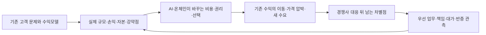

# 금융기관은 무엇으로 돈을 벌며, AI·온체인 시대에는 무엇을 지켜야 하는가

기준일 **2026-11-04 KST**. 현재 공개된 실적·사업과 연구자의 조건부 전망을 구분한다. 미래 부분은 선택한 업무의 제도·개별 권한·권리·고객 위임·인프라가 갖춰진 2027년 이후를 가정하며, 모든 업무가 2027년 초에 개방된다는 예측이 아니다.

이번 판단의 출발점은 **새 기술이 아니라 기존 수익을 만들어 온 고객의 필요와 금융기관의 책임**이다. BNK는 예금·신용·지역 기업의 지급, 교보는 증권의 중개·발행·운용 위험과 생명의 장기 부채, 한화는 보험의 보장·유통·투자와 해외 금융 기능에서 출발한다. 같은 AI와 온체인을 도입하더라도 우선순위가 다른 이유다. 아래의 사업 방향은 회사가 확정한 계획이 아니라 실적과 공식 신호에서 도출한 연구 판단이다.

**읽는 순서:** 이 문서 → [BNK의 실제 기반과 선택](36_bnk_business_model_priorities.md) · [교보의 실제 기반과 선택](37_kyobo_business_model_priorities.md) · [한화의 실제 기반과 선택](38_hanwha_business_model_priorities.md). 앞선 [고객·자금 사례](31_agent_finance_customer_money_2027.md)는 흐름을 이해하는 보조 자료다. 가상의 배분이나 수익률이 이번 결론을 뒷받침하는 근거는 아니다.

## 1. 먼저 원래의 사업을 이해한다

아래는 사업의 경제적 구조를 설명한 표다. 회계 손익계산서의 모든 항목을 단일 공식으로 대체하지 않는다. 규모는 자산·자본·고객 거래가 감당할 수 있는 일의 범위를 보여주고, 수익은 누가 어떤 대가를 지급하는지를 보여준다. 두 가지가 모두 필요하다.

| 주체 | 고객이 맡기는 문제와 원래의 수입 | 그 수입을 남기기 위해 부담하는 것 | 혼동하면 안 되는 것 |
|---|---|---|---|
| 은행 | 예금·지급을 제공하고 기업·가계에 대출. 대출·유가증권 이자에서 조달 이자를 뺀 순이자, 외환·결제·판매 등 수수료 | 대손, 예금 유출과 만기 차이, 유동성·자본, 심사·회수·운영 | 예금은 은행의 부채. 대출 원금은 수익이 아니다. 예대금리차만으로 순이익을 설명할 수 없다. |
| 증권 | 거래 중개, 자금조달·발행·인수, 상품 판매·관리, 위험을 보유하는 운용·시장조성 | 인수·재고·시장·신용 위험, 조달·헤지, 자본, 청산·고객자산 관리 | 고객자산과 자기자본은 다르다. 매매·파생 총수익을 순수수료나 반복 이익과 비교하지 않는다. 인수·운용 이익은 시장과 손실에 민감하다. |
| 생명보험 | 보험사고 때 보장하고 장기 계약을 유지. 보험서비스의 손익과 자산·부채에 관련된 투자·금융 손익 | 보험금·사업비, 해지·질병·장수 등 위험, 판매비, 보유계약 관리와 자산부채관리(ALM) | 보험료 수금은 이익이 아니다. CSM은 미실현 보험서비스 이익을 나타내는 잔액으로 당기 현금·순익이 아니다. 자산 수익만 높고 부채 위험이 커지면 성공이 아니다. |
| 운용·판매·청산 | 운용자산에 대한 보수, 판매·계좌·거래·운영 대가를 각 계약상 법인이 수취 | 유통사 배분, 운용·사후처리·수탁 비용, 규제·배상·운영 위험 | 고객 투자성과가 운용사 수익은 아니다. AUM·거래량·수탁액은 보수율·지급자·비용 없이 수익을 말해 주지 않는다. |
| 금융지주·기업집단 | 계열사의 자본 배분·협업으로 외부 고객의 업무를 더 잘 해결하고 그룹 기여를 얻음 | 법인별 자본·인가·데이터 동의, 계열거래 조건, 연결 조정과 이해상충 | BNK 금융지주와 교보·한화의 그룹 범위는 같지 않다. 자회사 수익·내부 보수를 단순 합산하거나 보험자산을 신사업 가용자금으로 보지 않는다. |

실제 수익 항목·기간·연결 범위는 세 그룹 상세와 [재무 관측 원장](../data/institution_business_baselines.json)에 연결했다. 같은 업종의 같은 정의를 맞추지 않은 자산·순익 순위는 만들지 않는다. 이 구분이 먼저 되어야 “토큰을 발행하면 이익이 늘어난다”는 비약을 피할 수 있다. **C-409**.

## 2. 현재 세 그룹의 출발점이 다르다

| 그룹과 관측기간 | 확인된 현재 기반 | 이 사실에서 도출하는 전략적 의미 |
|---|---|---|
| **BNK, 2026년 1~9월/9월말** | 연결 자산168.21조원. 순이자이익2조2,872억원과 비이자이익3,183억원으로 이자 기반이 크다. 자회사 은행·비은행 이익 합계 중 은행 비중은72.3%이며 연결 지배주주 순익을 분모로 삼은 값이 아니다. 경남 SME 대출은 원화대출의57.2% | 기업 신용·지급 관계를 잃으면 신규 관리수수료만으로 만회하기 어렵다. 지역 정보와 기업 접점을 신용·지급 결과로 전환하는 일이 우선이다. 다만 신용손실·조달·자본 부담이 함께 있어 거래량 확대만으로 성공을 판정하지 않는다. [공식 IR](https://www.bnkfg.com/download?seq=6765) · [상세와 분모](36_bnk_business_model_priorities.md) |
| **교보, 증권·생명2026상반기 / 문고2025년** | 증권 연결 자본2.274조원, 순수수료2,026.74억원. 별도 해외선물 위탁수수료688.28억원이라는 기존 수입이 있다. 생명 연결 지배주주 순익은 증가했지만 별도 순익·보험손익은 감소. 문고 연간 영업이익59.64억원은 매출9,834.70억원 대비 약0.61% | 증권의 현재 거래·발행·관리 고객을 먼저 보고, 생명은 장기 보장·부채·독립 투자심사로 연결한다. 문고의 유통매출 전체를 IP금융 기회로 바꾸지 않는다. 브랜드보다 원권리·집행·사후관리에서 대가를 받을 근거가 필요하다. [증권 공시](https://dart.fss.or.kr/dsaf001/main.do?rcpNo=20260814003361) · [생명·문고 근거와 범위](37_kyobo_business_model_priorities.md) |
| **한화생명 중심, 2026상반기/6월말** | 별도 세전 보험손익2,853억원·투자손익3,548억원. 별도 보유CSM 약8.93조원과 일반계정 운용자산 약93.74조원, GA 조직38,092명이 관리 기반이다. 회사 정의의 해외 자회사 합산손익/연결순익은11% | 국내 계약의 적합성·유지·청구와 자산부채관리가 큰 기반이다. 해외 이익은 이미 존재하지만 Nobu 방카·Velocity 단독·UAE ETF·블록체인 사업의 증분이익은 따로 확인해야 한다. 국내 본업을 건너뛰고 해외 신호만으로 방향을 정하지 않는다. [회사 작성 IR](https://file.irgo.co.kr/data/BOARD/ATTACH_PDF/Z4XB5R4VUER2VMQPFBEF4RFR9MUMR2762026812174652.pdf) · [공식 목록·범위와 한계](38_hanwha_business_model_priorities.md) |

한화 자료는 회사 작성 IR의 외부 배포본이며 공식 호스팅과의 바이트 동일성·후속 정정 대조가 미완료다. 교보생명 업무보고서와 IR은 투자손익 기준 차이가 있어 별도로 보존했다. BNK Q3 PDF는 보존 원본을 재검토하고 현재 공식 링크·보도 수치와 대조했으며 이번 원격 바이트 재취득은 하지 못했다. 상세 보고서에 자료별 읽은 위치와 한계를 남겼다.

실적은 전략의 정답이 아니라 **어떤 사업을 지켜야 손익이 움직이는지, 어디에 자본과 운영 역량을 먼저 써야 하는지**를 결정하는 근거다. 한 시점의 이익 증가가 지속적 경쟁우위를 입증하지는 않는다. 최근 공개 기간이 다른 경우 날짜를 그대로 표시하고 비교를 제한한다.

## 3. 환경 변화는 어느 연결고리를 바꾸는가

### AI는 먼저 발견·비교·재선택 비용을 낮춘다

지금까지는 고객이 익숙한 지점·설계사·증권 앱에서 상품을 찾고 거래하면서 한 기관에 여러 기능을 묶어 맡기는 경우가 있었다. 고객 AI는 허용된 범위에서 예금·환전·증권·보장 공급자를 따로 비교할 수 있다. 그러면 같은 고객을 유지해도 환전이나 거래처럼 수익이 나는 기능만 경쟁사로 이동할 수 있다. 앱 이용자 수와 전체 거래관계는 같지 않다.

그 결과는 세 가지로 나뉜다. **다른 금융사가 거래를 가져가는 경우**, AI·유통 플랫폼이 고객 접점의 대가를 받는 경우, **경쟁으로 가격이 내려 고객의 절약으로 남는 경우**다. 기존 수익이 줄었다고 그 금액 전부를 특정 경쟁사의 수익으로 배분해서는 안 된다. 큰 금융사도 AI를 쓰고 가격을 낮춘다. AI가 작은 회사에만 유리하다는 결론은 성립하지 않는다. **C-410**.

이를 보여 주는 공식 신호가 IBKR다. 회사는 외부 AI 연결에 추가 연결료를 부과하지 않는다고 안내하면서 기존 거래·데이터 비용을 별도로 둔다. 일반 승인 방식과 제한된 현금·상품 범위의 AI Partition도 구분한다. 이는 **AI 접속 자체를 팔기보다 기존 거래 서비스를 선택하기 쉽게 만드는 대응**으로 읽을 수 있다. 해당 페이지의 관할별 가용성에는 계획 표현이 남아 있으므로 한국 전면 제공이나 보편적 자율거래의 증거로 쓰지 않는다. [공식 안내](https://www.interactivebrokers.com/en/trading/ai-integrations.php), **KYX-V-008**.

### 온체인은 권리의 표현과 전달·결제를 바꾼다

온체인 자산은 기존 계좌 밖에서도 보유·이전될 수 있고, 허용된 상품을 다른 서비스에 연결하는 비용을 낮출 가능성이 있다. 하지만 원권리, 차입자의 상환 능력, 보험의 보장 의무, 환매 때 실제 현금을 내줄 주체는 여전히 필요하다. 토큰이 이동했다는 사실과 급여·세금·보험금을 필요한 통화로 지급할 수 있다는 사실은 다르다.

은행에는 예금 밖 잔액을 포함한 지급·조달 관리, 증권에는 원권리·담보·발행·사후관리, 보험에는 보장·계약·청구·지급과 장기 부채 관리의 문제가 남는다. 이 기능을 기존 금융망+AI로도 잘 해결한다면 온체인 비용을 추가할 이유는 약하다. 온체인을 채택할 근거는 같은 고객 업무에서 권리 연결·반복 대사·접근·결제 조건이 실제로 더 좋아지는 경우다. [기존 환경 분석](29_tokenization_competition_group_strategy.md).

BIS는 스테이블코인의 준비자산 구성과 은행들의 대응에 따라 조달·신용 효과가 달라질 수 있다고 분석한다. 따라서 BNK 예금의 이탈을 은행권 전체 예금의 같은 크기 감소로 바꾸지 않는다. 은행권에 자금이 남더라도 대형 은행의 기관성 예금으로 모이고 경남은행의 안정적인 거래성 예금이 줄 수 있다는 **분배와 가격의 문제**가 중요하다. 이는 확정된 BNK 결과가 아니라 조건부 경로다. [BIS 원문](https://www.bis.org/publications/aer-2026/anchoring-trust-money), **FIN-003, C-411**.

### 둘이 합쳐질 때 상품은 늘어도 책임은 없어지지 않는다

AI가 같은 자산으로 다양한 포트폴리오와 계약 설명을 만들면 상품의 겉모양은 쉽게 복제된다. 이때 희소한 것은 자산 이름이 아니라 믿을 만한 원권리, 차별화된 심사·현금흐름, 공급 가능한 신용·유동성, 실패를 해결할 운영일 수 있다. 다만 권리와 운영까지 표준화되고 대형사가 싸게 제공하면 그 보수도 낮아진다. “신뢰가 중요하다”는 문장만으로 높은 보수를 정당화할 수 없다. **C-413**.

## 4. 그래서 어느 수익을 먼저 방어하고 무엇을 추가할 것인가

아래는 **기존 STR 12개 순위를 재산정한 표가 아니라 실행 초점을 명확히 한 것**이다. 실제 실적과 고객 업무에 근거해 기존 제안의 무게중심을 정한다. 상세 근거·반대 조건은 각 그룹 보고서와 [우선 대응 원장](../data/business_model_transition_priorities.json)에 있다.

| 그룹 | 우선 방어할 수익과 고객 업무 | 환경 변화가 만드는 위기 | 먼저 검증할 기회 | 후순위로 둘 것 |
|---|---|---|---|---|
| BNK | 거래성 예금의 조달 기여, 지역 기업의 운전자금·외환·지급 관계 | AI가 유휴자금을 옮기고 대형 은행이 무료 자금관리와 싼 환율·대출을 묶으면 거래성 예금과 수익성 있는 업무가 함께 빠짐 | 기업의 실제 지급일정·수금·신용을 함께 보고 외부 계좌·지갑까지 포함해 필요한 통화로 지급을 완료. 기존 RM의 지식을 조직의 심사·운영으로 연결 | 코인 발행량이나 지갑 가입자 수를 주목표로 삼는 일. 지급 데이터만 확보하면 신용위험이 자동 감소한다는 주장 |
| 교보 | 증권의 기존 중개·기업금융 고객, 자금·증거금·담보·발행 후 관리 | 표준상품 비교·판매·단순 조합 보수가 압박받고 해외 거래 기능이 대형·글로벌 증권사로 이동 | 기존 강점이 확인된 고객 업무의 실행·자금·사후관리와 검증 가능한 발행. 비정형 RWA는 원권리·반복 현금·관리 대가가 확인된 거래부터 | 대형사 플랫폼 전면 복제. 생명 자산·문고 브랜드를 확보된 자금·독점 고객으로 가정. 비정형 RWA 전체를 문고 POD 하나로 대표 |
| 한화 | 보험의 보장·보유계약 유지·유통 생산성·ALM | 보험료만 비교되면 가격 경쟁, 채널 전환·수수료 압박. 유리한 고객만 이동하면 잔여 위험·유지 비용도 악화 가능 | 정확한 보장·면책 비교와 계약 유지·청구·지급 경험. Nobu의 현지 수납·고객 업무, 미국 운영·UAE 유통은 별도 법인·지급자의 유료 수요로 좁혀 검증 | 해외 제휴·투자액을 주력 반복 이익으로 간주. 젊은 인구·낮은 보험 보유만으로 수요 확정. USDC/USDT 브랜드 선택부터 시작 |

핵심은 **무료 기능을 더 붙이는가가 아니라 고객에게 필요한 유료 금융 기능을 더 잘 수행하는가**다. BNK의 자금관리 화면, 교보의 AI 연결, 한화의 보장 비교는 별도 보수를 못 받을 수 있다. 그래도 기존 거래·신용·보험 관계를 효율적으로 유지하는 수단이면 의미가 있다. 반대로 이용자가 늘어도 예금 조달 기여가 더 줄거나 유통사 지급 비용과 보험 위험이 더 커지면 회사에 유리한 성장은 아니다.

## 5. 고객 AI가 선택할 때 무엇을 제시하고 책임져야 하는가

고객 AI의 목표도 같지 않다. 기업은 특정 날짜의 지급, 투자자는 목적·위험·현금화, 보험 고객은 필요한 보장의 지속이 중요하다. 최고 금리·최저 수수료·최저 보험료 하나로 순위를 매기면 다른 권리와 위험을 잘못 비교한다. 금융기관은 사람이 읽는 설명과 AI가 검증할 공식 정보를 함께 관리해야 한다.

| 고객 AI가 확인할 것 | 금융기관이 유지해야 할 공식 정보·약속 | 세 그룹에서의 구체적 적용 |
|---|---|---|
| 내 목적에 맞는 권리인가 | 계약상 법인, 권리·자격, 제외조건, 담보·보장 범위, 근거·갱신 시각 | BNK 지급통화·대출 조건 / 교보 발행자·수익권·손실 부담 / 한화 보장·면책·대기기간·갱신 |
| 실제 조건으로 실행할 수 있는가 | 유효기간 있는 전체 가격, 환율·비용, 잔액·한도, 필요한 서류·심사, 완료 예정 시점 | 표시 수익률보다 필요한 날의 현금. 표시 보험료보다 심사 후 조건. 제시 가격과 확정 가격 구분 |
| 내가 맡긴 범위 안인가 | 조회·추천·주문·자산이동의 위임 분리, 금액·기간·상품 제한, 사람에게 돌아갈 조건 | 은행 기업 승인권자 / 증권 주문·담보 / 보험 가입·변경·청구의 위임 범위 각각 관리 |
| 지금 어떤 상태인가 | 접수·심사·체결·결제·입금·청구 완료의 구분, 중복 요청 방지, 현재 의무·담보 | 토큰 잔액과 인출 가능 현금, 주문과 체결, 보험 청구와 보험금 지급을 나눠 반환 |
| 실패하면 누가 고치는가 | 오류 정정·취소 가능 범위, 이의·민원, 복구 담당과 처리 근거, 손실 부담 계약 | 시스템 오류·미인가 지시·부적합 판매·보험 약관 분쟁 등 원인별 책임. 포괄적 무손실 보장 아님 |

이 표는 연구자의 설계 제안이다. IMF 저자들은 AI의 의도 생성과 권한 통제·결제를 분리하고 책임의 모호성을 지적한다. 여기서 도출할 사업 논리는 **AI를 믿으라고 요구하는 대신 고객의 권리와 실제 결과를 확인할 수 있게 만들라**는 것이다. 기술적 서명이나 정상 응답만으로 법적 책임·지급 이행이 증명되지는 않는다. [IMF Note](https://www.imf.org/-/media/files/publications/imf-notes/2026/english/insea2026004.pdf), **ST-TD-007, C-412**.

독립 고객 AI, 금융사 자체 AI, 판매수수료를 받는 플랫폼 AI도 구분해야 한다. 자체 AI가 계열 상품만 비교한다면 비교 범위를 밝혀야 한다. 고객 AI에 선택되기 위한 광고·소개비는 유통비용이며, 순위와 추천의 이해상충을 관리해야 한다. 외부 AI에 잘 연결되는 것과 고객에게 좋은 조건을 제공하는 것은 별개다.

## 6. 경쟁사가 대응한 뒤에도 왜 남는지를 묻는다

| 첫 판단 | 상대의 합리적 대응 | 그래도 우리를 선택할 이유가 될 수 있는 것 | 이 판단을 버릴 관측 |
|---|---|---|---|
| BNK는 지역 기업을 잘 안다 | 시중은행·IBK가 무료 시스템, 가격·보증·신용 한도를 결합 | 현장 정보가 실제 한도·조건·예외 처리·회수 성과로 이어지고 고객이 비용 대비 편익을 확인 | 지역 지식이 RM 개인에게만 남거나 경쟁사의 같은 조건보다 지급·조달 결과가 열위 |
| 교보는 신뢰와 그룹 자산이 있다 | 대형 증권사가 더 싼 실행·금융상품과 자체 발행 자산을 제공 | 검증된 원권리, 발행자 접근, 거래·담보·사후관리에서 대체하기 어려운 결과 | 발행자·고객의 계약 의향이 없거나 같은 권리·서비스를 더 싸게 조달 가능 |
| 한화는 보험·현지 은행·해외 기능이 있다 | 현지 은행·보험사 및 글로벌 운영사가 기존 채널·낮은 가격·좋은 청구 경험으로 대응 | 해당 고객의 보장 공백·납입·유지·지급 문제를 더 잘 해결하고 법인별 협업 비용을 감당 | 낮은 유지율·불리한 위험 선택·불만·채널 비용이 편익을 상쇄하거나 계열 연결이 실제 계약으로 이어지지 않음 |

경쟁우위는 소유한 계열사 목록이 아니라 **경쟁사의 대안을 본 고객도 계속 선택하는 이유**로 검증한다. 지역성·브랜드·해외 거점은 그 이유를 만들 재료이며 결과 자체가 아니다. 반대로 모든 접점을 직접 소유할 필요도 없다. 고객 AI가 앞단을 차지하더라도 신용·실행·보장·운영의 대가를 받을 수 있다. 중개 단계에서 밀려난 것인지, 수익성 있는 핵심 기능을 남긴 것인지 분리해 판단한다.

## 7. 다음 작업도 이 논리 순서로 축적한다

자료 수집 담당은 결론을 바꿀 실적과 원문을 고른다. 해석 담당은 연결/별도·잔액/흐름·총액/순액·신사업 단계의 차이를 풀어 쓴다. 적용 담당은 그 사실이 기존 수익과 고객 선택을 어떻게 바꾸는지 설명한다. 검증 담당은 사실에서 결론으로 건너뛴 부분을 찾는다. 숫자 예시는 그다음에 필요할 때만 추가한다.

현재 남은 핵심 공백은 실제 고객의 기능별 이탈·유료 계약 의사, 경쟁사와 맞춘 총비용·서비스 결과, 신사업별 법인 수익·비용·손실이다. 모두 미확인으로 보존한다. [재사용 절차](../agents/business_model_reasoning_workflow.md) · [이번 실행](../runs/2026-11-04-business-model-priorities.json).

[전체 논증](35_business_models_and_agent_finance.md) · [재무 관측·출처 위치](../data/institution_business_baselines.json) · [우선 대응·판단 변경](../data/business_model_transition_priorities.json) · [이번 실행](../runs/2026-11-04-business-model-priorities.json)
