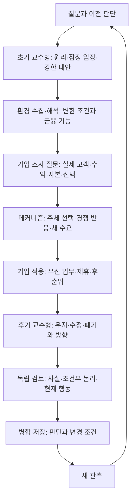

# 금융·경제 도메인으로 변화의 의미와 방향을 판단하는 에이전트

설계 기준일: 2026-11-06. 기존 금융 근거·실적·제도 자료의 관측일은 유지한다. 이 날짜는 전체 금융환경을 다시 조사한 날짜가 아니다.

## 판단: 역할 수보다 의견이 만들어지는 연결을 보완한다

이번 설계의 중심은 **금융 기능이 존재하는 이유에서 출발해, 환경 변화가 그 기능의 비용·위험·수요·경쟁을 어떻게 바꾸는지 설명하고 우선 방향을 선택하는 것**이다. 보고서를 많이 읽거나 여러 담당이 동의했다는 사실만으로 좋은 판단이 되지는 않는다.

기존 설계에도 교수형 질문, 현금·권리·수익의 추적, 경쟁 가설과 검증이 있었다. `roles.json`은 교수형 역할을 기업 조사 전에 두고 있었지만, 사업모델 작업 절차는 주로 후기 반론에 배치했다. 어떤 경제 원리를 왜 골랐고, 그 원리의 조건과 새 근거가 최종 의견을 어떻게 바꿨는지 전달하는 공통 형식도 충분히 명시되지 않았다. 따라서 기존 8개 역할을 유지하면서 초기 가설과 후기 판단 갱신을 연결했다.

설계는 [역할 명세 v2.1](../agents/roles.json), [경제적 의견 작성 절차](../agents/economic_opinion_workflow.md), [도메인 지도](../agents/economic_domain_lenses.md)에 저장한다. 이들은 재사용할 지침이다. 파일이 있다고 상시 에이전트·예약 조사·자동 거래가 실행되는 것은 아니다.

## 1. 교수형 역할은 조사 전과 조사 후에 서로 다른 일을 한다

초기 교수형은 미래를 먼저 확정하는 사람이 아니다. 기존 근거에서 설명력이 있는 가설과 가장 강한 대안을 제시해 조사할 질문을 만든다. 수집 담당은 반대 자료와 새로운 설명도 찾는다. 후기 교수형은 초기 입장을 유지·수정·폐기하고 그 이유를 남긴다. 사후에 초기 가설을 고쳐 처음부터 알고 있었던 것처럼 기록하지 않는다.

| 역할 | 이번에 더 명확해진 책임 | 다음 담당에게 넘길 결과 |
|---|---|---|
| 총괄·병합 | 질문·기준선·단계·판단 이력 관리 | 현재 입장, 대립, 우선 행동, 갱신 질문 |
| 환경 수집 | 가설을 가를 경제·정책·기술 변화 찾기 | 바뀐 비용·제약·정보와 원문, 반대 근거 |
| 기업 신호 수집 | 산업 가설을 실제 법인과 경쟁 조건에 대입 | 고객·수익·자본·역량, 실행 신호, 부족한 기반 |
| 원문 해석 | 관측·모형 전제·저자 전망·이번 해석 구분 | 무엇을 지지하거나 약화시키는지와 원문 위치 |
| 메커니즘 분석 | 선택 원리에서 고객 행동과 다음 반응 도출 | 돈·권리·위험·가격·수량·마진의 전달 경로 |
| 목적 적용 | 실제 그룹의 우선 업무와 포기할 선택 제안 | 방어·신규 수요·전문 기능 판매의 실행 제안 |
| 교수형 추론 | 초기 가설 제시, 후기 방향 선택과 갱신 | 원리·중심 입장·가장 강한 반대 경로·전환 조건 |
| 독립 검토 | 사실과 논리, 현재 실행 가능성을 별도 판단 | 고칠 오류, 남길 의견 차이, 판별 관측 |

메커니즘 담당은 전달 경로의 일관성을 책임지고, 교수형 담당은 여러 경로 중 무엇을 더 중요하게 볼지 종합한다. 동일한 분석을 역할별로 길게 반복하지 않는다. 작은 질문은 판단·이유·반대 조건·다음 행동을 한 문단으로 답할 수 있다.

## 2. 금융·경제 지식은 이름이 아니라 판단 도구로 쓴다

질문에 맞는 원리 하나부터 선택한다. 적용 조건과 설명하지 못하는 부분을 함께 적는다. 논쟁적인 모형 결과나 수치 추정은 원연구·가정·적용 범위를 별도로 확인한다.

| 물어볼 문제 | 우선 적용할 원리 | 결과에서 설명해야 할 변화 |
|---|---|---|
| AI가 비교하면 금융 중개는 필요 없어지는가? | 정보비대칭·위임·계약 | 탐색비와 검증·심사·위험 인수·집행 책임은 무엇이 다른가? |
| 자체 구축·계열 협업·외부 구매 중 무엇이 유리한가? | 거래비용·기업 경계·비교우위 | 외부 계약비와 내부 조정비 중 무엇이 더 줄어드는가? |
| 예금이 디지털 자산으로 옮겨가면 은행은 어떻게 되는가? | 은행 조달·신용창출·화폐·정책 | 개별 은행과 은행권 전체에서 누구의 부채·조달비·신용 조건이 바뀌는가? |
| 24시간 결제가 자금 부담도 줄이는가? | 유동성·만기·결제·담보 | 대기 감소와 상계·일중 신용 상실을 함께 보면 언제 현금이 더 필요한가? |
| 무한히 조합하는 상품이 더 좋은 투자인가? | 위험분담·포트폴리오·ALM·가격 | 원권리·현금흐름·위험이 늘었는가? 고객과 기관의 지급 의무에 맞는가? |
| 비용 절감의 이익은 누가 가져가는가? | 산업조직·플랫폼·경쟁 | 가격 인하·플랫폼 보수·기존 비용 소멸·회사 기여가 어떻게 나뉘는가? |
| 달러 레일 확대가 현지 금융을 대체하는가? | 국제통화·외환·개방경제 | 저축 통화와 급여·세금·부채 통화, 헤지·환류 조건은 어떻게 다른가? |
| 기존 거래 이동 외에 무엇이 새로 가능해지는가? | 생산성·보완재·신규 수요·투자 시점 | 낮아진 고정비로 어떤 작은 고객·거래가 성립하며 누가 대가를 내는가? |

각 원리는 [도메인 지도](../agents/economic_domain_lenses.md)에서 적용 조건과 반대 경로까지 연결한다. 예를 들어 AI가 거래비용을 낮춘다는 사실만으로 작은 전문회사가 대형 금융사를 이긴다고 결론내리지 않는다. 대형 금융사의 내부 비용도 낮아지면 통합이 강화될 수 있다. 필요한 기능이 남는 것과 그 기능으로 높은 보수를 받는 것도 별도다.

## 3. 세 그룹에 적용하면 의견의 내용이 달라져야 한다

아래는 기존 보고서에 기반한 **조건부 판단 예시**다. 새로운 회사 확정 전략·관측 실적·정량 예측이 아니다. 제도와 고객 위임이 성립한 미래를 가정해도 경제적 유인과 경쟁은 계속 분석한다.

**BNK:** 기존 예금·대출·결제·외환에서 고객 AI가 잔액을 더 쉽게 이동시키면, 고객의 높은 수익과 은행의 조달 안정성이 충돌할 수 있다. 은행권 전체 예금이 재배치되는 것과 BNK가 안정적 예금을 잃는 것은 다른 문제다. 따라서 잔액을 계속 붙잡는 화면보다 수출기업의 수금·급여·세금·외환·신용한도·예외 복구를 함께 관리하는 업무를 우선 검토한다. 다만 시중은행이 같은 정보와 신용을 더 싸게 제공한다면 지역 관계만으로 고객 잔류를 주장할 수 없다. 특정 업종에 집중하거나 제휴·비용 구조를 바꿔야 한다. 관련 기준선: [BNK 사업모델](36_bnk_business_model_priorities.md), [기능 대체와 고객관계](39_finance_substitution_customer_relationships.md).

**교보:** AI가 상품 비교·조합을 쉽게 만들어도 동일 기초자산의 현금흐름이 무한히 늘지는 않는다. 단순 포장과 접근에 받던 대가는 경쟁으로 낮아질 수 있다. 원권리의 발굴·검증·구조화·현금 관리와 고객의 목적에 맞는 실행이 우선 검토 대상이다. 그러나 원권리 검증도 표준화되어 경쟁자가 동일 품질로 제공한다면 그 기능의 추가 보수 역시 줄어든다. 문고·생명과의 연결은 권리·고객 동의·자금 사용권을 따로 확인하고, 작은 발행의 고정비가 낮아져 새 수요가 생기는지도 본다. 관련 기준선: [교보 사업모델](37_kyobo_business_model_priorities.md).

**한화:** AI 보험 비교는 설명 비용만 바꾸는 것이 아니다. 누가 새로 가입하고, 어떤 계약을 유지·해지하며, 어떤 위험집단이 남는지가 장기 손익과 현금흐름을 바꾼다. 따라서 공식 약관·인수조건·유지/전환 손익·납입·청구·이의 처리를 고객 AI가 정확히 사용할 수 있게 하고, 위험 선택과 ALM까지 연결하는 업무를 우선 검토한다. 위험정보가 고객과 보험자 양쪽에 정확히 공유되면 역선택이 줄어드는 반대 경로도 가능하다. Nobu 접점은 현지 소득·납입 주기·보장 공백·지급 통화에서 새 수요를 찾는 후보이며, 은행 고객 수를 보험 수요나 새 이익으로 바꾸지 않는다. 관련 기준선: [한화 사업모델](38_hanwha_business_model_priorities.md).

세 사례 모두 기존 수익 방어만으로 끝내지 않는다. 반복 실사·관리·유통 비용이 낮아져 이전에는 수익성이 맞지 않았던 작은 기업·발행·보장 업무가 가능해지는 경로를 비교한다. 그때도 고객 편익·지급 능력·위험·경쟁 후 대가가 남는지를 설명해야 한다.

## 4. 최종 의견은 명확하게, 수정 조건은 추적 가능하게 남긴다

최종 산출물은 다음 질문에 답한다. 필요한 항목만 [의견 템플릿](../agents/templates/economic_opinion.md)에 남기고 기존 출처·주장·가설 ID와 연결한다.

1. 지금 어떤 방향을 우선하며, 기존 기능과 어떤 원리 때문에 그렇게 판단하는가?
2. 무엇이 사실이고 무엇이 가정인가? 어떤 비용·제약의 변화가 누구의 선택을 바꾸는가?
3. 경쟁사와 정책당국이 대응하면 결과가 어떻게 달라지는가? 새 수요와 기존 사업 잠식은 무엇인가?
4. 가장 강한 반대 설명은 무엇이며, 어떤 관측이 나오면 판단과 행동을 바꿀 것인가?
5. 지금 준비할 일과 조건 성립 후에 실행할 일은 무엇인가? 초기 입장은 왜 유지·수정·폐기했는가?

검토자는 사실 오류, 조건부 추론의 오류, 현재 실행 권한을 구분한다. 미래의 관측이 아직 없다는 이유로 명시된 가정을 무조건 기각하지 않는다. 반대로 미래에 권한이 생긴다는 가정을 현재의 거래 권한으로 사용하지 않는다. 회사 강점·고객 신뢰도 경쟁 후 선택과 실제 책임 이행으로 설명한다.

## 5. 검증 범위와 교수 원문의 귀속

[세 그룹 검토 문항](../agents/evaluations/domain_reasoning_cases.json)은 기존 공개 보고서를 바탕으로 한 3개 사례와 신규 수요 후속, 총 7개 조건변경 질문이다. 조건이 달라졌는데도 같은 전략을 반복하면 원리 적용이 약한 것으로 본다. 답이 같아도 같은 이유를 경제적으로 설명할 수 있으면 허용한다. 참고 답은 유일한 정답이 아니며, 키워드·형식·점수로 경제적 타당성을 인증하지 않는다. 이번 실제 적용 결과와 독립 검토 범위는 [설계 실행 기록](../runs/2026-11-06-agent-design.json)에 남긴다. 제한된 사례의 검토는 미래예측 성능이나 실제 사업 수익성의 증명이 아니다.

[실제 적용 답변](../runs/2026-11-06-agent-design-probe.md), [보존 입력](../runs/2026-11-06-agent-design-input.json), [독립 검토와 교정](../runs/2026-11-06-agent-design-review.md)을 함께 저장했다. 별도 작성자의 답변에서 7개 조건변경이 판단·행동의 어떤 근거를 바꾸는지 검토했다. 설계감사가 지적한 신규 수요 평가와 같은 사실에 대한 새 해석 기록을 보완했고, 답변의 주선·관리 비용과 추가 인수위험 비용을 구분하는 문장도 교정했다. 기존 설계보다 성능이 좋아졌다고 측정한 결과는 아니다.

교수 원문에서는 [거래비용과 기업 규모의 열린 질문](https://github.com/cschung7/2026-class-UG-AIFinance/blob/3200cf6953b1b45257fcd25a3c7c961942f7bff7/agent_lecture_2006-spring.html)의 슬라이드10·15와, [위임·근거 전달과 완결된 경제 질문](https://github.com/cschung7/2026-2nd/blob/f031aa16ba6a99eec875c8a543db99208be598d5/hermes-agent-economics-lecture.html)의 슬라이드14·22를 참고했다. 읽은 고정 버전·범위와 기존 출처 ID의 관계는 실행 기록에 보존한다. 모든 도메인 관점과 세 그룹 제안은 이번 연구자의 종합이며 교수의 현재 의견이나 추천으로 귀속하지 않는다.
